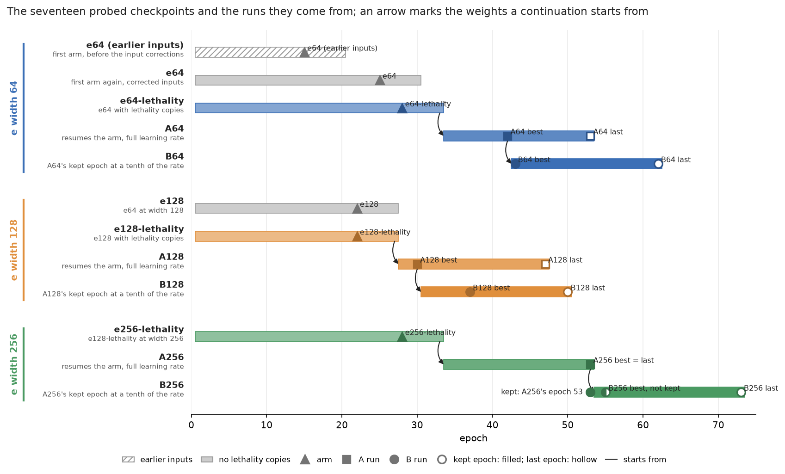
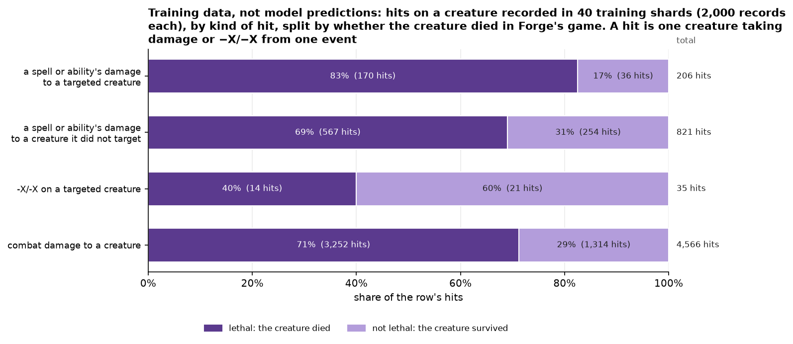
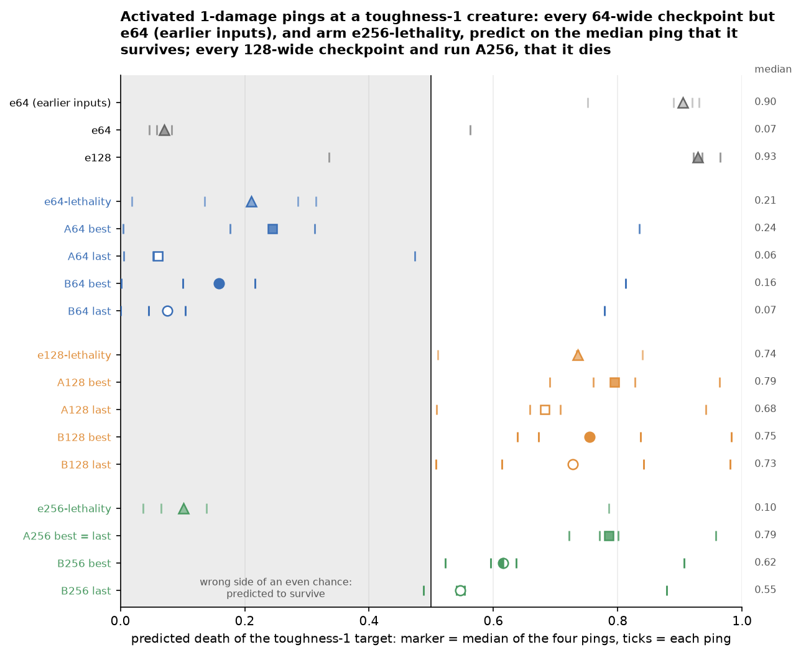
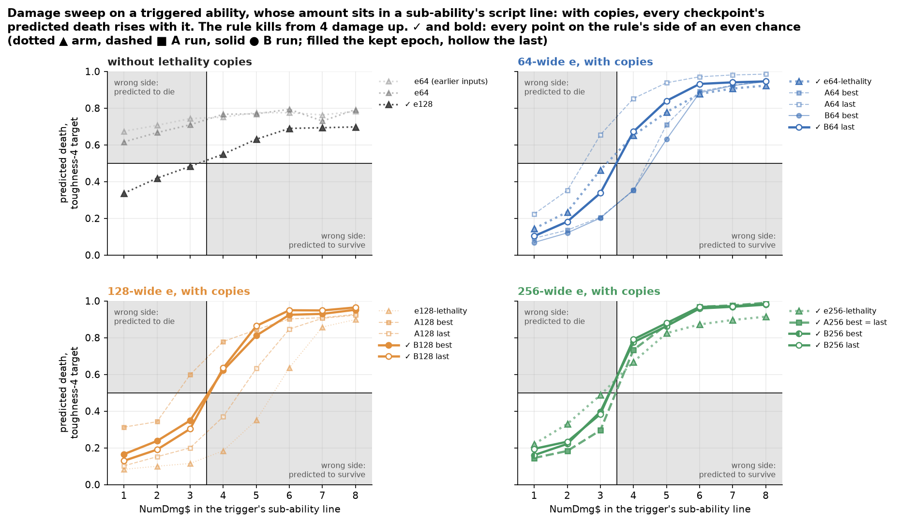
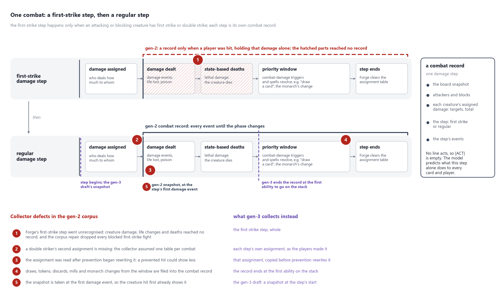
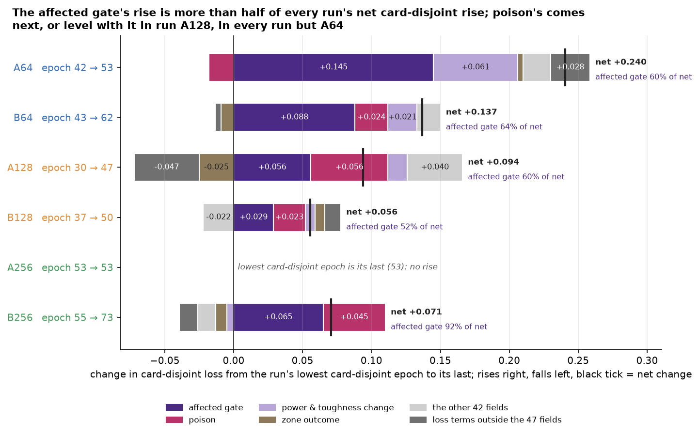
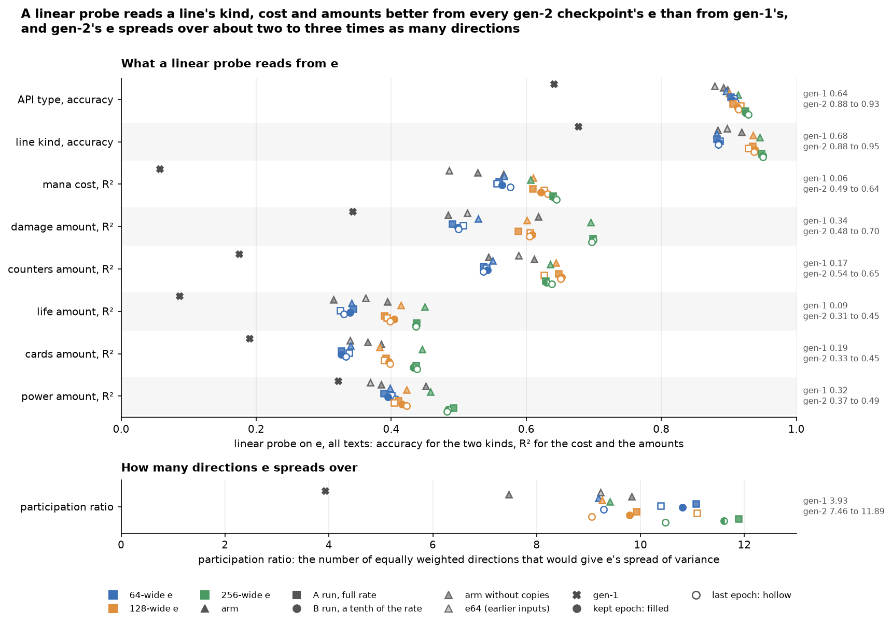
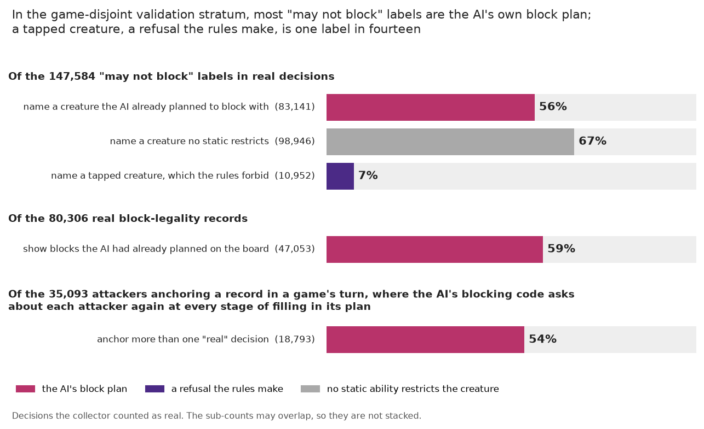
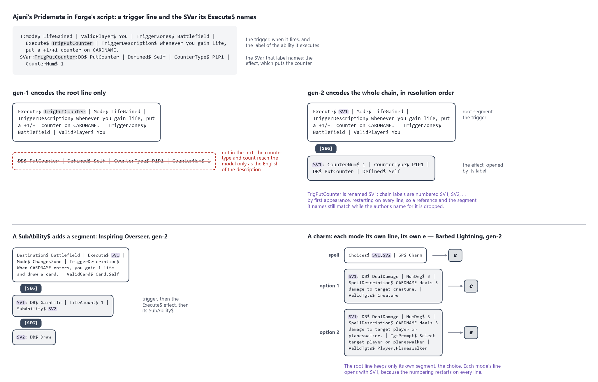
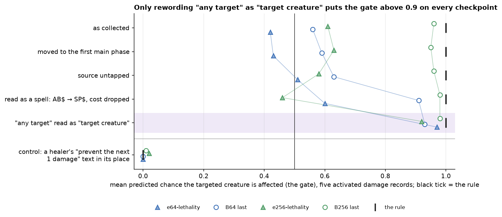

# Ability effect model — gen-2

This record covers gen-2, the second generation of a model that learns what Magic: The Gathering abilities do by watching Forge play. Forge is the open-source Magic rules engine, and its AI plays both sides of the sealed games the model learns from. Every ability on a Forge card is a line of script, such as `SP$ DealDamage | NumDmg$ 3 | ValidTgts$ Creature`. An encoder reads that script and outputs one vector `e`, the ability's embedding. An effect head reads `e` beside a snapshot of the board and predicts, for every card and player, what the ability changes: which creatures die, how much damage each takes, whose life changes, which keywords are gained. The training data are effect records, one per observed event such as an ability resolving or a combat damage step, each holding the board before the event and what the event changed.

Gen-2 changes what the encoder reads, collects a new corpus with a seat that sometimes plays at random, and trains the width sweep: arms, runs from scratch that differ in the width of `e`, and continuation runs that carry them further. This record judges those changes and the rules they targeted: the death rule and its boundary, combat, gate 2, how a checkpoint is chosen, the losses and the width. Gate 2 is a check that combat keywords move the model's predictions the way they move real outcomes. Its sibling, [the knowledge-probes record](2026-09-19-effect-knowledge-probes-design.md), reports where in the model each kind of knowledge lives, and what the model knows of evasion, targeting, colour and zones.

The summary comes first, then the measures every result reads ([how to read the results](#seventeen-checkpoints-from-twelve-runs-read-on-two-validation-strata-kept-out-of-training)). The results follow, organized by question. They end with a verdict on each design change and with the defects that qualify the results. The design of each change comes after them. The runs, the steps taken stage by stage and the evidence for each defect come last, and the data are in [`2026-09-18-effect-model-gen2/`](2026-09-18-effect-model-gen2/README.md).

## What gen-2 found

Gen-2's `e` holds far more of what an ability's script states than gen-1's, and with lethality copies the model learns that damage kills a creature when it reaches the creature's toughness. Run B256's last epoch, from the 256-wide run at a tenth of the learning rate, is the best checkpoint overall: it has the best probe mean, an average over eight probe questions, and the lowest error against the death rule of any checkpoint. Gen-2's first arm still trailed gen-1 on the part of the loss the two generations share, no width of `e` leads on every measure, and the model shows no first strike. Defects found after the runs changed what every arm learned on several output fields.

**The model learns that damage kills a creature only when training shows it the rule directly.** Forge's AI aims its removal at creatures it can kill, so nearly every damage spell in the corpus is lethal, and the first arms predicted deaths from a creature's toughness alone. Lethality copies, training copies of qualifying records with the damage and the toughness redrawn and the death labelled by the rule, gave the model the damage-versus-toughness comparison. The copies make up 2% of the records trained and cost nothing on the validation loss. A trigger's damage moves the predicted death as a spell's does. Where a checkpoint still misses a lethal hit, as on activated 1-damage pings such as Prodigal Sorcerer's, it mostly doubts that the hit creature is affected at all. The doubt sits in the affected gate, the model's predicted chance that a card is changed at all. It follows the ability's wording and how rarely training shows that wording ([the death rule](#the-model-compares-damage-with-toughness-only-after-training-shows-it-the-rule-directly)).


*Each cell is the predicted death of a damage spell's target, averaged over 20 real records with the spell's damage and the target's toughness edited. Rows are the width of `e`; columns run from the arm without copies through the arm with copies to each continuation run's kept and last epoch. Orange cells predict a death more likely than not and blue cells less likely, brighter meaning more likely on both sides; both hues fade toward grey near an even chance. The rule says the target dies on and below the black staircase, where the damage is at least the toughness. Each panel's error is the mean absolute difference from the rule's 0 or 1 over its 64 cells; run B256's last epoch has the lowest, in bold. Data: `damage_grids.csv`.*

**Where the lethal boundary sits wanders from epoch to epoch at the full learning rate, and settles near the rule at a tenth of it.** Twenty more epochs at the same rate sharpen the boundary but move its position by up to a point of damage between consecutive epochs. A tenth of the rate holds it in a narrow band near the rule, from whichever checkpoint the run starts ([the boundary](#where-the-boundary-sits-wanders-between-epochs-at-the-full-learning-rate-and-settles-near-the-rule-at-a-tenth-of-it)).

**In combat the model's predicted deaths fade over two to three points of toughness around the rule's boundary, it learns indestructible and most of deathtouch, and it shows no first strike.** The corpus lost every real blocked fight of the first-strike damage step to a collector bug. Only the probe forks, copies of real combats replayed with one keyword stripped from one creature, showed a first striker surviving the creature it kills first, and they were too few to teach the step ([combat](#in-combat-the-models-predicted-deaths-fade-over-two-to-three-points-of-toughness-it-learns-indestructible-and-most-of-deathtouch-and-it-shows-no-first-strike)).

**Three combat keywords hold on every checkpoint, and double strike swings far beyond its sampling noise.** Lifelink, indestructible and trample agree with real outcomes well above gate 2's bar on every checkpoint. Double strike fails and passes between checkpoints of one run, by several times what its records allow by chance ([gate 2](#three-combat-keywords-hold-on-every-checkpoint-and-double-strike-swings-far-beyond-its-sampling-noise)).

**Validation losses swing between epochs by about as much as a run improves, and a tenth of the learning rate cuts the swing several times over.** A difference of a tenth of a loss point between two checkpoints at the full rate is within that swing. The output fields with many records plateau by epoch 20, and the small ones, such as poison, swing more than they improve ([training](#validation-losses-swing-between-epochs-by-about-as-much-as-a-run-improves)).

**The validation loss and the probes disagree about which checkpoint is best.** In every continuation run, the probes rate the last epoch as good as or better than the epoch with the lowest card-disjoint loss, the validation loss on games holding cards whose texts the model never trained on. The loss rises late in training because the model grows more confident on card-disjoint records, mostly about whether a card is affected at all and about poison, and not because it ranks outcomes worse. Gen-3 judges checkpoints by probes instead ([validation against probes](#the-probes-keep-improving-after-the-card-disjoint-loss-has-bottomed-out)).

**No width of `e` leads on every measure, and the three widths do not line up in order.** The 64-wide runs have the lowest card-disjoint loss at every stage of training. The 256-wide runs have the lowest game-disjoint loss, the validation loss on unseen games whose texts trained. At a tenth of the learning rate they also have the best probe mean, by a small margin, and their continuation checkpoints come closest to the rule on average over the eleven scorecard measures that have a rule. The 128-wide runs have the weakest probes at every stage, which points to the seeds rather than to the width. In the probes record, four times the width does not move what decides deaths or trigger firing into `e` ([width](#the-64-wide-and-256-wide-runs-split-the-measures-and-the-128-wide-runs-trail-on-the-probes-at-every-stage), [the probes record](2026-09-19-effect-knowledge-probes-design.md#e-adds-most-over-a-random-vector-of-its-width-on-what-a-line-states-and-next-to-nothing-on-deaths-trigger-firing-and-block-legality)).

**Gen-2's `e` spreads its variance over two to three times as many directions as gen-1's, and a linear probe reads a line's kind, cost and amounts from it far better** ([what `e` holds](#gen-2s-e-spreads-over-two-to-three-times-gen-1s-directions-and-a-linear-probe-reads-a-lines-kind-cost-and-amounts-from-it-far-better)).

**The probes record finds that `e` carries what a line states, and that the trunk, the effect head's shared body, answers most board questions.** A probe, a small network fitted to read one answer from one input, recovers from the board and `e` alone nearly all of what the model knows about whether an ability is affordable and how long a pump lasts. On deaths, trigger firing, affected cards, target legality and damage taken, a probe on the trunk's output reads about as much as the model's own answer, and the probes cannot say whether `e` holds what those questions need. Against a random vector of its width, `e` adds a few hundredths of AUC at most on deaths, trigger firing and block legality, and less than nothing on deaths at width 256. AUC is the chance that a true case is ranked above a false one, so 0.5 is chance. From `e`, a probe reads under a fifth of how much a text's outcome varies across boards on texts the model trained on. On held-out texts it reads nothing, where gen-1's `e` read a quarter ([the probes record's summary](2026-09-19-effect-knowledge-probes-design.md#what-the-probes-found)).

**Gen-2's first arm trailed gen-1 on the part of the loss the two generations share, mostly in fields gen-2's corpus makes harder to predict or gen-1 never trained** ([gen-2 against gen-1](#the-first-arm-trailed-gen-1-on-the-loss-the-two-generations-share-mostly-in-fields-gen-2s-corpus-makes-harder-to-predict-or-gen-1-never-trained)).

**Whole-chain encoding, the value head, the covariance noise, the template holdout and the game-disjoint stratum drawn toward rare-keyword combats did what they were for.** Defects undermined two other changes: the withheld keyword, and the exclusion of the AI's what-if queries, the legality questions it asks while it plans. The random seat supplied the block decisions it was meant for, but too few short damage hits to teach the death rule, which lethality copies taught instead. Most measurements the design promised for the corpus build were not taken ([each change judged](#whole-chain-encoding-the-value-head-the-covariance-noise-and-the-template-holdout-did-what-they-were-for-and-defects-undermined-the-withheld-keyword-and-the-what-if-exclusion)).

**Defects found after the runs qualify some results here and in the probes record, and four of them changed what every arm learned.** Fields with no event were taught as 0. Trigger records taught the trigger's cause as its effect. The value head misread static boosts and removed counters. The corpus build wrote 82% of its planned training set. Among the collector defects, faults in the code that writes records during games, the largest is that more than half of the corpus's "may not block" labels name a creature the AI had already planned to block with, though no rule kept it from blocking ([the defects](#defects-in-the-collectors-the-corpus-build-and-the-training-labels-qualify-these-results-and-four-of-them-changed-what-every-arm-learned)).

**The zero-shot keyword check measured nothing.** The check scores the model on records of a keyword withheld from training, to test that a new set's keyword is read through its definition. Every arm deleted cascade, the withheld keyword, instead of expanding it to its definition. The check therefore compared records missing an ability with records whose abilities trained ([the withheld keyword](#every-arm-deleted-the-withheld-keyword-instead-of-expanding-it-so-the-zero-shot-check-measured-nothing)).

## Seventeen checkpoints from twelve runs, read on two validation strata kept out of training

Every result below reads one or more of seventeen gen-2 checkpoints, a checkpoint being the saved weights of a model at one epoch of training. An epoch is one pass of the training schedule: 5,000 steps of 32 records each. The subsections define the model's parts, the data each measure reads, the measures, the runs, and the size of a difference that counts.

### The trunk reads each ability's `e` in a slot of its own beside the board

The effect head is a transformer: a network that reads a set of input vectors, its slots, and lets each output depend on all of them. Its shared body is the trunk, and small output heads read the trunk to produce each predicted field. The affected gate is the output field that gives the model's predicted chance that a card or player is changed at all; the other per-entity fields say how it changes, given that it does. A verdict head answers yes/no questions about the acting ability, such as whether it is affordable and whether a trigger fires, and each of its answers is a verdict bit. The trunk reads a slot for the game, one per player, an `[ACT]` slot holding the acting ability's `e`, and for each object in the snapshot a `[CARD]` slot followed by the `e` of that object's spell and activated abilities. Statics, triggers and replacements on the board have no slot. `e` is the part meant for reuse: deckbuilding and drafting models read one fixed `e` per ability without any board, and a future game-playing agent would read it as its ability representation.

![Diagram of the effect model. A Forge script passes through a tokenizer and the ability encoder to a vector e of width 64, 128 or 256. In training only, noise is added to e, an MLM head reads the encoder's tokens, and value, API-type and parameter-key heads read e alone. e feeds the [ACT] slot and the ability slots of each object's block in the trunk's input, beside [GLOBAL], two [PLAYER] slots and [CARD] slots. Statics, triggers and replacements are never in a block. A six-layer trunk feeds the created-objects, verdict and per-entity heads. Numbered badges mark where read-out ladder rungs 0, 1, 1w, 1o, 2 and 3 read, and a panel shows the three ablation scopes.](2026-09-18-effect-model-gen2/charts/diagram-model-and-probes.png)

*Dashed parts exist only in training. The MLM head, a masked-language-model head, trains the encoder to restore hidden words of the script. The rose badges mark the input each rung of the probes record's read-out ladder probes, and the slot rows at the bottom right show which slots each ablation scope replaces; [the probes record](2026-09-19-effect-knowledge-probes-design.md) defines both.*

### Two validation strata keep whole games out of training, and one of them holds texts the model never trained on

The card-disjoint stratum holds games containing a held-out card, whose ability texts the model never trained on. The game-disjoint stratum holds whole games whose ability texts also appear in training. A validation loss is the training loss measured on a fixed sample of 2,048 records from one stratum, the same records every epoch. Each run keeps the epoch with the lowest card-disjoint loss, called its kept epoch. The knowledge probes read a frozen probe set drawn from both strata, so every checkpoint is probed on the same items.


*Whole games move together, never single records, because the records of one game share a board. A tile's outline gives the stratum its game went to: rose card-disjoint, violet game-disjoint. Held-out texts are picked by a hash of each text's masked template, its script text with the numbers, the card's name and the descriptions masked, and training games are played from pools without any held-out card. The card-disjoint loss chooses the epoch a run keeps.*

### Three gates and a probe mean score every checkpoint

The three gates come from gen-1's design. Gate 1 compares the encoder with a baseline that memorizes each text, and gen-2 does not run it, because it trains no such baseline. Gate 2 checks that combat keywords move predictions the way they move real outcomes. Gate 3 checks that `e` does not collapse onto a few directions.

The knowledge probes are recorded in [the probes record](2026-09-19-effect-knowledge-probes-design.md). A probe asks a model a targeted question, such as whether a creature dealt 3 damage at toughness 4 dies, by editing a real record and reading the prediction, or by fitting a small model to read a known property from the model's vectors. A yes/no probe is scored by AUC, the chance that a true case is ranked above a false one, so 0.5 is chance. An amount is scored by R², the share of its variance the probe explains.

The probe mean summarizes a checkpoint in one number. It is the mean AUC of the model's own answer, read from its trained output heads with no probe fitted, on eight questions over the game-disjoint probe records: whether a card is affected, whether it dies, whether a trigger fires, whether an ability is affordable, whether a target is legal, whether a target carrying protection is legal, whether a creature may block, and whether a pump lasts until end of turn. Four of the eight read labels that gen-2's defects distort. May block, whether a card is affected and whether an ability is affordable carry collector defects, faults in the code that writes the records during games ([the defects](#defects-in-the-collectors-the-corpus-build-and-the-training-labels-qualify-these-results-and-four-of-them-changed-what-every-arm-learned)). May block and pump duration also read fields whose unset labels were trained as 0 ([the zero-filled labels](#every-affected-entity-was-scored-on-every-output-field-and-a-field-with-no-event-was-taught-as-0)).

### A checkpoint is named after its run: an arm, then an A run at the full learning rate, then a B run at a tenth of it

Each width of the width sweep trains in three stages. An arm is a run from scratch, named after the width of `e`: `e64`, `e128` and the others. An arm whose name ends in `-lethality` trained with lethality copies. Arm `e64 (earlier inputs)` is `e64`'s first run, on the model inputs as they were before three corrections that every later run uses. An A run resumes its arm from the arm's last epoch for twenty more epochs at the same learning rate, the step size of each weight update. A B run starts from its A run's kept epoch and trains twenty epochs at a tenth of that rate.

Each continuation is probed at its kept epoch, as `A64 best`, and at its last, as `A64 last`. Run A256 reached its lowest card-disjoint loss at its last epoch, so it has a single checkpoint. Run B256 never went below the checkpoint it started from, so it keeps run A256's epoch 53; its own lowest epoch, 55, is probed as `B256 best`. Gen-1 is the checkpoint of the previous generation. The full run table is in [Details](#twelve-runs-share-one-corpus-one-seed-and-one-encoder-and-differ-in-width-lethality-copies-and-learning-rate).



*Each bar is one run. An A run resumes its arm after the arm's last epoch; a B run starts from its A run's kept epoch at a tenth of the learning rate. Triangles mark arms, squares A runs and circles B runs; a filled marker is a run's kept epoch and a hollow one its last, and `B256 best` is half filled. An arm's checkpoint carries its row's name, so its marker is labelled by its epoch. Grey bars trained without lethality copies, and the hatched bar is `e64 (earlier inputs)`. Data: `runs.csv`, `checkpoints.csv`.*

### Each run is one seed, so a difference between runs counts only where it exceeds the swing between epochs

Every run is a single training run with one seed, so two runs can differ by chance alone. A seed fixes a run's initial weights, the order of its data, its dropout and its noise. Dropout switches off a random share of the network's units at each training step. Three sources of variation make two equally good runs score differently, and one run measures only two of them.

| source | what varies | measured from one run |
|---|---|---|
| validation sample | the card-disjoint loss of one model on another sample of held-out texts | yes, by resampling the held-out texts |
| movement within a run | the loss from one epoch to the next as the weights keep changing | yes, from the epochs on the plateau |
| seed | the level a run settles at | no; it needs a second run |

The epoch-to-epoch swing is the smallest difference that counts, not the whole margin. On arm `e64 (earlier inputs)` the plateau's swing was about a tenth of a loss point, and [the training results](#validation-losses-swing-between-epochs-by-about-as-much-as-a-run-improves) measure it on every run. Seed variance is usually larger, because a run with another seed tends to sit at another level for the whole run rather than only to wobble differently. Consecutive epochs start from each other's weights, so their spread also understates the noise in their mean.

| arm `e64 (earlier inputs)`, epochs 14 to 20 | mean | standard deviation |
|---|---:|---:|
| card-disjoint loss | 4.06 | 0.11 |
| of it, the output fields | 3.58 | 0.12 |

The runs are therefore compared by agreement across measures. A width that wins on both losses, on the probes and on the death-rule and combat probes is more convincing than one that wins on a single number, although all of them come from the same run. The scorecard in [the width section](#the-64-wide-and-256-wide-runs-split-the-measures-and-the-128-wide-runs-trail-on-the-probes-at-every-stage) is that comparison. Two stronger checks were designed and not run: a comparison of two checkpoints paired on the same held-out texts, with a confidence interval bootstrapped over texts, and a second seed of one run, which would measure the spread between seeds.

## Results

### The model compares damage with toughness only after training shows it the rule directly

Without help, the model predicts a creature's death from its toughness alone. The toughness sweep edits one hit creature's toughness from 1 to 8 on 20 real damage records and reads the predicted death. In arm `e64`, a 1-damage spell and a 3-damage spell give the same curve, falling between toughness 4 and 6. Each curve should instead fall just after its own ability's damage, at the dotted mark of its colour.


*One row per width of `e`; the columns run from the arm without copies through the arm with copies to each continuation run's kept and last epoch. Each band spans the lowest to the highest record of one damage group at each toughness, and the solid curve is the group's median; the count of records is in the legend. The rule says a group stops dying at its dotted mark, and the black horizontal marks an even chance. The 1-damage spell group and the activated-ping group share the dotted mark at 1.5, drawn in alternating blue and purple dashes. An activated ping is a permanent's paid ability that deals 1 damage, such as Prodigal Sorcerer's "{T}: deal 1 damage to any target"; the 1-damage spells and triggered abilities form their own group. Data: `sweep_records.csv`, `toughness_sweep_records.csv`.*

The corpus holds few targeted damage hits that fall short of the creature's toughness: 36 in 40 training shards, files of 2,000 records each, against 1,314 short combat hits. A short hit is also rarer as a share, about one targeted hit in six against nearly three combat hits in ten. Forge's AI aims its removal at creatures it can kill. A model fitting the corpus therefore learns that "a small creature hit by removal dies" and has no reason to compare the amount with the toughness. In combat both numbers are on the board, but a spell's amount reaches the trunk only through `e`.



*Each bar splits one kind of damage to a creature into the hits that killed it and the hits that fell short of its toughness, as shares of the bar with the counts in brackets. Data: `lethal_hits_in_corpus.csv`.*

The fix is training copies labelled by the rule. A record qualifies when its acting ability deals one stated amount of damage, or -X/-X, and nothing in its chain can change whether the creature dies. Each copy redraws the amount and the hit creature's toughness from 1 to 8 and labels the death by rule 704.5f-g, so about half the copies are lethal. About one training record in four hundred qualifies, and `--lethality-copies 8` makes the copies about 2% of the records an epoch trains on.

With the copies, most curves fall at or within one point of their own damage, and the damage-by-toughness grid at the top of this record gains its diagonal. The card-disjoint loss did not get worse, so the copies cost nothing on the objective.

Three faults remain, and the grids show all of them:

- **The boundary is soft.** Where the damage exactly equals the toughness, the prediction sits mostly between two fifths and four fifths rather than near one.
- **The lethal side tops out near 0.85 on the arms and near 0.9 on the continuation runs.** That ceiling comes from the affected gate rather than from the death. On clearly lethal hits the predicted death given that the creature is affected, the quantity [the boundary chart](#where-the-boundary-sits-wanders-between-epochs-at-the-full-learning-rate-and-settles-near-the-rule-at-a-tenth-of-it) plots, is 0.99. On a quarter to a third of the training records the arms doubt that the hit creature is affected at all ([the doubt](#where-the-model-doubts-that-a-hit-creature-is-affected-the-text-leaves-the-victim-open-or-is-rare-in-training)).
- **Activated pings at a toughness-1 creature are predicted to spare it on every 64-wide checkpoint but `e64 (earlier inputs)` and on arm `e256-lethality`.** Arm `e64 (earlier inputs)` predicts the death, and the 128-wide checkpoints and run A256 do too. `B256 best` and `B256 last` pass only narrowly. Arm `e256-lethality` misses the pings and its B run passes them, so the fault belongs to each checkpoint rather than to the width. Much of the fault is in the affected gate, because training holds few activated "any target" pings.



*The toughness sweep's four activated 1-damage pings at a toughness-1 target. Each tick is one ping's predicted death and the marker the median of the four, in the colours and shapes of the other charts; the right margin gives the median. The grey half is the wrong side of an even chance, since the rule kills the creature. Most checkpoints that miss still predict one of the four pings lethal, so their miss comes from the other three; arm `e64-lethality` and `A64 last` predict all four to spare the creature. Gen-1 predicts 0.00 on all four and is not drawn. Data: `sweep_records.csv` (sweep `toughness`, value 1), `toughness_sweep_records.csv` (kind `activated`, damage 1).*

With copies, every checkpoint's predicted death rises steeply with the damage a spell states, and without them arm `e64` barely rises. The damage sweep reads the rule from the text's side. Where the toughness sweep edits the board, the damage sweep fixes a toughness-4 target and re-encodes one spell's script with `NumDmg$` from 1 to 8. The rule puts the step between 3 and 4. Where a checkpoint's curve crosses one half moves from checkpoint to checkpoint, which [the boundary section](#where-the-boundary-sits-wanders-between-epochs-at-the-full-learning-rate-and-settles-near-the-rule-at-a-tenth-of-it) explains.


*The damage sweep for every checkpoint. The first panel holds the checkpoints trained without lethality copies, gen-1 among them; the other three hold one width each. Grey quadrants are where a prediction falls on the wrong side of an even chance: a death predicted below 4 damage, or a survival from 4 up. Dotted triangles are the arm, dashed squares the A run and solid circles the B run; a filled marker is a run's kept epoch and a hollow one its last. `B256 best` is half filled, and gen-1 is a dark grey cross. In the first panel the three arms without copies are told apart by their grey: lightest `e64 (earlier inputs)`, then `e64`, darkest `e128`. A checkpoint with every point on the rule's side is ticked in the legend and drawn bold: arm `e64-lethality`, run A256 and all six B-run checkpoints. Data: `sweeps.csv` (sweep `damage_spell`).*

#### A trigger's damage, which only whole-chain encoding brings to the encoder, moves the predicted death as a spell's does

Every checkpoint trained with lethality copies reads the damage a triggered ability deals from the script line the trigger executes, and its predicted death rises with that amount as steeply as with a spell's. On a trigger the `NumDmg$` amount sits in the line the trigger names through `Execute$`. Gen-1's encoder never read that line, and gen-2's whole-chain encoding brings it to the encoder ([whole-chain encoding](#gen-2-encodes-the-whole-chain-in-resolution-order)). The triggered damage sweep is the damage sweep run on 20 real records whose acting ability is a triggered damage ability, again with a toughness-4 target. It edits only `NumDmg$`, and the trigger's description keeps the amount the record was collected with, so a rising curve comes from the parameter and not from the prose. Gen-1 was not read on it.



*The triggered damage sweep for every gen-2 checkpoint, read as the damage sweep above: grey quadrants are the wrong side of an even chance, line style and marker give the stage, and the first panel's arms without copies are told apart by their grey. A checkpoint with every point on the rule's side is ticked in the legend and drawn bold: arms `e128`, `e64-lethality` and `e256-lethality`, run A256 and every B-run checkpoint but `B64 best`. Gen-1 has no triggered sweep. Data: `sweeps.csv` (sweep `damage_triggered`).*

| predicted death at a toughness-4 target, median over the 14 checkpoints with copies | 1 damage | 3 damage | 4 damage | 8 damage | checkpoints with every point on the rule's side |
|---|---:|---:|---:|---:|---:|
| triggered damage ability | 0.14 | 0.34 | 0.66 | 0.95 | 8 of 14 |
| damage spell | 0.07 | 0.32 | 0.65 | 0.87 | 8 of 14 |

*Run A256's single checkpoint counts once. Data: `sweeps.csv` (sweeps `damage_triggered` and `damage_spell`).*

- **Each checkpoint places the trigger's boundary where it places the spell's.** Run A64's last epoch and run A128's kept epoch cross one half before 3 damage on both sweeps. Run A64's kept epoch, run A128's last epoch and arm `e128-lethality` cross it after 4 damage on both. Two checkpoints change verdict. `B64 best` passes one half at 4 damage on the spell by a hundredth and stays well below it on the trigger. Arm `e256-lethality` passes one half at 3 damage on the spell and stays a hundredth below it on the trigger, so it keeps the rule's side on the trigger only.
- **The trigger's curve sits a little higher at both ends.** It starts a little above the spell's at 1 damage and reaches near certainty at 8, where the spell's tops out below nine in ten.
- **Without copies, the 64-wide arms predict a death at every amount.** Arms `e64` and `e64 (earlier inputs)` stay between three fifths and four fifths from 1 damage to 8. Arm `e128` rises slowly and crosses one half between 3 and 4 damage.

#### Where the model doubts that a hit creature is affected, the text leaves the victim open or is rare in training

On the arms, a quarter to a third of the boundary chart's 40 training rows put the affected gate below an even chance at the hit creature, though the creature was hit in every one. The B runs keep three or four such rows, and in runs B64 and B256 every one is a triggered ability. The doubt falls on four kinds of text.

| acting line | rows | `e64-lethality` | `e256-lethality` | run B64, last | run B128, last | run B256, last |
|---|---:|---:|---:|---:|---:|---:|
| spell | 23 | 8 | 4 | 0 | 1 | 0 |
| activated ability | 8 | 1 | 1 | 0 | 1 | 0 |
| mode of a modal spell | 4 | 0 | 0 | 0 | 0 | 0 |
| triggered ability | 5 | 5 | 5 | 4 | 1 | 3 |
| all rows | 40 | 14 | 10 | 4 | 3 | 3 |

*Rows whose affected gate at the hit creature is below one half, per checkpoint. The 40 rows hold 31 distinct records. The curated corpus, the training corpus `build-corpus` selects from the collected records, writes a rare text's records several times, and the probe takes the rows as it finds them, so three Suffocating Blast resolutions fill twelve rows. Data: `boundary_records_gate.csv`.*

- **A victim left to a choice.** Purging Scythe deals 2 damage to the creature with the least toughness, and its controller picks among ties. When several creatures share the least toughness, doubting each of them is the right answer.
- **A spell with two targets.** Suffocating Blast counters a spell and deals 3 damage to a creature. Arm `e64-lethality` puts the creature's affected gate between a third and two fifths, and run B256's last epoch near certainty.
- **Activated "any target" damage abilities**, such as Prodigal Sorcerer's ping. The checkpoints that miss the pings in the toughness sweep doubt their target. The doubt follows the wording and its rarity in training. Only replacing "any target" with "target creature" lifts the affected gate above nine in ten on every checkpoint read. The whole training corpus holds about seventy resolved activated "any target" damage abilities with a tap in their cost, and about seven times as many "any target" damage spells ([the evidence](#an-activated-pings-doubt-follows-its-wording-which-training-shows-about-seventy-times)).
- **A victim the input cannot identify.** Skewer Slinger deals 1 damage to the creature it blocks or is blocked by. Both of its records have several creatures in combat, and the card features say that a creature blocks and how many creatures block it, not which attacker each blocker blocks. Run B256's last epoch gives the two victims an affected gate of 0.13 and 0.02.

The gen-3 draft proposes the blocking pairing as an input ([gen-3 draft](2026-XX-XX-effect-model-gen3-design.md#the-board-input-should-say-which-attacker-each-blocker-blocks)), and examples of their own for rare wordings like the pings ([gen-3 draft](2026-XX-XX-effect-model-gen3-design.md#a-rare-wording-of-a-common-effect-needs-examples-of-its-own-and-field-weighting-cannot-see-it)).

### Where the boundary sits wanders between epochs at the full learning rate, and settles near the rule at a tenth of it

At the full learning rate the boundary sharpens over twenty more epochs, but its position moves from one epoch to the next by more than that sharpening. The chart reads the same 40 qualifying training records at every epoch. It plots the predicted death given that the hit creature is affected, the death head alone without the affected gate, for a hit lethal by one point, exactly lethal, and short by one point. A sharp boundary at the right place puts "lethal by one" near 1 and "short by one" near 0, on either side of an even chance. Because the 40 records are the same every epoch, the movement is the model's, not a sample's.


*One row per width of `e`. The left panel holds the arm, dotted, and the A run, dashed, both at the full learning rate; the right panel holds the B run, solid, at a tenth of it. Dark purple downward triangles are hits lethal by one point, mid-purple circles exactly lethal hits, and light purple upward triangles hits short by one; the grey region is above an even chance, and a tinted span marks the arm's epochs. Dashed verticals mark each run's lowest card-disjoint epoch. Arm `e256-lethality`'s epochs were not read. In the B runs, after run B128's first few epochs, a hit short by one point stays at or below an even chance and an exactly lethal hit above it. In the A runs both cross it. Data: `boundary_by_epoch.csv`.*

In run A128 a hit short by one point is predicted to kill anywhere from one time in six to three times in four, depending on the epoch. Run A256's range is as wide, and run A64's narrower but of the same kind. The epoch a run keeps can land anywhere in that range: run A128's kept epoch has the boundary moved furthest toward a death of any checkpoint, while run A64's happened to land near the rule. Arm `e256-lethality`'s kept epoch also leans toward a death: its damage sweep crosses one half before 3 damage, where arm `e128-lethality`'s crossed after 5 and arm `e64-lethality`'s near the rule.

At a tenth of the learning rate the position settles. Run B128 started from run A128's misplaced epoch 30, pulled the boundary back within a few epochs, and then held it. The gap between "lethal by one" and "short by one" holds near six tenths in runs B64 and B256 and near a half in run B128, and in all three B runs the error against the rule falls slowly. On the probe set's grids, run B256's last epoch has the lowest error against the rule of any checkpoint. Run B128's last epoch, run A256's checkpoint and `B256 best` follow, level with each other. The training-records chart and the probe-set grids agree.

Dropping to a tenth of the rate is therefore what places the boundary. More epochs at the full rate do not. On the damage sweep, all six checkpoints of the B runs, kept and last, keep every point on the rule's side of an even chance. Of the full-rate checkpoints trained with lethality copies, only arm `e64-lethality`, by a hundredth at 4 damage, and run A256's single checkpoint do. Run A256's boundary moved between epochs as much as run A128's, and its last epoch is the one where it happened to sit near the rule.

### In combat the model's predicted deaths fade over two to three points of toughness, it learns indestructible and most of deathtouch, and it shows no first strike

Every checkpoint gets the direction of the plain combat rule right, and its predicted deaths fade over two to three points of toughness around the rule's boundary, as on the damage grid. Indestructible is learned outright and deathtouch mostly. First strike barely moves the prediction.

The combat grid asks the same question of a block that the damage grid asks of a spell. It takes 40 real one-on-one blocks from the validation strata, edits the attacker's power and the blocker's toughness, or the blocker's power and the attacker's toughness, from 1 to 8, and reads the predicted death. A keyword variant grants one creature a keyword and compares the prediction with the rule. The script is `scripts/effect_knowledge_probes/combat_grid.py`.

The grid's edited boards contradict their own damage-assignment input, so its first-strike and power-axis readings may understate what the model knows. Each card slot of a combat record carries the damage the creature assigns, beside its power. The grid edited power and the damage step and kept the base record's assignment. A creature without first strike therefore still showed its damage assigned in the first-strike step, and an attacker edited to power 8 still showed the base record's assignment. The checkpoints below were not re-read with the grid's assignment set from the edited board ([the grid's assignment](#the-combat-grids-edits-have-to-move-the-damage-assignment-with-them-2026-10-21)).

A combat record covers one damage step, and the model predicts that step alone. The grid reads a first striker in the first-strike step, where it deals its damage and the creature it fights deals none, and a double striker's second hit in the regular step, with the first hit already marked on the blocker.



*One combat as Forge runs it, and what a gen-2 combat record captured. Hatched parts reached no record. The crimson numbers are collector defects. Defect 1 is in [the input fixes](#the-first-arm-exposed-three-faults-in-the-models-inputs-and-the-arm-trained-again-on-corrected-ones-2026-10-14), defects 2 to 4 in [the collector defects](#nine-collector-defects-shaped-gen-2s-labels-and-gen-3-collects-without-them), and defect 5, the snapshot timing, below. The violet marks are where gen-3 moves the record's boundaries; the snapshot at the step's start is a proposal of the gen-3 draft, and the collector already makes the other changes.*


*Run B64's last epoch. Top: the predicted death of the blocker and of the attacker with no keyword, coloured as the damage grids, orange above an even chance and blue below; the rule kills on and below the staircase. Bottom: the change in predicted death when the attacker has deathtouch, where the rule adds a death above the staircase, and when the attacker has first strike in the first-strike step, where the rule removes the attacker's death below it. Data: `combat_grids.csv`.*

The plain rule's boundary is blurred over two to three points of toughness. The attacker's death sits further from the rule than the blocker's on every checkpoint. The likely reason is in the data: a combat record's snapshot is taken at the step's first damage event, so the creature damaged first already shows that damage. In 26 of the 40 blocks the blocker is marked with exactly the attacker's power, and the attacker is never marked. When the lethal damage is already on the board, every checkpoint predicts the death nine times in ten or more; when the model must add the opposing power itself, it is far less sure. The grid clears both creatures' marked damage before editing. The gen-3 draft proposes taking the snapshot at the start of the damage step ([gen-3 draft](2026-XX-XX-effect-model-gen3-design.md#a-combat-records-snapshot-should-be-taken-before-the-damage-step-deals-any-damage)).


*Each marker is one checkpoint's (with − without) / (rule − without): the change the keyword makes in the mean predicted death, over the cells where the keyword changes the rule's answer, as a share of the change the rule makes. 0 means the keyword is ignored and 1 means the rule's full change. Colour gives the width of `e` and the shape the stage, as in the other charts; grey triangles trained without copies. Within a row each checkpoint sits at its own fixed height, the earliest stage on top; the height carries no value. Data: `combat_grids.csv`.*

The keywords sort into three groups:

- **Learned outright: indestructible.** No checkpoint predicts an indestructible blocker's death more than one time in fourteen, on average over the cells where the damage is lethal.
- **Learned mostly: deathtouch and damage already marked.** Deathtouch moves the non-lethal cells between half and nearly all of the way to a death, depending on the checkpoint, and fades at the blocker's highest toughness on every checkpoint. A double striker's second hit is read from the damage the first one marked. Run A64's last epoch reads it best, ahead of run B64's last epoch and run B256's last, close behind each other.
- **Not learned on the grid: first strike.** In the first-strike step a first striker cannot die, yet every checkpoint on the corrected inputs predicts its death within a tenth of its death without the keyword, for an attacker and a blocker alike. Only arm `e64 (earlier inputs)` moves it about half of the way.

The corpus explains the last group. A collector bug lost the creature damage and deaths of every first-strike damage step, and the repair dropped the blocked first-strike fights it could not recover. The probe forks, copies of real combats replayed with one keyword stripped from one creature, are the only blocked first-strike fights the model sees, and they do not teach the step. Gen-3's collector records the first-strike step whole, and the gen-3 draft adds combat copies labelled by the rule as an option.

### Three combat keywords hold on every checkpoint, and double strike swings far beyond its sampling noise

Lifelink, indestructible and trample pass gate 2 on every checkpoint with room to spare. First strike, deathtouch, infect and double strike vary between checkpoints far more than sampling allows. Double strike fails gate 2 on seven of the sixteen checkpoints scored on it, and infect fails it on arm `e64` alone.

Gate 2 asks, on the game-disjoint stratum, whether the model's predictions move the way a damage-step keyword moves the real outcome. A probe fork copies a real combat and strips the keyword from one creature. Gate 2 counts how often the model's predicted change and the real change point the same way, and passes a keyword at 70% over at least 200 qualifying records.


*Each row gives its keyword's median number of qualifying records. Within a row each checkpoint sits at its own fixed height, the earliest stage on top; the height carries no value. The grey band is the row's median plus or minus the 95% half-width that sampling alone would give at that median, so a spread wider than the band is the model's. The black vertical is gate 2's 70%. Arm `e64 (earlier inputs)` scored first and double strike on the wrong damage step and is left out of those rows. Data: `gate2.csv`.*

Lifelink and indestructible agree 97% of the time or more on every checkpoint, and trample 87% or more. Lifelink and indestructible vary by about as much as sampling allows, or a little more. Trample ranges over ten points, eight times its sampling half-width, so its variation is the model's, but no checkpoint comes near gate 2's bar.

The other four also move far more than sampling allows:

- First strike ranges over about twenty points on 2,503 records, whose sampling half-width is under one and a half. Run A256's checkpoint scores lowest, just above gate 2's 70%.
- Deathtouch and infect each range over twelve to fourteen points.
- Double strike ranges from 44% to 85% on 294 records, eight times its sampling half-width. Within run B64 it fails at the kept epoch and passes at the last.

Nearly every qualifying first-strike and double-strike case is an unblocked attacker, read through the defending player's life, because the corpus lost the blocked first-strike fights. Neither the lethality copies nor the width moves any row consistently. A keyword verdict from one checkpoint is therefore a draw from that range, and gate 2's pass or fail on double strike says little about the run. Gate 2 also read the effect fields without the affected gate and counted some records twice ([the gate-2 defect](#gate-2-read-the-effect-fields-without-the-affected-gate-over-a-population-up-to-a-third-larger-than-its-distinct-records)).

### Validation losses swing between epochs by about as much as a run improves

Both validation losses fall quickly for about ten epochs and slowly after that. From then on, single epochs land a tenth of a point or more above or below the trend, about as far as the trend falls in five to ten epochs. The validation samples are fixed, so the swing is the model changing between epochs and not a different sample. Each run keeps its lowest card-disjoint epoch, so the kept epoch is partly the luckiest one.


*One column per width of `e`. Curve style gives the stage: dotted the arm with copies, long-dashed the A run at the full rate, solid with a dot per epoch the B run at a tenth of it; grey is the arm without copies. The large marker with a black edge is each run's lowest card-disjoint epoch, shaped by stage: triangle for the arm, square for the A run, circle for the B run. The bottom row is the training loss, averaged over each epoch's 5,000 steps; it runs about a tenth higher with lethality copies, which add records the corpus rarely shows. Data: `epochs.csv`.*

The card-disjoint loss swings more than the game-disjoint loss in almost every run. The card-disjoint stratum holds 500 held-out texts, and how well the model generalizes to each of them changes from epoch to epoch. The training loss moves by two to three hundredths in every run.

The training loss also shows why the validation losses swing. After a short warmup, in which the learning rate climbs from zero, it stays at its peak for the whole run, so the weights never settle: each epoch ends at a different point near the bottom of the loss surface. The training loss is averaged over the 5,000 steps of an epoch and smooths that movement out, while a validation loss scores the single set of weights the epoch ended on. When runs B64 and B128 drop to a tenth of the rate, their training loss falls by about a tenth in the first epoch and by about two tenths within two, against run A64 and run A128 on the same shards. The weights move closer to the bottom once their steps are smaller.

At a tenth of the learning rate the swing shrinks between two and six times on card-disjoint loss and about three times on game-disjoint loss, while the training loss keeps the same small movement. The three B runs are the only runs whose single epochs can be compared with each other at face value.


*The standard deviation of each loss around its own five-epoch moving mean, from epoch 10 on, on a log scale. Each curve runs from a width's arm through its A run to its B run, and the ÷ figure is how many times smaller the B run's swing is than the A run's. Grey triangles, named along the axis, trained without lethality copies. Data: `epochs.csv`.*

The early stopper, which ends a run after five epochs without a new lowest card-disjoint loss, ended every arm while its trend was still falling, and every continuation run lowered its arm's loss further. A difference of a tenth of a point between two runs' kept epochs at the full rate is inside the swing and says little.

#### The large output fields plateau by epoch 20, and the small ones swing more than they improve

The fields with many records, such as the affected gate, the zone outcome and the keywords gained, rise smoothly to a plateau where they remove between three quarters and seven eighths of their constant-predictor loss. A field's constant-predictor loss is the loss of always predicting the field's average, and its explained deviance is the share of that loss the model removes, so 0% is no better than the average. The small fields swing by tens of points of explained deviance from one epoch to the next.


*Card-disjoint explained deviance per epoch for the runs with lethality copies. Colour gives the width of `e`, and the curve style the stage: dotted the arm, dashed the A run, solid the B run. The arms keep their width's full hue here, so the three dotted curves stay apart. Below 0 is worse than a constant prediction. The poison panel's scale reaches −105, against −40 on the others. Data: `fields_by_epoch.csv`.*

Poison is the clearest case. After the first twenty epochs its explained deviance moves between a fifth and seven tenths from epoch to epoch on the 64-wide runs, and the 256-wide runs stay in the same band. On the 128-wide runs it rarely rises above two fifths and often falls below zero, worse than a constant prediction. Since the widest and the narrowest `e` agree, the 128-wide runs' poison is more likely their seed's level than an effect of width. Types gained and blocking legality swing by about thirty points. A comparison of two checkpoints on any of these fields is mostly a comparison of two draws. Gen-3 addresses these fields directly with a field-normalized loss, which divides each field's loss by its constant-predictor loss, and with adaptive sampling, which draws more of the records a weak field needs.

### The probes keep improving after the card-disjoint loss has bottomed out

In every continuation run whose last epoch was not also its lowest, the last epoch has a higher card-disjoint loss than the kept epoch, yet the probe mean rates it as good or better. The chart plots each checkpoint's [probe mean](#three-gates-and-a-probe-mean-score-every-checkpoint) against each validation loss, with an arrow from each run's lowest card-disjoint epoch to its last. Every arrow points right on the card-disjoint panel, toward a worse loss, and level or up, toward better probes.


*Colour gives the width of `e`: blue 64, orange 128, green 256. Triangles are arms, squares A runs and circles B runs; a filled marker is the lowest card-disjoint epoch and a hollow one the last. Grey triangles trained without lethality copies, the lightest being `e64 (earlier inputs)`. Run A256 reached its lowest card-disjoint loss at its last epoch, so it has a single point and no arrow. Run B256's arrow starts at its own lowest epoch, 55, drawn half filled, not at the checkpoint it keeps. Data: `checkpoints.csv`, `probe_ladder.csv` (rung 3, the model's own answer, game-disjoint records).*

The card-disjoint loss rises because the model grows more confident, not because it ranks outcomes worse. The affected gate carries more than half of every run's net rise. Poison's rise comes next in every run but A64, where poison's loss falls, and in run A128 it is level with the affected gate's. On the same card-disjoint records, the probe asking whether a card is affected scores as high or higher at the last epoch in all runs but one. Log-loss, the training loss, charges heavily for a confident miss, and a text the model never saw produces a few.



*Rises extend right and falls left; the black tick is the net change. Rises and falls stack apart, so a run's bars together reach further than its net change, and the share printed under the net is the affected gate's rise divided by the net. The affected gate, poison, power and toughness change and zone outcome have their own segments, and the other 42 output fields share one. Gen-2's 47 output-field terms do not sum to its card-disjoint loss: the rest, 0.40 to 0.57 on the continuation runs, is its own segment. Gen-1's field terms sum to its loss within half a hundredth. Run A256's lowest epoch is its last, so it has no rise, and run B256's bar runs from its own lowest epoch, 55. Data: `epochs.csv`, `fields_by_epoch.csv`.*

Across all seventeen checkpoints, both losses track the probes: lower-loss checkpoints have better probes, on either loss. Among the fourteen checkpoints trained with lethality copies the correlation is at the edge of what fourteen points can tell from none, which is a rank correlation of about 0.55.

| rank correlation with the probe mean, sign set so that positive means agreement | card-disjoint loss | game-disjoint loss |
|---|---:|---:|
| all 17 checkpoints | +0.71 | +0.73 |
| the 14 checkpoints with lethality copies | +0.55 | +0.53 |

*Run A256's single checkpoint counts once. Data: `checkpoints.csv`, `probe_ladder.csv`.*

Gen-3 therefore judges its checkpoints by a score built from the probes and from rule scenarios, edits of real records that each test one rule as the damage grid does, rather than by the summed loss ([gen-3 draft](2026-XX-XX-effect-model-gen3-design.md#the-summed-validation-loss-disagrees-with-the-probes-over-training-and-gen-3-judges-checkpoints-by-probes-and-rule-scenarios)).

#### At a tenth of the learning rate, two runs' losses rise with their confidence and the third repairs a misplaced boundary

Two of the three runs at a tenth of the learning rate show the confidence rise within a single run. The card-disjoint losses of runs B64 and B256 creep up across the run, while run B128's falls for a few epochs and then holds level. All three training losses keep falling. The rises are several times their epoch-to-epoch swing.

- **The rise in runs B64 and B256 is confidence on card-disjoint records.** In run B64 the affected gate carries about two thirds of the net rise. In run B256 the affected gate and poison together rise by more than the net, while the other fields fall. The zone outcome and the damage stay level or improve in both. Both runs' last epochs score as well as their lowest-loss epochs on the probes, and their error against the death rule keeps falling.
- **Run B128 had a misplaced boundary to repair.** It started from the checkpoint whose boundary leaned furthest toward a death, and its first epochs pull that boundary back, which is where its early gain comes from. Its affected gate's loss falls slightly instead of rising.

| at a tenth of the learning rate | run B64 | run B128 | run B256 |
|---|---:|---:|---:|
| card-disjoint trend, per ten epochs | +0.04 | 0.00 | +0.05 |
| game-disjoint trend, per ten epochs | +0.03 | −0.02 | +0.01 |
| training-loss trend, per ten epochs | −0.08 | −0.12 | −0.08 |
| affected gate's card-disjoint loss, first epoch → last | 1.06 → 1.15 | 1.16 → 1.13 | 1.04 → 1.11 |

*Each trend is a straight-line fit over the run's epochs after its first three. Data: `epochs.csv`, `fields_by_epoch.csv`.*

### The 64-wide and 256-wide runs split the measures, and the 128-wide runs trail on the probes at every stage

The 64-wide runs have the lowest card-disjoint loss at every stage. The 256-wide runs have the lowest game-disjoint loss, level with run A128's last epoch at the full-rate stage. On the probes, the 64-wide arm leads the arms, runs A64 and A256 tie, and run B256 leads the B runs. Run B256's last epoch has the best probe mean of any checkpoint. The 128-wide runs have the highest card-disjoint loss and the weakest probes at every stage. Each point in the chart is a checkpoint trained with lethality copies, at three stages: the arm, the A run at the full learning rate and the B run at a tenth of it.


*Each panel's title says whether lower or higher is better. The solid curve and filled markers join each width's kept epochs, the dashed curve and hollow markers its last epochs; run B256's point is its own lowest epoch, 55, drawn half filled, not the checkpoint it keeps. The grey bar on each loss panel reaches one standard deviation of the epoch-to-epoch swing above the stage's lowest kept loss. The probe mean and the participation ratio have no such noise estimate, and the probe-mean axis spans only a few hundredths of AUC. The participation ratio is defined below the scorecard. Data: `checkpoints.csv`, `probe_ladder.csv`, `gate3.csv`.*

The gaps between the widths are at the edge of the epoch-to-epoch swing at the full rate. The card-disjoint gap between the 64-wide and 128-wide runs is a tenth to two tenths of a point, and the probe means of the three widths lie within a hundredth and a half of each other at each stage. The 64-wide runs keep the lowest card-disjoint loss and the 128-wide runs the weakest probes through both continuation runs, so those two gaps are more than one lucky epoch. The probe lead between the 64-wide and 256-wide runs changes hands between stages.

The order of the widths points to the seeds rather than to the width. A width effect that grows or shrinks with the width would put the 128-wide runs between the other two. On the card-disjoint loss and the probes they trail both. Each width was trained from one seed, so [a second seed per width](#each-run-is-one-seed-so-a-difference-between-runs-counts-only-where-it-exceeds-the-swing-between-epochs) is what would separate the two explanations.

The scorecard sets every gen-2 checkpoint against thirteen measures at once, and no checkpoint leads on most of them. Eight different checkpoints top a row. The 256-wide continuation checkpoints come closest to the rule on average, and five of the six arms come last. The B runs cluster at the top of the damage-grid and damage-sweep rows, and the activated-ping row cuts across the widths. Three rows stay far from the rule on every checkpoint: the colour and evasion rankings sit near chance, and the sweeper's slope at a fifth of the rule's or less. Their leaders lead by a few hundredths.


*Each cell is coloured by how far the checkpoint goes from a predictor that knows nothing toward the rule, darker closer. An AUC runs from 0.5 to 1, the gate-2 agreement from 50% to 100%, and the damage grid's error from 0.5, a constant one half, to 0. The two count slopes run from 0 to the rule's 1, the retargeted share from 1 to 0, and the ping's predicted death and the handed-over target's drop from 0 to 1. The two losses have no rule and are coloured from the row's worst checkpoint to its best. ▲ marks a measure where higher is better and ▼ one where lower is better. Every cell that prints the same as the row's best is bold. The last row is each checkpoint's mean distance toward the rule over the eleven rows below the losses. The rows from blocking onward come from the probes record. Data: `checkpoints.csv`, `probe_ladder.csv`, `damage_grids.csv`, `sweeps.csv`, `sweep_records.csv`, `gate2.csv`, `evasion_ranking.csv`, `colour_pips_ranking.csv`, `zone_amounts.csv`, `zone_who.csv`, `target_flips.csv`.*

A wider `e` spreads its variance over few more effective directions. The participation ratio counts them: it is the number of equally weighted directions that would give `e`'s spread of variance. Every checkpoint trained with lethality copies sits between 9 and 12 directions; arm `e64`, without copies, has 7.5. The 256-wide arm has about 9.4, and runs A256 and B256 between 10.5 and 11.9, the highest of them less than one direction above the best narrower checkpoint, so the vector's extra width goes almost unused. What a nonlinear probe reads from `e` against a random vector of the same width is in [the probes record](2026-09-19-effect-knowledge-probes-design.md#e-adds-most-over-a-random-vector-of-its-width-on-what-a-line-states-and-next-to-nothing-on-deaths-trigger-firing-and-block-legality). On the death rule, combat, gate 2 and the board-abilities subsets, the 256-wide arm lands inside or at the edge of the range of the other checkpoints.

### Gen-2's `e` spreads over two to three times gen-1's directions, and a linear probe reads a line's kind, cost and amounts from it far better

Every gen-2 checkpoint's `e` spreads its variance over two to three times as many effective directions as gen-1's, by its participation ratio. The ratio is about 4 for gen-1 and between 7.5 and 12 for the gen-2 checkpoints.

A linear probe, a straight-line fit from `e` to a property of the line, reads a line's API type, its kind, its mana cost and each of its stated amounts better from every gen-2 checkpoint's `e` than from gen-1's. The API type is the first word of the script, the kind of effect, such as `DealDamage`, and the line kind is what sort of line it is, such as a spell, an activated or triggered ability, a static or a keyword. The gain is large on every property but the power amount, where the weakest gen-2 checkpoint scores only a little above gen-1.

The 64-wide checkpoints read the damage, counters, life and cards amounts worse than every wider checkpoint, and the 256-wide checkpoints read every amount but counters best. The 256-wide continuation checkpoints also read the mana cost best. On the counters amount the lead passes to the 128-wide checkpoints: run B128's kept epoch reads it best, and the 256-wide checkpoints sit among the other 128-wide ones. A linear probe with more inputs fits more of any label, so these scores bound what width adds rather than measuring it. The gain over gen-1 cannot be credited to whole-chain encoding alone, because gen-2 also trains two heads that read `e` alone ([the probes record](2026-09-19-effect-knowledge-probes-design.md#gen-2s-e-holds-whether-a-line-taps-or-sacrifices-almost-perfectly-and-its-timing-and-most-of-its-amounts-well)).



*A linear probe fitted on `e` alone, over all texts, for gen-1 (dark grey cross) and the seventeen gen-2 checkpoints, in the colours and shapes of the other charts. The API type and the line kind are scored by accuracy, the mana cost and the amounts by R²; the right margin gives gen-1's score and gen-2's range. The bottom strip is each checkpoint's participation ratio. Data: `embedding_probes.csv`, `gate3.csv` (`participation_ratio`).*

Gate 3 passes on every gen-2 checkpoint but one. Arm `e64` put 30.03% of its variance on its top principal component, just past gate 3's 30% limit, against 40% for gen-1. That component sorts lines by what they do, from damage and exile aimed at a creature to spell-copy and cast triggers. It is a direction along which lines differ by effect, and the other directions still carry variance, since the participation ratio of arm `e64` is about twice gen-1's.

The probes record reads `e` with a small nonlinear probe and against the trunk ([the probes record's summary](2026-09-19-effect-knowledge-probes-design.md#what-the-probes-found)).

### The first arm trailed gen-1 on the loss the two generations share, mostly in fields gen-2's corpus makes harder to predict or gen-1 never trained

Both runs of gen-2's first arm, `e64 (earlier inputs)` and `e64` on the corrected inputs, sat above gen-1 on the shared part of the card-disjoint loss at nearly every epoch from epoch 4 on. The shared part is the sum of the 47 output-field terms, which both generations' losses contain. The gap moves by up to two fifths of a point between consecutive epochs, more than its typical size, which is the swing [the training results](#validation-losses-swing-between-epochs-by-about-as-much-as-a-run-improves) measure on every run.

| summed output-field terms, card-disjoint, gen-2 run minus gen-1 | epochs | gap |
|---|---|---:|
| `e64 (earlier inputs)` | 4 to 8 | +0.12 to +0.26 |
| `e64 (earlier inputs)` | 9 and 10 | +0.02 and +0.05 |
| `e64 (earlier inputs)` | 11 to 20 | +0.09 to +0.58 |
| `e64` | 4 to 9 | +0.03 to +0.42 |
| `e64` | 10 | −0.04 |
| `e64` | 11 to 30 | +0.12 to +0.55 |

*Data: `fields_by_epoch.csv`.*


*(a) The card-disjoint loss summed over the 47 output-field terms, by epoch, for gen-1 and both runs of the first arm. (b) The gap at epoch 18 split by field: arm `e64 (earlier inputs)`'s loss minus gen-1's, to the right where gen-2 trails. The six mana deltas are summed into one bar, and the fields that differ by under 0.01 either way into the last. The colour compares each field's constant-predictor loss between the two corpora, and the right margin gives both. A field's constant-predictor loss is recovered from its loss and its explained deviance, as the median over epochs. Data: `fields_by_epoch.csv`.*

The trailing comes from fields whose constant-predictor loss gen-2's corpus raised, or which gen-1 never trained. At epoch 18, the fields whose constant-predictor loss gen-2's corpus made a quarter or more larger, or new, carry four fifths of what the fields gen-2 trails on add. Keywords gained, poison and +1/+1 counters lead them, all fields the ability text decides. The fields where gen-2 leads are mostly ones its corpus made easier to predict, such as oil counters, cards milled and blocker legality. On the affected gate the two generations are level, though gen-2's corpus gives it a lower constant-predictor loss.

Three of the trailing fields have reasons of their own. `pt_duration`, how long a power and toughness change lasts, is a label gen-1 never had in practice, because gen-1 recorded every pump as instant. On keywords gained, the template holdout also leaves a held-out keyword grant without a training text that differs from it only in its numbers ([the template holdout](#gen-2-holds-out-whole-templates-and-reports-card-disjoint-results-per-text-and-per-rule-family)). Poison's constant-predictor loss rose by half, but most of its gap is the model fitting poison worse: at epoch 18 the arm removes 3% of its constant-predictor loss, where gen-1 removes 49%.

### Whole-chain encoding, the value head, the covariance noise and the template holdout did what they were for, and defects undermined the withheld keyword and the what-if exclusion

Whole-chain encoding, the value head, the covariance noise, the template holdout, the game-disjoint stratum drawn toward rare-keyword combats and the lethality copies each show the effect they were designed for in a reported result. The random seat did its job only in part. Defects undermined the withheld keyword and the exclusion of the AI's what-if queries. The remaining changes have no measured result, among them every balance the corpus build applies. A change "worked" where a reported result shows the effect the design aimed at. It is "undermined" where a defect kept it from doing its job, and "not measured" where no result reads it. The [design section](#design-what-gen-2-changes-from-gen-1-and-why) holds each change's rationale.

| change | what it was for | outcome | evidence |
|---|---|---|---|
| [whole-chain encoding](#gen-2-encodes-the-whole-chain-in-resolution-order) | bring a trigger's effect, every sub-ability and each charm mode to the encoder | worked | a trigger's damage moves the predicted death as a spell's does ([triggered damage sweep](#a-triggers-damage-which-only-whole-chain-encoding-brings-to-the-encoder-moves-the-predicted-death-as-a-spells-does)); a linear probe reads amounts and costs from `e` far better, a gain the value head shares ([what `e` holds](#gen-2s-e-spreads-over-two-to-three-times-gen-1s-directions-and-a-linear-probe-reads-a-lines-kind-cost-and-amounts-from-it-far-better)) |
| [SVar labels renumbered by position](#gen-2-renumbers-svar-labels-by-position-because-the-names-authors-give-them-carry-no-mechanism) | link a segment to its parent without the names authors give them | not measured | |
| [each charm mode as its own ability](#gen-2-encodes-and-records-each-mode-of-a-charm-as-its-own-ability) | one text and one effect record per chosen mode | collected; its effect on the model not measured | the pilots fixed two faults in how modes were keyed ([stage 2](#stage-2-piloted-the-collection-twice-and-raised-the-random-seats-share)) |
| [the random seat](#gen-2-collects-one-match-in-four-with-a-seat-that-takes-a-random-legal-action-at-half-its-decisions) | rare outcomes for common texts, and block decisions against attacks Forge's AI would not make | worked for block decisions; too few short damage hits for the death rule; off-policy records not scored separately | the AI's real blocks against random attacks grew about twentyfold between the pilots ([stage 2](#stage-2-piloted-the-collection-twice-and-raised-the-random-seats-share)); about one targeted damage hit in six falls short of the creature's toughness in training, and lethality copies taught the rule instead ([the death rule](#the-model-compares-damage-with-toughness-only-after-training-shows-it-the-rule-directly)) |
| [weight ceiling against the 99th-percentile text](#gen-2-sets-the-weight-ceiling-against-the-99th-percentile-text-and-logs-what-the-tail-receives) | rare texts trained more often | not measured | |
| [rule-family balancing](#gen-2-balances-the-curated-corpus-across-rule-families-as-close-to-uniform-as-the-records-allow) | comparable examples for every rule | not measured; the build wrote 82% of its planned training set | [the short training set](#the-corpus-build-planned-the-training-set-over-records-it-then-sent-to-validation-and-delivered-82-of-it) |
| [outcome balancing within a family](#within-a-family-curation-balances-the-outcomes-as-well-as-the-texts) | minority outcomes in comparable numbers | not measured | |
| [noise with the covariance of `e`](#gen-2-draws-the-noise-with-the-covariance-of-the-e-vectors-estimated-as-a-running-average) | keep the effect head from using `e` as a per-text key, and spread `e` over more directions | worked, in a result the other changes to `e` share | the top component's share is below gen-1's on every checkpoint and the participation ratio two to three times gen-1's ([what `e` holds](#gen-2s-e-spreads-over-two-to-three-times-gen-1s-directions-and-a-linear-probe-reads-a-lines-kind-cost-and-amounts-from-it-far-better)); the pilot chose the ratio by the shape of `e` ([stage 0](#stage-0-piloted-the-noise-on-gen-1s-corpus-and-the-shape-of-e-set-the-ratio-at-01-2026-10-08)) |
| [the value head](#gen-2-adds-an-auxiliary-head-used-in-training-only-that-reads-from-e-the-values-the-script-states) | `e` carries the amounts and costs a script states | worked, on labels that misread static boosts and removed counters | `e` holds whether a line taps or sacrifices almost perfectly and most amounts well ([the probes record](2026-09-19-effect-knowledge-probes-design.md#gen-2s-e-holds-whether-a-line-taps-or-sacrifices-almost-perfectly-and-its-timing-and-most-of-its-amounts-well)); [the misread labels](#the-value-head-never-saw-a-static-power-boost-and-counted-removed-counters-as-placed) |
| [the template holdout](#gen-2-holds-out-whole-templates-and-reports-card-disjoint-results-per-text-and-per-rule-family) | card-disjoint texts unseen in training, numbers included | worked, apart from sixteen training records; the per-text and per-family reports and the memorization gap not measured | [two templates leaked](#two-held-out-templates-reached-training-through-a-token-and-a-variant-script) |
| [the keyword cache and expansion fixes](#gen-2-builds-the-cache-with-known-keywords-left-as-tokens) | the cache reads what the head trained on, and every keyword expands to a clean definition | not measured | |
| [one keyword withheld](#gen-2-withholds-one-keyword-so-the-zero-shot-check-has-something-to-measure) | a zero-shot check that measures reading a keyword through its definition | undermined | [every arm deleted cascade](#every-arm-deleted-the-withheld-keyword-instead-of-expanding-it-so-the-zero-shot-check-measured-nothing) |
| [the camel-case split](#gen-2-deletes-the-script-tokenizer-and-splits-camel-case-compounds-on-the-script-surface) | fewer unknown tokens in script parameters | not measured | |
| [the game-disjoint stratum drawn toward rare-keyword combats](#gen-2-draws-the-game-disjoint-stratum-toward-games-with-rare-keyword-combats) | enough records for gate 2 | worked | gate 2 scores seven of its eight keywords, where gen-1's stratum gave it two; wither stays short ([gate 2](#three-combat-keywords-hold-on-every-checkpoint-and-double-strike-swings-far-beyond-its-sampling-noise)) |
| [rule-family balancing of combats](#rule-family-balancing-gives-the-rare-keyword-combats-their-own-budget) | rare-keyword combats trained more often | not measured | |
| [real decisions only, no what-if queries](#gen-2-records-every-real-decision-and-collects-no-what-if-queries) | legality labels taken where a player declares | undermined; the legality fields on real decisions not reported separately | most "real" block-legality records are the AI's queries while it plans its blocks ([the block plan](#most-block-legality-labels-that-say-a-creature-may-not-block-describe-the-ais-unfinished-block-plan)) |
| [a corpus collected from scratch](#gen-2-collects-its-corpus-from-scratch-because-the-holdout-and-the-random-seat-both-act-at-collection-time) | the template holdout and the random seat in the games themselves | done | [stage 3](#stage-3-collected-for-training-and-for-the-card-disjoint-stratum) |
| [no baselines, with stand-ins](#gen-2-trains-no-baselines-because-the-knowledge-probes-measure-what-the-baselines-measured) | the baselines' questions answered without training them | half: the board-alone and state-dependence stand-ins reported; the memorization gap and the parsed-feature probes not measured | `e` barely holds how much a text's outcome varies across boards ([the probes record](2026-09-19-effect-knowledge-probes-design.md#e-barely-holds-how-much-a-texts-outcome-varies-from-board-to-board)) |
| [the width sweep](#gen-2-runs-a-width-sweep-over-e-compared-by-hand) | a width of `e` chosen by comparison | done; no width leads | [width](#the-64-wide-and-256-wide-runs-split-the-measures-and-the-128-wide-runs-trail-on-the-probes-at-every-stage) |
| lethality copies, during the runs | the model compares damage with toughness | worked | [the death rule](#the-model-compares-damage-with-toughness-only-after-training-shows-it-the-rule-directly) |
| corrected input vocabularies, thermometer codes and "at least k" labels, during the runs | the trunk can compare an amount with a toughness | not measured apart from the copies; without copies arm `e64` still barely compares | [the input fixes](#the-first-arm-exposed-three-faults-in-the-models-inputs-and-the-arm-trained-again-on-corrected-ones-2026-10-14) |

*Thermometer codes write a board amount n as n ones followed by zeros, and the "at least k" labels teach the value head each stated amount as forty yes/no questions, one for each k from 1 to 40.*

### Defects in the collectors, the corpus build and the training labels qualify these results, and four of them changed what every arm learned

Twenty-six defects make the corpus, the model's labels or a reported figure differ from what the design intended. All but one were found after the gen-2 runs. Four of them changed what every arm learned on many records: fields with no event taught as 0, trigger records teaching the trigger's cause as its effect, the value head's misread amounts, and a training set at 82% of its plan. The largest for the probes is in the collectors: most "may not block" labels describe the AI's block plan. The collectors are the connector code that writes effect records during games, and the Forge hooks are the engine changes, on the `effect-record-hooks` branch of Forge, that report events to them. The gen-2 corpus is not collected again, and gen-3 collects and trains without these defects. The table maps each defect to the results it qualifies, in this record and in the probes record. "None" means no reported result reads what it changes. The evidence for each is in [Details](#nine-collector-defects-shaped-gen-2s-labels-and-gen-3-collects-without-them).

| defect | where it sits | what it changes | results it qualifies |
|---|---|---|---|
| most "may not block" labels name a creature in the AI's unfinished block plan | collection | the `blocker_legal` labels | the probe mean's may-block question; the probes record's may-block question and [the evasion grid's](2026-09-19-effect-knowledge-probes-design.md#evasion-the-model-knows-an-evasive-attacker-is-hard-to-block-and-which-blocker-answers-it-only-for-horsemanship-and-fear) level |
| a reveal from a library reaches no card and no player | collection | the `reveal` bit of `library_events` | none |
| created tokens carry no keywords, and several kinds of token are recorded as the first | collection | the created-objects field | none |
| prevented damage names nobody it was prevented for | collection | the affected gate | none |
| an ability's own card is marked affected by the tokens, coins and copies it produces | collection | the affected gate | the card-affected question of the probe mean and of the probes record's read-out ladder |
| a double striker's second hit is recorded with no damage assigned | collection | the combat input's damage assignment | [the combat grid's](#in-combat-the-models-predicted-deaths-fade-over-two-to-three-points-of-toughness-it-learns-indestructible-and-most-of-deathtouch-and-it-shows-no-first-strike) double-strike second hit |
| events of abilities that resolve after combat damage are written into the combat record | collection | combat records' draws, tokens, discards and mills; those triggers' own resolutions | none; the combat grid reads deaths only |
| "tapped for mana" trigger records are partly the AI's questions about planned taps | collection | the trigger's fired bit, on a few mana cards | none |
| a prevention shield with nothing left to prevent records a prevention of 0 | collection | the `damage_prevented` amount | none |
| `affordable` and `has_legal_target` come partly from the AI's cost check and targeting, known from the design | collection | two verdict bits | the probe mean's affordable question; the probes record's affordability and [colour](2026-09-19-effect-knowledge-probes-design.md#colour-the-model-counts-the-mana-a-player-has-and-barely-checks-its-colour) probes |
| every affected entity is scored on every output field, and a field with no event is taught as 0 (every arm) | training labels | `tap_state`, both durations, `target_legal`, the legality fields, and player and permanent fields that do not apply | the probe mean's may-block and pump-duration questions; the probes record's pump-duration and may-block questions; [the explained deviance](#the-large-output-fields-plateau-by-epoch-20-and-the-small-ones-swing-more-than-they-improve) of those fields |
| trigger records teach the triggering event as the trigger's effect (every arm) | training labels | the affected gate and the effect fields on trigger records | the affected gate's F1 and the explained deviance on trigger records |
| the value head never sees a static power boost and counts removed counters as placed (every arm) | training labels | the value head's power, toughness and counter labels | the probes record's [line properties](2026-09-19-effect-knowledge-probes-design.md#gen-2s-e-holds-whether-a-line-taps-or-sacrifices-almost-perfectly-and-its-timing-and-most-of-its-amounts-well) and its oracle rung, which reads the same labels |
| the corpus build plans the training set over records it then sends to validation, and writes 82% of it (every arm) | corpus build | the size and class mix of the training set | every result, since every arm trained on it |
| each training shard comes from a single collection run | corpus build | the composition of every batch | none measured |
| the masked-language-model term can read a masked number off its own input | training | what the masked-language-model term teaches | none measured |
| every arm deletes the withheld keyword instead of expanding it | training | cascade's line, read as empty | [the zero-shot check](#every-arm-deleted-the-withheld-keyword-instead-of-expanding-it-so-the-zero-shot-check-measured-nothing), which measured nothing |
| cascade's line in every cache is encoded from a token training never updated | encoding | one cache row | the cascade row of the embedding probes, the nearest-neighbour and UMAP checks and the decodability battery |
| gate 2 reads the effect fields without the affected gate, over a population up to a third larger than its distinct records | evaluator | gate 2's agreement and counts | [gate 2's](#three-combat-keywords-hold-on-every-checkpoint-and-double-strike-swings-far-beyond-its-sampling-noise) first-strike and double-strike agreement, biased low |
| the knowledge probes file trained texts as held-out lines | probes | the held-out line stratum | the probes record's held-out line scores, biased high |
| the embedding probes count each curated copy as a separate record | probes | the weights of the effect-profile probes | none |
| the knowledge probes score variant cards without their text | probes | 2.8% of the game-disjoint probe items | every knowledge-probe figure on game-disjoint records, slightly |
| the observed-mana probe label counts mana events rather than mana | probes | one probe label | none; it scored no rung |
| the card-disjoint cap admits held-out games that resolve no held-out text | corpus build | an eighth of the card-disjoint games | the card-disjoint loss, which chooses each run's kept epoch |
| two held-out templates reach training through a token and a variant script | corpus build | sixteen training records | the card-disjoint results on those two templates |
| the evaluator gives a false reason for three checks it never ran | evaluator | the reports' wording | none |

*UMAP is a method that draws high-dimensional vectors as a two-dimensional map. F1 is the harmonic mean of precision and recall.*

The block plan is the largest collector defect. More than half of the "may not block" labels in real block decisions name a creature the AI had already planned to block with, and two thirds name a creature no static restricts. Only one in fourteen names a tapped creature, a refusal the rules make.



*Real decisions in the game-disjoint stratum, as the collector counted them. Magenta bars count the AI's block plan, the purple bar a refusal the rules make, and the grey bar labels naming a creature no static ability restricts. An attacker anchors a record when the record asks which creatures may block it. The AI's blocking code asks about each attacker again at every stage of filling in its plan, and the collector counts each of those queries as a real decision. An attacker anchoring more than one real record in a turn therefore shows the plan being filled in. The sub-counts within a group may overlap, so they are not stacked. Data: `legality_planned_blocks.csv`.*

None of the defects in the corpus build, the labels, the evaluator and the probes flips a gate verdict. Their evidence is in [Details](#sixteen-defects-in-the-corpus-build-the-training-labels-the-evaluator-and-the-probes-shaped-gen-2s-results-and-gen-3-is-built-without-them).

## Gen-3 rebalances by rule, judges checkpoints by probes and collects without gen-2's defects

The gen-3 draft, [`2026-XX-XX-effect-model-gen3-design.md`](2026-XX-XX-effect-model-gen3-design.md), carries each of these results forward:

- **Rebalancing by rule**, so that no keyword or rule is rare in training, with rule-labelled copies where real records are too few. The lethality copies are the first case, and combat copies are proposed.
- **Checkpoints judged by probes and rule scenarios**, from the disagreement between the loss and the probes, with each field's loss divided by its constant-predictor loss.
- **The first-strike step collected whole**, which the collector already does. Two draft proposals come from the combat results: the combat snapshot taken before damage, and the blocking pairing in the input.
- **Block legality recorded before anyone declares**, from [the collector defects](#nine-collector-defects-shaped-gen-2s-labels-and-gen-3-collects-without-them). The same fixes make each event name only the entities it changed, give each damage step its own assignment, and stop combat records where the stack starts.
- **The withheld keyword read through its definition**, so the zero-shot check measures what it was meant to ([gen-3 draft](2026-XX-XX-effect-model-gen3-design.md#the-withheld-keyword-reaches-training-as-its-definition-so-gen-3s-zero-shot-slice-is-the-first-that-tests-reading-one)).

What gen-3 takes from the knowledge probes, including every line of a permanent in the snapshot, is in [the probes record](2026-09-19-effect-knowledge-probes-design.md#gen-3-inherits-two-board-questions-already-in-e-and-no-firm-case-for-moving-another-into-it).

## Design: what gen-2 changes from gen-1, and why

Gen-1 is the model trained on the corpus of 2026-09-17 (run `09.17f`, filed under `models/effects/runs/2026-09-17-full-textless-corpus/`), together with four baselines. Its design rationale is [`2026-09-04-ability-effect-model-design.md`](2026-09-04-ability-effect-model-design.md), called the design doc below. Each baseline trains on the identical pipeline and differs from gen-1 in one input, so each answers one question. `identity` gives every distinct ability text a free vector in place of the encoder's output, and asks whether the encoder reads text at all. `taxonomy` replaces that vector with a hash of the script's API type and parameter keys, and measures what reading a script's parameters adds over knowing its effect category. `state-only` zeroes every ability vector and gives each record kind its state-only loss, the loss the board alone allows. `no-state` also removes the board, so the model can learn only each text's average effect.

The encoder has two surfaces. The script surface is the Forge script text, and the prose surface, the rendered rules text, is the fallback for a line with no script. A head is a network trained on top of a shared representation to predict one kind of output.

Each of the first ten sections below records one gap found while gen-1 trained, the evidence for it, and the change gen-2 makes. The three after them set how gen-2 is collected, evaluated and trained. Each section opens with its change's outcome, which [the results](#whole-chain-encoding-the-value-head-the-covariance-noise-and-the-template-holdout-did-what-they-were-for-and-defects-undermined-the-withheld-keyword-and-the-what-if-exclusion) judge, and [Details](#gen-2-ran-in-six-stages-and-the-pilots-and-the-first-arm-forced-fixes-the-design-had-not-foreseen) give the stages the work ran in. Gen-2's gate figures are not compared with gen-1's figure by figure, because the corpus, the split and the encoding all change.

Three changes came during the runs, and the design sections do not describe them. Lethality copies, training copies whose death is labelled by the damage rule, joined after the first arms ([the death rule](#the-model-compares-damage-with-toughness-only-after-training-shows-it-the-rule-directly)). Thermometer codes for the board's amounts and "at least k" labels for the value head replaced plain numbers after the first arm ([the input fixes](#the-first-arm-exposed-three-faults-in-the-models-inputs-and-the-arm-trained-again-on-corrected-ones-2026-10-14)). And every arm deleted the withheld keyword where the design expands it ([the withheld keyword](#every-arm-deleted-the-withheld-keyword-instead-of-expanding-it-so-the-zero-shot-check-measured-nothing)).

<!-- embed: diagram-design-changes -->

### The encoder reads only the first script line of an ability, so a trigger's effect never reaches it

Whole-chain encoding did what it was for. A trigger's damage, which sits in a line gen-1 never encoded, moves gen-2's predicted death as a spell's does ([the triggered damage sweep](#a-triggers-damage-which-only-whole-chain-encoding-brings-to-the-encoder-moves-the-predicted-death-as-a-spells-does)). The renumbered SVar labels and the per-mode charm records have no result of their own ([each change judged](#whole-chain-encoding-the-value-head-the-covariance-noise-and-the-template-holdout-did-what-they-were-for-and-defects-undermined-the-withheld-keyword-and-the-what-if-exclusion)).

On the script surface the encoder is fed one Forge script line per ability: the line the ability's
runtime trait was parsed from. An ability that Forge writes across several lines loses every line
but the first. For a triggered ability the first line is the trigger condition, and the effect is a
separate `SVar` line, a named script variable, that the trigger names through `Execute$`. Ajani's Pridemate encodes as the trigger
line alone:

```
Execute$ TrigPutCounter | Mode$ LifeGained | TriggerDescription$ Whenever you gain life, put a +1/+1 counter on CARDNAME. | TriggerZones$ Battlefield | ValidPlayer$ You
```

The `DB$ PutCounter | Defined$ Self | CounterType$ P1P1 | CounterNum$ 1` line that does the work is not in the text.
The model knows that this is a life-gain trigger which does something the description calls "put a
+1/+1 counter"; it does not see the counter type or the count as parameters.

The omission is near-universal for triggers and common for the rest.

| converted card corpus, excluding keyword lines | count |
|---|---:|
| lines with a script surface | 41,914 |
| triggered lines | 16,135 |
| triggered lines whose `Execute$` effect is absent from the encoded text | 16,098 |
| lines with a sub-ability chain below the first effect | 8,820 (21%) |
| chain length 1 / 2 / 3 / 4 or more sub-abilities | 5,595 / 2,247 / 698 / 280 |
| longest chain | 13 sub-abilities |
| median ratio of full-chain text to root text, chained lines only | 1.4× |
| 90th percentile of that ratio | 2.1× |

Modal abilities lose every mode. A charm's root line names its modes only by label, as in `Choices$
DBDmgC,DBDmgP`, and where it has a description, the description ends in the placeholder `ABILITY`
that Forge fills from the modes at runtime. The encoder sees that the ability offers a choice and
not what any choice does.

| charm lines | count |
|---|---:|
| charm lines in the converted card corpus | 783, on 781 cards |
| charm lines whose encoded text names no mode | 742, on 740 cards |

The converter renders `script_text` from the parameters of the line the ability was parsed from, though it already walks the sub-ability chain for the record attribution and the prose. Gen-1 still sees a trigger's effect through the description parameter, because Forge attaches the rules text to the root line; the prose is present for all but about one line in eighty. The rest of the mechanism reaches the encoder only as English.

The description is not a full substitute for the script. Synthetic script variants perturb a parameter and play the variant for the engine's ground truth on a text that never existed. A variant that changes `CounterNum$ 1` to `CounterNum$ 2` on a trigger produces a record whose encoded text is identical to the original, because the changed line is not in the text. The variant records then teach the model that one text has two outcomes.

#### Gen-2 encodes the whole chain in resolution order

`script_text` becomes the concatenation of every script line the ability owns, in this order:

- the root line;
- for a trigger, the ability it executes through `Execute$`;
- each sub-ability in chain order, including a `RepeatSubAbility` where one exists.

Replacement effects get the same treatment through `ReplaceWith$`. A dedicated token separates the
segments. Each segment after the root opens with the label its parent referenced it by, so
`SubAbility$ SV2` in one segment and `SV2:` opening a later one give the model the link. The labels
are renumbered by position within the line, so the link survives and the author's name for the SVar
does not ([SVar labels](#gen-2-renumbers-svar-labels-by-position-because-the-names-authors-give-them-carry-no-mechanism)). A charm's modes are not inlined into its root line. Each mode is
encoded on a line of its own ([charms](#gen-2-encodes-and-records-each-mode-of-a-charm-as-its-own-ability)).

Three things follow from the change, and the second is the one that decides the order of work.

1. **The converter rewrites the sidecars, and the script vocabulary is rebuilt.** `script_text` is a
   field of the sidecar, the `.provenance.json` file `convert` writes beside each converted card to
   map each rendered line to the Forge script it came from, and the rendered prose does not change.
   The vocabulary grows by the numbered labels and the rarer sub-ability parameters.
2. **The holdout is chosen on the chained text.** A text is held out by the hash of its masked
   template, the normalised script text with its numbers, `CARDNAME` and descriptions masked
   ([gate 1](#gate-1-scores-fewer-than-half-of-the-held-out-texts-and-a-third-of-the-recorded-ones-have-a-numeric-twin-in-training)), and the corpus's rarity table is keyed on the script text. Changing
   `script_text` changes every key. The holdout is therefore computed on the chained text before the
   new corpus is collected, which is the only point at which changing it costs no training games
   ([collecting from scratch](#gen-2-collects-its-corpus-from-scratch-because-the-holdout-and-the-random-seat-both-act-at-collection-time)).
3. **Sequence length grows, and most chains stay well under the cap.** The encoder truncates at 512
   tokens, and the table above gives the growth on chained lines. A chain that exceeds the cap is logged rather than
   silently cut from the tail, because the tail of a chain is its last effect.

Prose stays as it is: the fallback for a line with no script, which is a keyword-derived line or a
synthetic land mana line, and nothing else.

Gen-2 does not build the design doc's paired-prose loss. That loss would pull a line's prose
encoding toward its script encoding, so that a card with prose but no Forge script would still get a
usable `e`. Gen-2 serves cards implemented in Forge, and every one of them has a script.

Under gen-2's encoding, Ajani's Pridemate's counter reaches the encoder as parameters, a chain of
sub-abilities reaches it segment by segment, and each mode of a charm gets its own `e`.



*Top: Ajani's Pridemate in Forge's script, a trigger line and the SVar its `Execute$` names. Gen-1
encodes the root line only, so the counter type and count reach the model only as the English of
the description. Gen-2 encodes the root, a `[SEG]` separator and the SVar line, with the label
`TrigPutCounter` renamed `SV1`. Bottom left: Inspiring Overseer's trigger, its `Execute$` effect and
that effect's `SubAbility$`, three segments. Bottom right: Barbed Lightning's charm root keeps only
its choice, and each mode's option line, opened by `SV1` because numbering restarts on every line,
gets its own `e`.*

#### Gen-2 renumbers SVar labels by position, because the names authors give them carry no mechanism

Forge's card scripts name their SVars freely, and most names are used once. The table counts the
labels that `Execute$`, `SubAbility$` and `ReplaceWith$` reference across Forge's card scripts.

| SVar labels referenced in Forge's card scripts | count |
|---|---:|
| distinct labels | 3,488 |
| references | 36,501 |
| labels referenced once | 2,355 |
| labels referenced fewer than five times | 3,009 |

Labels kept as written damage the vocabulary. A label is one whole token, so a name used once
either takes a vocabulary slot of its own or reads as `[UNK]`. A label read as `[UNK]` no longer
links a reference to the segment it names, which is the only reason the label is in the text.

Labels kept as written also damage the holdout. Two texts that do the same thing under different
names, `SubAbility$ DBDraw` and `SubAbility$ DBDrawCard`, are different texts. The rarity table
counts them apart, and the holdout hashes them apart, so one twin can train while the other sits in
the card-disjoint stratum as a held-out text.

Gen-2 renames every chain label in a line's `script_text` to `SV1`, `SV2`, … in order of first
appearance. A label keeps its number everywhere in the line, so a reference and the segment it names
still match. Numbering restarts on every line. The rename covers the values of `Execute$`,
`SubAbility$`, `RepeatSubAbility$` and `ReplaceWith$`, each item of `Choices$`, and the label that
opens each segment. Amount SVars, such as the `X` of `NumDmg$ X`, are not chain links and keep their
names. What a label loses is redundant: `DBDraw` says "draw", and the segment it opens says
`DB$ Draw`.

#### Gen-2 encodes and records each mode of a charm as its own ability

A charm's outcome depends on which modes its caster chose, and no single text can show that choice.
The converter already emits one `option` line per mode beside the charm's root line. Gen-1's
sidecars give those lines no provenance key and no script text, and the provenance join resolves
every chosen mode to the root line. A charm resolution therefore acts through one text whose
outcome is damage on one record and a drawn card on another, depending on a choice the model never
sees.

Gen-2 makes each mode a separate ability, in four steps.

1. **Each `option` line carries its mode's chain.** Its sidecar entry holds the mode's provenance
   key and a `script_text` holding the mode's script line, opened by its label, followed by its
   sub-abilities. The root line keeps only its own script line: the choices, how many modes to
   choose, and whether a mode may repeat.
2. **Each mode gets its own `e`.** The effect model adds a learned option-kind embedding to every
   ability row that comes from an `option` line. Option rows follow their root row within the
   card's block, so the flag and the order link a mode to its charm.
3. **A patched worker records each chosen mode as its own effect.** A resolution record comes in
   halves: a cost record for paying the ability's cost and an effect half for what it did. A modal
   resolution becomes one cost record acting through the root line and one effect half per chosen
   mode, acting through that mode's `option` line. Each effect half carries only its mode's events and a snapshot taken
   just before that mode resolved. All of them share one `link_id`, which therefore joins a cost
   record with its effect halves rather than only a pair. A mode chosen twice, as a Pawprint charm
   allows, produces two effect halves.
4. **A degraded worker keeps the root line.** Without the engine hooks the collector cannot tell
   where one mode's events end and the next begin. A degraded worker writes one effect half
   through the root line carrying every chosen mode's events.

### Every outcome in the corpus is one Forge chose, so the model can learn abilities without learning targets

The random seat did part of its job. It supplied the block decisions against random attacks it was meant for, but training still holds about five lethal targeted damage hits for every short one, and lethality copies taught the death rule instead. The off-policy records were never scored separately ([each change judged](#whole-chain-encoding-the-value-head-the-covariance-noise-and-the-template-holdout-did-what-they-were-for-and-defects-undermined-the-withheld-keyword-and-the-what-if-exclusion)).

Every record comes from games in which both seats follow Forge's AI. The corpus is therefore
observational under one decision rule, one policy in reinforcement-learning terms. A resolution
record exists because Forge decided to take that action, and Forge takes an action only when it
already predicts the outcome it wants. In the records, "Lightning Bolt targets a creature" and "that
creature dies" are therefore almost the same event, and "Murder targets a creature" is never paired
with an indestructible target. A model reaches a good loss on that corpus by learning that Bolt
means death. It never has to learn that the target's toughness decides it, because no record shows
Bolt on a creature that survived. Combat records do show damage that failed to kill, and the effect
head carries some of what it learns there across record kinds. The part of its mapping that depends
on the ability is still learned only on the boards and targets Forge chose.

A corpus like this understates any measure of whether the encoder reads text. A lookup table learns
"Bolt means death" as well as the encoder does, so the encoder's margin over gen-1's identity
baseline is smaller than it would be on a corpus where the outcome depended on the target.

Off-policy play, in which one seat takes actions Forge's AI would not have chosen, is the cheap
general fix. Forge's rules engine computes every record's outcome, so an action Forge's AI would
never take still produces a correct record when it resolves. The fork probes already in the corpus,
games copied at the damage step and replayed with one keyword stripped from one creature, fix only
the damage-step keywords, and each further case would need its own fork machinery. The records
off-policy play adds are the ones the corpus lacks:

- Bolt on an 8/8, Murder on an indestructible creature, a player exiling their own creature. The
  ability resolves and the entity stays, or the wrong side loses something. These teach the effect
  head's affected-or-unaffected output and its zone-outcome field to read the target's state.
- Targeting through a ward cost the caster cannot pay. The cost record's outcome field already
  carries `countered`; the class is empty in gen-1's corpus.
- A 1/1 attacking into a 4/4, and blocks Forge would never assign, including the combats deathtouch
  decides, which Forge's combat AI declines ([rare-keyword combats](#two-build-settings-leave-gate-2-and-the-trainer-short-of-rare-keyword-combats)). Combat records are
  the observational complement, and random declarations reach the region Forge's attack logic never
  enters.
- "Tap target creature" on a creature that is already tapped. A resolution that changes nothing,
  which the corpus has never recorded.

#### Gen-2 collects one match in four with a seat that takes a random legal action at half its decisions

The random seat is Forge's AI with its choices overridden at the decision points that matter: the
spell or ability to play, its targets, the attackers to declare, and the blocks to assign. At each
of those points it acts at random with one probability, the same at every point, and then draws
from the legal options. Otherwise it takes Forge's ranked choice. Land drops, mana payment
and mulligans stay with Forge, because a random land drop produces no record the corpus lacks and
only makes the board less like one the model will be asked about. The other seat stays the standard
Forge AI, so the game keeps a shape Forge would produce and ends. Two random seats never play each
other.

The override lives in the connector as a controller the match worker installs on one seat, and
Forge itself does not change.

A random draw picks one element at a time, because the legal attacks, blocks and target sets are
combinations too numerous to list and draw from.

| Decision | Random draw |
|---|---|
| spell or ability | uniform over the playable spells and abilities other than mana abilities |
| attackers | each creature that can attack does so with probability ½ |
| blockers | each creature that can block picks uniformly from no block and the attackers it may legally block |
| targets | a count uniform between the ability's minimum and maximum, then that many distinct legal targets |

A declaration Forge rejects as illegal is redrawn. After a fixed number of failed draws the seat
takes Forge's choice for that decision. The play draw never passes while something is playable,
because a pass produces no resolution record, and resolutions Forge would not choose are what the
random seat is for. Mana abilities are left out of the play draw because mana payment stays with
Forge. A mana ability drawn at random would tap a land for mana that nothing spends.

Four details are fixed in this design rather than left to the collection run.

1. **Records from the random seat carry a flag.** The flag lets the evaluation score the model
   separately on off-policy records, which is the number that says whether off-policy collection
   worked.
2. **Playability decision records are unaffected.** The `decision` subkind records the rules'
   verdict on every candidate, not the action the seat took, so a random seat produces the same
   decision records a Forge seat does. Nothing in that class needs the flag.
3. **One match in four has a random seat, and it acts at random at half its decision points.** The
   random seat produces rare outcomes for common texts, and the attacks Forge's AI would not make,
   which are the only source of block decisions against such attacks once what-if queries, the
   legality questions the AI asks while it plans, are not collected ([what-if queries](#most-blockers-records-are-the-ais-what-if-queries-and-nothing-in-a-record-says-which-kind-it-is)). On-policy games supply everything else, so the two share
   one corpus. The two settings multiply to one eighth, the expected share of one seat's decisions
   taken at random per match played. A seat that acted at random at every point would lose most
   games early, and its boards would say little about the boards the model is asked about.
4. **Random-seat games are played in both collections.** They appear in the training collection,
   played from pools depleted of every card that carries a held-out text, and in the full-strength
   collection, played from complete pools, that supplies the card-disjoint stratum. The off-policy
   records of training therefore have held-out counterparts to be scored on.

Two limits are accepted. Random targets on a wide board mostly produce uninformative no-ops, so the
share of useful records per game is lower than under Forge's play. And random attacks and blocks
cost the random seat life and creatures, so its games run shorter and its boards are thinner than
Forge's. The probability of acting at random sets how far both go. The first pilot collection, at
one match in eight and a quarter of the decisions, yielded too few block decisions against random
attacks to replace the what-if queries, which is what sets the values above
([the first pilot](#the-first-pilot-collection-showed-every-gen-2-mechanism-working-and-two-problems-2026-10-09)).

### The rarity weight is flat for 97% of texts and nothing balances rule families, so rare texts and rare rules train least

None of the three changes below has a measured result. The per-epoch log's shares by rarity bucket and by family and the per-family validation results were not reported, and the corpus build wrote 82% of its planned training set ([the short training set](#the-corpus-build-planned-the-training-set-over-records-it-then-sent-to-validation-and-delivered-82-of-it)).

The rarity weight the trainer applies within a class does nothing for the tail of the curated
corpus. Curation is the `build-corpus` step that selects which collected records enter the training
corpus. It fills each class, a record category such as the effect halves of resolution records or
the legality records, to a fixed share of the corpus. A record is weighted by the inverse square
root of the games its text was seen in, with a ceiling of twenty times the weight of the
most-observed text. The most-observed texts are the five basic-land mana abilities, each seen in
about ninety thousand games. Measured against that reference, the ceiling binds for every text seen
in fewer than about 228 games, which is 97% of the rarity table. A text recorded in one game and a
text recorded in two hundred receive the same weight. Only the mana abilities, the enters-tapped
replacement and the eight hundred or so texts above that line weigh less. The figures below are from
the manifest of the corpus gen-1 trained on.

| gen-1 corpus manifest | |
|---|---:|
| texts in the rarity table | 31,561 |
| most-observed text (`Add {B}`), games | 91,133 |
| 99th / 95th / 50th percentile, games | 447 / 153 / 11 |
| texts seen in one game | 2,639 (8%) |
| texts seen in four games or fewer | 8,681 (28%) |
| texts at the weight ceiling | 30,740 (97%) |

Under the flat weight, a rare text reaches the encoder about a hundred times less often than a
common one. A curated shard holds 2,000 records. An epoch, one pass of the training schedule, visits
256 shards in 5,000 training steps of 32 records each, so it consumes about a third of each shard it
visits. The weighted shuffle decides which third, heaviest first. With a flat table that draw is
uniform, so a text's share of an epoch is its share of the records that survived the per-text cap.
The cap is 200 records, and a text seen in one game contributes one to three.

The per-text cap is the only setting that changes the mix of texts in the curated corpus, and it
acts only on the most common texts. The cap drops about three of every five resolution-effect
records read and about half or more in every other ability-keyed class. A cap is a ceiling and never
a minimum, so curation cannot add tail records. What it can do is stop the common texts from crowding
them out, and in gen-1 it does that only down to two hundred records per text.

| class | records read | kept | dropped by the cap |
|---|---|---|---|
| resolution-effect | 2,226,674 | 233,317 | 1,311,253 |
| resolution-cost | 1,832,641 | 61,719 | 943,357 |
| trigger | 1,864,406 | 62,447 | 936,613 |
| continuous | 1,354,894 | 92,007 | 875,225 |
| rewrite | 187,434 | 54,130 | 101,220 |

#### Gen-2 sets the weight ceiling against the 99th-percentile text and logs what the tail receives

The ceiling is expressed against the text at the 99th percentile of games rather than the single
most-observed one. With the reference at about 450 games, a one-game text weighs about twenty times
the reference and the ceiling barely binds, which is what the ceiling was written to do: stop a
single text from dominating a batch without flattening everything below it. The mana abilities and
the few hundred texts above the reference weigh less than it, which is where they belong. The rarity
table in the manifest does not change; only the trainer's reading of it does.

Nothing in gen-1 reports whether training reaches the tail. The manifest's unique texts per output
show only whether curation kept it. The trainer's per-epoch log therefore gains the share of records trained
by rarity bucket of their text: one game, two to four, five to nineteen, twenty or more.

#### A per-text weight shows a mechanism once per variant, so a keyword with few variants stays rare

Equalising texts does not equalise mechanisms. Every "deal N damage to target X" script is its own
text, so the damage mechanism reaches the encoder once for each of its variants, and a keyword
written on a handful of cards reaches it a handful of times however heavily each of its texts is
weighted. The weight fix above removes the bias between texts and leaves this one untouched. The
table groups the rarity table's texts into rule families: by Forge API type, trigger mode or
keyword.

<!-- embed: rule-families -->

| rule family | distinct texts | games |
|---|---|---|
| ChangesZone triggers | 5,393 | 312,514 |
| Pump | 1,989 | 73,949 |
| DealDamage | 1,224 | 66,343 |
| Flying | 608 | 20,153 |
| Suspend | 52 | 3,095 |
| Ninjutsu | 22 | 738 |
| Cascade | 11 | 1,052 |
| Dredge | 7 | 602 |
| Cypher | 0 | 0 |

Under equal per-text weights the damage family gets well over a hundred times the attention of
dredge.

#### Gen-2 balances the curated corpus across rule families, as close to uniform as the records allow

The embedding should carry a comparable understanding of every rule of the game, not a picture of
how often each rule comes up in Forge's games. The ideal is the same number of examples for every
rule. No mapping from records to the numbered rules of the comprehensive rules exists, but Forge
implements roughly one class per rule mechanism. Each record kind therefore takes its family from
the mechanism vocabulary Forge already uses, and a keyword line's family is the keyword whatever the
record kind.

| Record kind | Family |
|---|---|
| resolution, effect and cost halves | the acting ability's API type |
| trigger | the trigger mode |
| continuous | the static mode |
| rewrite | the replacement type |
| combat | the damage-step keywords present in the fight, or none |
| playability | the mode of the static that forbids it, or else the verdict that failed |

A playability verdict that fails on mana has no static behind it, and neither does one that fails
for want of a target. Where no static is responsible, the first verdict that failed names the
family: cannot be played, unaffordable, or no legal target. Without that rule, every unaffordable
and every untargetable candidate would share one family with the candidates that pass.

`build-corpus` gives every family within a class the same quota of records. A family with more
records than the quota is cut down to it. A family with fewer is written whole, and each of its
records is repeated up to a reuse cap. Each family therefore receives the quota or its records
times the reuse cap, whichever is smaller.

The reuse cap is what stops uniformity from turning into memorization, in which the model predicts
from the identity of a text rather than from what the text says. Dredge has seven texts in about six
hundred games. A budget equal to that of the ChangesZone triggers would replay those few cards and
boards hundreds of times, and the model would learn the cards rather than the rule.

The per-text cap counts copies as well as distinct records. A record repeated four times counts four
against its text's cap of two hundred, so no text is replayed past the cap. A family made of a few
texts therefore stays short rather than filling its quota with them, and its shortfall goes on the
list below.

A family short of its quota is a collection problem rather than a sampling one. Cypher has no
record at all, and no weight reaches it. The manifest reports each family's available records, its
quota, the records written, the repeats and the shortfall. The shortfall list is the work list
for `collect-coverage` and `collect-variants`.

Inside a family, the text weight and the per-text cap of the previous subsections balance the texts.
The per-epoch log reports the share of records trained per family beside the share per rarity bucket.
The validation results are reported per family and averaged over families, so the evaluation weighs
the rules the way training does.

#### Within a family, curation balances the outcomes as well as the texts

A family's records are balanced over a coarse outcome signature: which pairs of zone outcome and
changed-or-not occur among the affected entities. Lightning Bolt killing its target and Lightning
Bolt leaving it standing then appear in comparable numbers. On-policy play records almost only the
first.

The signature ignores how many entities share a pair, so that a mass effect is not split by board
size. A wrath that kills three creatures and one that kills seven produce the same outcome on boards
of different sizes. If counts entered the signature, each board size would become a cell with its
own share, and the rare large boards would be repeated to fill it.

The minority outcomes come mostly from the random seat, so this balance is what turns the random
seat's games into training signal. The random-seat flag is not itself a curation key: the signature
selects the minority outcomes directly, from whichever seat produced them. The manifest records the
on-policy and off-policy record counts per class beside the existing per-class counts.

### The training noise on the ability vector is under 1% of its length, so it does not stop the effect head memorizing texts

The covariance noise did what it was for, in a result the other changes to `e` share. Gate 3's top component holds less of the variance than gen-1's on every gen-2 checkpoint, and the participation ratio is two to three times gen-1's ([what `e` holds](#gen-2s-e-spreads-over-two-to-three-times-gen-1s-directions-and-a-linear-probe-reads-a-lines-kind-cost-and-amounts-from-it-far-better)).

Gen-1's noise on `e` is too small to stop the effect head memorizing texts, because nothing keeps
`e` small and the noise does not scale with it. The design doc's first memorization lever keeps `e`
small and noisy in training, so that the effect head cannot use `e` as a precise per-text lookup key
("Coverage and memorization are separate tail problems, and both get levers" in the design doc).
Gen-1 implements only the noise half. The encoder adds Gaussian noise with a fixed standard
deviation of 0.05 to each of the 64 coordinates (`e_noise` in `ability_encoder.py`). `e` is a linear
projection of the encoder's output, restrained only by the optimizer's weight decay, a pull of every
weight toward zero by a factor of 0.01 of the learning rate per step. A larger `e` makes the same
absolute noise relatively smaller, and the effect head reads `e` through a linear layer, which
absorbs any scale.

In the trained gen-1 encoder the vectors are large enough that the noise no longer matters. The
figures are over every row of the shipping cache under `output/effects/abilities/cardsfolder/`, with
the taxonomy baseline's files left out. The noise moves a vector by less than a hundredth of its
length. Along the ninth principal direction, the weakest the encoder uses, the spread of the vectors
is almost ninety times the noise.

| shipping ability cache | |
|---|---|
| vectors | 66,142 |
| length, mean | 53.4 |
| length, 10th / 50th / 90th percentile | 40.5 / 54.3 / 64.4 |
| length, shortest | 23.6 |
| standard deviation of one coordinate, over all vectors | 6.8 |
| standard deviation along the ninth principal direction (design doc Outcome) | 4.4 |
| noise, standard deviation per coordinate | 0.05 |
| noise, expected length in 64 dimensions | 0.40 |

The effect head can therefore tell texts apart at a precision far finer than the typical distance
between two of them, which is the lookup the lever was meant to make expensive. In gen-1 only the
design doc's other four levers acted against memorization.

#### Gen-2 draws the noise with the covariance of the `e` vectors, estimated as a running average

Five fixes are open, and they differ in whether the encoder can still escape the noise.

- **Normalizing each `e` to a fixed length before the noise.** The fixed noise then has a scale it
  cannot escape. It also discards length, which ranges over a factor of nearly three in the shipping
  cache and may carry information. It changes the vectors the cache stores, so every consumer reads
  a different `e`.
- **A penalty on the length of `e` in the loss.** It adds a second weight, and the balance between
  that weight and the noise is what sets the noise's effective size.
- **One noise level for every direction, proportional to the average spread of `e`.** Rescaling `e`
  as a whole then changes nothing. The encoder can still widen a few directions, though. The noise
  is sized to the average, so along those directions it is small against the spread, and they can
  carry a precise per-text key. The same reward for piling variance into a few directions is what
  gate 3's concentration check flags.
- **Noise in each coordinate proportional to that coordinate's spread.** Widening one coordinate no
  longer helps. The coordinates are arbitrary axes, however. A signal laid along a diagonal across
  many coordinates meets noise smaller relative to its spread by up to the square root of the width
  of `e`.
- **Noise with the covariance of the `e` vectors.** The noise is wide along the directions in which
  the vectors spread widely and narrow along the others, diagonals included. The ratio of noise to
  spread, the noise ratio, is then the same along every direction, and no reshaping of `e` changes
  it.

<!-- embed: diagram-noise-shapes -->

Gen-2 takes the last. Five details settle it.

1. **The covariance is measured around the mean, with the gradient stopped.** A common offset added
   to every vector separates no two texts, so it must not raise the noise. With the gradient
   stopped, the covariance is treated as a constant when the loss is differentiated, so the noise
   cannot become a path through which the loss changes `e`.
2. **The covariance is a running average over recent batches.** One batch spans at most one
   direction fewer than it has distinct texts. A batch with fewer distinct texts than `e` has
   dimensions would leave some directions without noise, and those directions could carry a key. One
   batch's estimate also varies with the batch size, which differs between arms that fit the 8 GB
   card differently. The average starts from the first batch's covariance.
3. **The noise ratio ramps up over the first epoch.** It rises linearly from zero to its value, the
   same way in every arm. Early in training `e` grows quickly and the running average lags behind
   it, which makes the noise smaller than intended rather than larger. The ramp makes the start of
   training independent of that lag.
4. **The noise moves from the encoder to the batcher.** It is applied to the vectors the batch
   carries, which is where the running average is kept.
5. **The noise ratio comes from a pilot on the gen-1 corpus.** Gen-1's effective ratio per
   coordinate was under a hundredth, from an absolute noise of 0.05 against a spread of 6.8. The
   pilot trains at ratios of 0.05, 0.1 and 0.2 with the value head of the next section switched
   on. It reads each run's card-disjoint results and the concentration of its `e`. Every arm of the
   width sweep then uses the chosen noise ratio.

The cache and its consumers do not change. The noise is applied in training only, and the encoded
`e` keeps its form and its unconstrained scale.

Gate 3 is where the change should show. Gate 3 caps the share of the embedding's variance on its top
principal component. Under noise with the covariance of the `e` vectors, the noise ratio is the same
along every direction, so widening one direction separates no more texts. The encoder separates the
most texts by spreading them over as many directions as it can. The change is therefore expected to
lower the top component's share, and gate 3 reports whether it does.

### The ability vector keeps less of an ability's amounts and costs than a hash of its parameter keys

The value head did what it was for. Gen-2's `e` holds whether a line taps or sacrifices almost perfectly and most of its amounts well, though the head's power, toughness and counter labels were misread ([each change judged](#whole-chain-encoding-the-value-head-the-covariance-noise-and-the-template-holdout-did-what-they-were-for-and-defects-undermined-the-withheld-keyword-and-the-what-if-exclusion)).

Gen-1's `e` holds less about amounts and costs than a hash that records only which parameters a
script sets. The figures are linear probes from the design doc's Outcome. The taxonomy hash holds
every parameter key's presence and no value.

| Property | Metric | gen-1 `e` | taxonomy hash |
|---|---|---:|---:|
| damage amount | R² | 0.34 | 0.55 |
| mana in the activation cost | R² | 0.06 | 0.33 |

Lightning Bolt's nearest neighbours show that the amount is lost. They are the same sentence with 1,
2, 4, 5, 6, 7, 10 and X damage, all at a cosine similarity of at least 0.997.

The effect head's loss rarely depends on the number. Forge casts Bolt mostly at creatures it kills,
so on the records the corpus holds, three damage and four have the same outcome. Costs are
supervised only through the cost halves of resolution records and the playability verdicts, and few
of the effect head's output fields score either. The outcome balancing above makes the amount matter
more often, but nothing in the loss asks `e` for a cost at all.

#### Gen-2 adds an auxiliary head, used in training only, that reads from `e` the values the script states

The auxiliary head, called the value head, reads `e` alone and predicts numbers parsed from the script:

- damage dealt, power and toughness change, counters placed and cards drawn;
- the mana cost by colour, plus its generic part;
- whether the cost taps or sacrifices.

The labels come from the sidecar's script parameters, for every segment of the chain, at no cost. A
label is masked where the script states no fixed number, as with X. The head follows the pattern of
the script-API head, gen-1's training-only head that predicts each script's API type from `e`: a
small loss weight, used in training only, and filtered out at save time.

Costs come from the line's `Cost$` alone. A spell's mana cost is printed on the card rather than on
any line, and it pays for the whole card, so no line is labelled with it. A spell line's mana-cost
labels are masked even when an additional cost puts mana in its `Cost$`, as in Bone Splinters'
`Cost$ B Sac<1/Creature>`. The effect head reads the card's mana value and colours from the board
snapshot and relates them to the card's abilities itself.

The weight is the one setting to watch. Gen-1's `e` predicted observed outcomes better than the
parsed script features did, because it groups abilities by what they do rather than by how their
scripts are written. A large weight would pull `e` back toward the parser's grouping.

The game agent reads `e` through the cache, and the amounts and costs are what it needs to weigh one
card against another. The knowledge probes that read amounts and costs from `e` become a check that
the head did its job. The probes that ask whether the model uses an amount against a toughness stay
independent of it.

### Gate 1 scores fewer than half of the held-out texts, and a third of the recorded ones have a numeric twin in training

The template holdout worked: every held-out text is unseen in training, numbers included, apart from sixteen training records that act through two held-out templates. The per-text and per-family reports and the memorization gap were not measured ([each change judged](#whole-chain-encoding-the-value-head-the-covariance-noise-and-the-template-holdout-did-what-they-were-for-and-defects-undermined-the-withheld-keyword-and-the-what-if-exclusion)).

Held-out texts are chosen by hash over the converted texts, not over the recorded ones, and nearly
half of them were never recorded. Sealed self-play never cast the cards that carry them, and
`collect-coverage` keeps held-out cards out of its decks by design, so nothing fills the gap. Of the
texts that were recorded, a third were seen in four games or fewer. The eligibility rule, which
holds out a text only if at most eight cards carry it, excludes almost nothing, because nine texts
in ten are on exactly one card.

| held-out texts, gen-1 | count |
|---|---:|
| held-out texts | 735 |
| with any record | 393 |
| with a resolution record gate 1 can score | 342 |
| recorded, seen in one game | 43 |
| recorded, seen in two to four games | 82 |
| recorded, seen in five to nineteen games | 142 |
| recorded, seen in twenty games or more | 126 |
| converted texts carried by one card | 33,456 of 36,981 |

The validation sample that selects checkpoints is dominated by the well-recorded held-out texts. The
sample is drawn by smallest record hash, which is uniform over records, and the resolution records
gate 1 can score number about eighteen thousand over the 342 texts. The resolution slots of the 2,048-record sample
therefore go to the texts with the most records, and a text seen in one game holds a few at most.
Gate 1 itself averages over entities and records, not over texts. The same well-recorded texts
therefore decide all three of its margins over the identity baseline: affected-entity F1,
zone-outcome accuracy and count deviance. Gate 1 therefore measures how the model reads the
well-recorded held-out texts. How it reads a held-out text recorded in a single game is measured
nowhere.

A third of the recorded held-out texts have a twin in training. A twin is a training text that is
identical once numbers, `CARDNAME` and the description parameters are masked, such as `NumDmg$ 2`
held out beside `NumDmg$ 3` in training. This masked form is the text's template. Corpus-wide, two
recorded texts in five share a template with another. The identity baseline cannot exploit a twin,
because it keys on the exact text. The encoder can, and reading `NumDmg$` is what it should do. A
gate averaged over held-out texts of which a third are one number away from a training text measures
interpolation between twins more than reading. The design doc's four-way stratified report does not
isolate these twins: its numeric-extrapolation and novel-combination strata are different cases.

| numeric twins | count |
|---|---:|
| recorded held-out texts | 393 |
| with a training text equal up to numbers, names and descriptions | 137 |
| recorded texts corpus-wide | 31,561 |
| sharing such a template with another recorded text | 13,320 |

#### Gen-2 holds out whole templates and reports card-disjoint results per text and per rule family

Four changes. The first two change how the card-disjoint sample is drawn and how its results are
reported. The third changes the holdout key, which acts at collection time. The fourth is a coverage
round that gives the held-out texts enough records to score.

1. **The card-disjoint sample is drawn per held-out text.** Its resolution slots fill round-robin
   over the held-out texts, a fixed number of records per text by smallest hash within the text,
   until the class quota is met. Every recorded held-out text is then in the sample, and the loss
   that selects checkpoints weighs a one-game text comparably to a hundred-game one. The
   card-disjoint stratum already caps games per held-out text for the same reason; this is the same
   rule one level down.
2. **Card-disjoint results are reported per text and by bucket.** A per-text mean sits beside the
   per-record numbers. The buckets are the rarity bucket of the held-out text's games and the rule
   family of the text, and the family results are also averaged over families. The family view is
   what shows a keyword the model reads badly, which a mean over the damage spells would hide. The
   memorization gap is the gap between a family's results on the game-disjoint stratum, whose texts
   trained, and on the card-disjoint stratum, whose texts did not. Gate 1 itself is not computed,
   because gen-2 trains no identity baseline ([baselines](#gen-2-trains-no-baselines-because-the-knowledge-probes-measure-what-the-baselines-measured)).
3. **The holdout key is the masked template.** A text is held out when the hash of its template
   falls below the holdout fraction, a number of templates per thousand (`--holdout-permille`), so a
   text's numeric twins go with it and every held-out text is unseen in training, numbers included.
   The template is taken from the chained script text, and the new corpus is depleted against it
   ([collecting from scratch](#gen-2-collects-its-corpus-from-scratch-because-the-holdout-and-the-random-seat-both-act-at-collection-time)). Chain labels need no mask, because the encoding text
   has already renumbered them ([SVar labels](#gen-2-renumbers-svar-labels-by-position-because-the-names-authors-give-them-carry-no-mechanism)). The eligibility rule counts the cards that
   carry any text of the template, not the cards of one text: a template such as `Pump +N/+N until
   end of turn` spans thousands of cards, and holding it out would deplete them all. The holdout
   fraction is set against the share of cards the holdout depletes, which `holdout-cards` reports
   before collection starts. The build lists the held-out texts with no resolution record gate 1 can score and
   those seen in fewer than five games, which the next point covers.
4. **A coverage round over the held-out cards alone.** `collect-coverage` gains the inverse of
   `--exclude-cards`: a run restricted to the held-out cards, writing full-strength records. Every
   game it produces names a held-out card, so the split rule routes it to the card-disjoint stratum
   on its own. The round runs until every held-out text with a castable carrier reaches five games.
   The held-out texts it reports as still under five games are the ones no game can cover.

### Keyword expansion builds the cache from definitions gates 1 and 2 never score, and misses every keyword whose name is not a single token

None of the expansion fixes has a measured result, and defects undermined the withheld keyword: every arm deleted cascade instead of expanding it ([the withheld keyword](#every-arm-deleted-the-withheld-keyword-instead-of-expanding-it-so-the-zero-shot-check-measured-nothing)).

Keyword expansion replaces a keyword token with its definition, the reminder text Forge prints for
the keyword ("New keywords are handled by expansion dropout over their definitions" in the design
doc). It has four defects. The cache and the gates read different encodings of every keyword line. A
keyword whose name does not become a single token never finds its definition: every hyphenated
keyword, and every multi-word keyword the vocabulary does not already know. The definition inserted
is a damaged template. And `build-vocab` scans Forge's generated keyword scripts into the script
vocabulary, though no expansion reads them. A fifth gap is in the evaluation: gen-1 withheld no
keyword, so the check that a keyword is read through its definition measured nothing. The evidence
comes from `scripts/effect_embedding_probes/keyword_expansion.py`, with its outputs in
`output/effects/reports/keyword-expansion-20260919/`. What the analysis found about the encoder
itself is in the design doc's Outcome, in "A keyword token encodes only loosely like its own
definition" and "An unknown keyword expands only when its name is one word".

The shipping cache encodes every known keyword as its definition, while the effect head trained on
the keyword token three times in four and gates 1 and 2 score the token every time. The expansion
probability is the chance that a known keyword is replaced by its definition, and each caller sets
its own. Training uses 0.25. Validation and gates 1 and 2 go through `SurfaceBatcher` with 0.
`encode-abilities`, which builds the cache, uses 1.0, so that two runs of the command write the same
file. An unknown keyword is expanded at every probability. Forty keyword rows of the shipping cache
match the full expansion at a mean cosine of 1.0000 and the unexpanded encoding at 0.77. Gate 3, the
ward canary (the distance between ward and the card lines that spell out its effect), the embedding
probes and the deployed head all read the cache. For a keyword line, each of them therefore reads an
input the head saw only a quarter of the time in training, and never the input gates 1 and 2 scored.

Expansion also fires on a keyword word inside other lines, such as a grant's description, so the
cache moves more than the keyword lines. Keyword lines move furthest. Cosine similarity below is
between a text's unexpanded and fully expanded encodings, 1 for the same direction.

| unique script texts in the corpus | 37,106 |
|---|---:|
| changed by full expansion | 7,658 (20.6%) |
| of which keyword lines | 1,925 |
| of which other lines naming a keyword | 5,733 |
| cosine over changed texts, median / 10th percentile / minimum | 0.968 / 0.748 / −0.662 |
| cosine over changed keyword lines, median / 10th percentile | 0.893 / 0.371 |
| cosine over changed other lines, median / 10th percentile | 0.979 / 0.868 |
| share of a text's 10 nearest neighbours that the other encoding keeps, 500 changed texts | 0.33 |

Expansion finds a definition through the token the tokenizer produced, so a keyword whose name is
not a single word expands only if the vocabulary already knows it. A multi-word name becomes one
token, `first_strike`, only by matching a merged vocabulary entry, which exists only for known
keywords. A hyphenated name never expands: the tokenizer cuts `Jump-start` at the hyphen and the
definition is filed under `jump-start`. Jump-start, web-slinging and beam me up never expand, on 24
lines. Starting intensity, on 20 more, has no reminder text to expand to. The same mismatch between
a display name and its token disables `HOST_BODIED_KEYWORDS`, the list of keywords whose body is
printed on the host card and which are never to expand. It spells `level up` and `read ahead` with a
space, the tokens are `level_up` and `read_ahead`, and both expand, on 26 and 10 lines.

The definition inserted is damaged in four ways.

- `_instantiate` strips only `%s`. The 38 templates written with `%d` or `%1$s` keep the specifier
  as tokens: toxic's reads "also get % d poison counters".
- No caller passes the line's own values. `expand_keywords` accepts `instance_values` and nothing
  supplies them, so a template loses its value and the line's parameter is left dangling after the
  sentence.
- 16 definitions contain `[UNK]`, the placeholder token the encoder reads for any word missing from
  the vocabulary. `build-vocab` scans the definitions but keeps only the 5,000 most frequent tokens,
  and 21 words of reminder text fall below that cut: `encoded`, `promise`, `specified` and
  `teammate` among them.
- Five templates (enlist, increment, read ahead, station, web-slinging) use the typographic
  apostrophe `’`, which becomes a token of its own rather than the `'` every other text uses.

| keyword line | what the encoder reads under expansion |
|---|---|
| `Toxic:1` | players dealt combat damage by this creature also get % d poison counters . : 1 |
| `Ward:2` | whenever this permanent becomes the target of a spell or ability an opponent controls , counter it unless that player . : 2 |
| `Enchant:Creature` | target a % 1 $ s as you cast this . this card enters attached to that % 1 $ s . : creature |
| `Start your engines` | if you have no speed , it [UNK] at 1 . it [UNK] once on each of your turns when an opponent loses life . max speed is 4 . |

No expansion reads Forge's generated keyword scripts, yet `build-vocab` scans them into the script
vocabulary. Both surfaces expand to the reminder template: `_definition_text` returns it, and no
code substitutes the generated script.

#### Gen-2 builds the cache with known keywords left as tokens

`encode-abilities` expands at probability 0, the setting validation and gate 2 use. The choice keeps
what 1.0 was chosen for: an unknown keyword still expands at every probability, so the cache stays
deterministic and a new set still reads through its definitions. It also makes the cache the input
the head saw three times in four in training and the one validation and gate 2 score. Expanding at
1.0 in training as well would make the two agree the other way, but it removes the keyword token the
design keeps, and the design doc's Outcome shows the encoder has learned that token as a symbol of
its own rather than as its definition.

1. **One setting, read by both callers.** The probability for scoring and for the cache is one
   constant that `SurfaceBatcher`'s scoring path and `AbilityEncoderRunner` both read, just as
   `SurfaceBatcher.text_of` is the one definition of the encoding text. Each caller setting its own
   value is how the cache and the gates came to read different inputs.
2. **The geometry is measured again.** Gate 3, the ward canary and the embedding probes are re-run
   on the new cache. Their keyword lines then describe the keyword token, which is what the head
   reads.

#### Gen-2 recognises a keyword line by its display name, not by a vocabulary token

The definition is looked up by the display name, the part of a keyword line's script text before its
first colon, matched case-insensitively against the definitions table. The whole name is replaced,
however many tokens it split into, and the text after the colon becomes the line's instance values.
A keyword word inside another line keeps the token path it has in gen-1.

1. **The match is checked against the sidecar.** The batcher sees only the encoding text, so the
   match is made on the text. The corpus build asserts that every text it matches belongs to sidecar
   lines whose `script_api_type` is `Keyword`. The sidecar's `line_kind` is not the key: it is the
   converter's category, `alternate cost` for jump-start.
2. **The host-bodied list is checked on the same path.** It compares display names, so level up and
   read ahead are excluded as the list intends.
3. **The keywords that never expand in gen-1 are the test.** Jump-start, web-slinging and beam me up
   must each expand both with and without a merged vocabulary token for their name.

#### Gen-2 fills each template with its line's values, strips every format specifier and reserves the definition words

1. **Instance values are filled.** The values after the colon fill the placeholders in order, and
   `%1$s` repeats its value at each use. Forge formats some values before filling them: ward's `%s`
   stands for a clause such as "pays {2}", not the bare `2`. Those formatted strings come from
   Forge, recorded per keyword by `extract-keyword-definitions`, rather than being rebuilt in
   Python.
2. **Every specifier is stripped where no value fills it.** The pattern covers `%s`, `%d` and the
   positional forms, and no expansion leaves a `%` token.
3. **The apostrophe is normalised.** `’` becomes `'` when the definitions are loaded.
4. **The definition words are reserved in the vocabulary.** `build-vocab` seeds every word of every
   template after stripping, as it already seeds `[PAD]` and `[CLS]`, so `--target-size` cannot cut
   them. The build asserts that no definition expands to `[UNK]`. The reservation lands in the
   script-vocabulary rebuild that the chain encoding and the camel-case split
   ([tokenizer](#the-script-tokenizer-is-never-called-and-the-prose-grammar-that-runs-in-its-place-splits-selectors-better)) already require, so it costs no rebuild of its own.

#### Gen-2 keeps the reminder template on both surfaces and stops scanning generated scripts

The generated script is not worth expanding to. It is the root line of the keyword's trait
alone. Prowess's is its `SpellCast` trigger condition without the +1/+1 it grants, and no trigger
among the 75 scripts carries the effect it executes: the same first-line gap the chain section
describes. Its description parameter holds the reminder text anyway. And only 75 of the 202 keywords
have one, so expanding to it would read three keywords in five in one language and the rest in
another.

1. **The template stays the definition on both surfaces.** The generated script is revisited once
   `extract-keyword-definitions` renders the whole chain, as the converter will for card lines.
2. **`build-vocab` stops scanning generated scripts**, so the capped vocabulary counts only text the
   encoder reads.

#### Gen-2 withholds one keyword, so the zero-shot check has something to measure

The zero-shot keyword check is the only test that a keyword the model never trained on is read
through its definition, which is how a new set's keyword reaches the model. Gen-1 withheld no
keyword, so the check reported nothing. The design doc's Outcome adds a reason to run it: an unknown
keyword's expansion lands far from the vector of the trained keyword it defines.

1. **Every arm of the width sweep withholds the same keyword.** `train-effect-model --withhold-keyword` keeps its
   token out of training and expands every occurrence to its definition. The keyword is chosen
   before the sweep, among the script-generated keywords new sets introduce, with enough records in
   the corpus for its fields to be scored.
2. **The check measures.** Gen-1's evaluator names the withheld keyword and stops. Gen-2 adds the
   measurement the design doc specifies: the effect head's per-field results on records where the
   withheld keyword acts or sits on the board, beside the same fields for keywords that trained.

### The script tokenizer is never called, and the prose grammar that runs in its place splits selectors better

The camel-case split was not measured on the rebuilt vocabulary.

`AbilityTokenizer.tokenize_script` is the tokenizer written for the script surface, and no code
calls it. Encoding for the cache (`ability_encoder_runner.py`) and encoding during training
(`surface_batching.py`) both pass the script text to `tokenize`, the prose grammar. The vocabulary
is built with the prose grammar too. `build-vocab --surface script` hands the script lines to the
shared price-predictor vocabulary builder, which splits them with `MtgTokenizer`. The design doc
counts a script tokenizer that splits compound selectors such as `Creature.nonDragon+OppCtrl` among
the costs of the script surface, in the design doc's section "The script is the primary surface;
prose is the paired secondary".

The prose grammar already makes that split. It ends a word at every character that is not a letter
or an underscore, so `.` and `+` end a word and are kept as tokens of their own. `tokenize_script`
makes the same cut at `.` and `+` but drops the separators, and before cutting it keeps letters,
digits and `-` together in one run. A sign then either vanishes, so `NumAtt$ +1` reads as `1`, or
fuses with its number into `-1`. A threshold fuses with its digit, so `powerGE4` becomes one token
and the 4 never reaches the numeric embedding, the encoder's separate input path that reads a
number's value. The vocabulary was built with the prose grammar, so every fused token is unknown to
it.

| script text | `tokenize` (runs) | `tokenize_script` (never called) |
|---|---|---|
| `ValidTgts$ Creature.nonDragon+OppCtrl` | validtgts $ creature . nondragon + oppctrl | validtgts $ creature nondragon oppctrl |
| `NumAtt$ +1` | numatt $ + 1 | numatt $ 1 |
| `NumDef$ -1` | numdef $ - 1 | numdef $ -1→[UNK] |
| `CounterType$ P1P1` | countertype $ p 1 p 1 | countertype $ p1p1→[UNK] |
| `ValidTgts$ Creature.powerGE4` | validtgts $ creature . powerge 4 | validtgts $ creature powerge4→[UNK] |

Measured against the shipping vocabulary `models/effects/vocab-script.txt`, the unused tokenizer
produces more than twice the unknown tokens of the one that runs. The sample is 5,000 script lines
from randomly drawn cards. "Parameters only" is the same lines with the text of every
`*Description$` parameter removed, which leaves the part of a line the script tokenizer was written
for.

| on 5,000 script lines | `tokenize` | `tokenize_script` |
|---|---|---|
| unknown-token rate, whole line | 0.34% | 0.85% |
| unknown-token rate, parameters only | 0.47% | 1.12% |
| lines with at least one unknown token | 413 (8%) | 824 (16%) |
| tokens per line, mean (median), whole line | 32.5 (34) | 30.4 (31) |
| tokens per line, mean (median), parameters only | 18.4 (20) | 17.6 (19) |

Neither grammar splits compound words, and compound words are where the unknown tokens come from.
Forge writes restrictions and SVar labels in camel case: `nonDragon`, `YouCtrl`,
`TrigDestroyYourLand`. Both grammars cut only at characters that are not letters, so each compound
is one token. `YouCtrl` and `OppCtrl` share nothing, and `nonDragon` shares nothing with the
`dragon` token the prose surface knows. In the parameters-only sample, camel-case compounds are
about one token in six and three quarters of the unknown tokens. For nearly two thirds of those
unknown compounds, every part is already in the vocabulary.

| parameters only, `tokenize`, 5,000 script lines | |
|---|---|
| tokens | 92,191 |
| tokens from a camel-case compound | 15,612 |
| distinct compound tokens | 1,174 |
| unknown tokens | 433 |
| unknown tokens that are compounds | 327 |
| unknown compounds whose parts are all in the vocabulary | 205 |

#### Gen-2 deletes the script tokenizer and splits camel-case compounds on the script surface

`tokenize_script` is removed rather than wired in, because the grammar that runs keeps the signs,
separators and digits it loses. The prose grammar gains one rule on the script surface: a word is
also cut where a lowercase letter is followed by an uppercase one, so `nonDragon` reads as `non
dragon` and `YouCtrl` as `you ctrl`.

1. **The vocabulary scan and the tokenizer apply the same rule.** `build-vocab --surface script`
   already stages the script lines as a text file for the shared builder, so it applies the split to
   that staged text. The price predictor's `MtgTokenizer` does not change. `tokenize` applies the
   rule when the loaded vocabulary is a script vocabulary, which `surface_of` already determines
   from the vocabulary path.
2. **The rule lands with the chain encoding's vocabulary rebuild.** The chain change rebuilds the
   script vocabulary anyway. The holdout hash reads the normalised script text rather than its
   tokens, so this rule does not move the held-out set.
3. **The measurement above is repeated on the rebuilt vocabulary.** The build log reports the
   unknown-token rate on the parameters and the number of distinct compound parts, so the rebuild
   shows whether the unknown compounds went away.
4. **Chain labels stay whole.** The chain encoding links a segment to its parent by its numbered
   label ([SVar labels](#gen-2-renumbers-svar-labels-by-position-because-the-names-authors-give-them-carry-no-mechanism)). Read by the prose grammar, `SV2` becomes `sv 2`, and the digit
   reaches the numeric embedding as if it were an amount. The tokenizer therefore keeps whole the
   values of `Execute$`, `SubAbility$`, `RepeatSubAbility$`, `Choices$` and `ReplaceWith$`, and the
   label that opens each segment. `build-vocab` reserves `sv1` up to the longest chain's label
   count, so the vocabulary size setting cannot drop one.
5. **A counter type is one token.** The prose grammar reads `CounterType$ P1P1` as `p 1 p 1`, so the
   digits of a counter type reach the numeric embedding as if they were amounts. On the script
   surface a counter type's value stays whole, `p1p1` or `m1m1`, in the tokenizer and in the
   vocabulary scan alike.

### Two build settings leave gate 2 and the trainer short of rare-keyword combats

Drawing the game-disjoint stratum toward rare-keyword combats worked: gate 2 scores seven of its eight keywords, where gen-1's stratum gave it two, and only wither stays short ([gate 2](#three-combat-keywords-hold-on-every-checkpoint-and-double-strike-swings-far-beyond-its-sampling-noise)). Rule-family balancing of combats was not measured.

Gate 2 cannot score six of its eight keywords for want of records, and two `build-corpus` settings
decide how many records it and the trainer get. The game-disjoint stratum that gate 2 reads is 1,000
games drawn uniformly. Curation keeps combat records for training at one rate whatever the fight.
The design doc's section [on why deathtouch and indestructible combats are
scarce](2026-09-04-ability-effect-model-design.md#deathtouch-and-indestructible-combats-are-scarce-because-few-creatures-carry-the-keywords-and-forges-combat-ai-avoids-the-combats-deathtouch-decides)
gives two causes: few creatures carry the keywords, and Forge avoids the combats deathtouch decides.
Both settings act on the first cause only. The random seat acts on the second.

#### Gen-2 draws the game-disjoint stratum toward games with rare-keyword combats

A uniform draw of 1,000 games holds too few of the rare keywords' combats for gate 2. The counts
below are gate 2's qualifying records on gen-1's stratum, against gate 2's minimum of 200.

| Keyword | Qualifying records, 1,000 uniform games |
|---|---:|
| first strike | 47 |
| deathtouch | 69 |
| trample | 179 |
| indestructible | 19 |
| wither | 11 |
| infect | 73 |

Drawing the stratum toward the games that hold these combats gives gate 2 enough records without
enlarging the stratum. A game enters the stratum when a hash of its `game_id` falls under a
threshold, and the threshold is higher for a game that holds a qualifying combat for a keyword short
of gate 2's minimum. The cost falls on training. Wither qualifies about once per hundred games in the
stratum above and about twice per hundred over both of gen-1's validation strata. A corpus of
gen-1's size therefore holds roughly 1,300 to 2,600 wither combats, and reaching 200 takes between a
thirteenth and a seventh of them out of training. The other keywords lose less.

The rule depends only on the game, so a rebuild over a grown corpus keeps every game it already
placed in the stratum and only adds new ones. The seeded sample gen-1's `build-corpus` draws redraws
the whole stratum whenever the corpus grows. That would move the games the knowledge probes read
into training, and the probes would score later models on boards they trained on.

The stratum over-represents rare-keyword games, so its results are reported per rule family and
averaged over families, the balance training is built to. The manifest records which games entered
for a keyword, so a figure over the stratum can also be read without them.

#### Rule-family balancing gives the rare-keyword combats their own budget

Gen-1's curation cannot favour a deathtouch combat over an ordinary one. It keeps 158,348 of the
1,066,917 combat records it reads, 15%, and chooses them by a hash of the record id, so the choice
is uniform over fights. The per-text cap and the rarity weight never see a combat record, because a
combat record carries no acting ability text.

On the 1,000 game-disjoint games, a damage-step keyword appears in about a quarter of combat
records, and the five rarest in about one in twelve.

| Combat records, 1,000 game-disjoint games | Records | Share |
|---|---:|---:|
| all | 8,762 | 100% |
| with any of the eight damage-step keywords | 2,051 | 23.4% |
| with deathtouch, double strike, indestructible, infect or wither | 740 | 8.4% |

Gen-2 balances combat records by the family table of the rarity section. A combat's family is the
set of damage-step keywords present in the fight, so a wither fight and a fight between two vanilla
creatures receive the same quota. The manifest's per-family counts show how far each keyword's
combats fall short of it.

### Most `blockers` records are the AI's what-if queries, and nothing in a record says which kind it is

Defects undermined the exclusion of what-if queries. Most block-legality records the collector counted as real decisions are the AI's queries while it assigns its blocks ([the block plan](#most-block-legality-labels-that-say-a-creature-may-not-block-describe-the-ais-unfinished-block-plan)). The legality fields were not reported on real decisions separately.

The collector writes a legality record every time Forge's AI computes a legal attacker or blocker
set, not only when a player declares. Forge computes those sets while planning in its main phases,
at upkeep, and while the attacking AI simulates how the defender would block each candidate
attacker. Only one `blockers` record in twenty-two is taken at a real blocking decision. Two in
three `attackers` records are.

A record counts as a real decision here by the same test as the design doc's avoidance analysis. An
`attackers` record is real when its snapshot phase is `combat_declare_attackers` and its actor is
the active player. A `blockers` record is real when its phase is `combat_declare_blockers` and its
anchor attacker is attacking. The counts are over both validation strata, 6,848 whole games.

| Snapshot phase | `attackers` records | `blockers` records |
|---|---:|---:|
| upkeep | 267 | 9,017 |
| draw | 26 | 1,819 |
| main 1 | 987 | 15,231 |
| beginning of combat | 1,250 | 31,040 |
| declare attackers | 4,813 | 55,317 |
| declare blockers | 0 | 6,050 |
| combat damage, first-strike damage, end of combat | 0 | 810 |
| main 2 | 0 | 7,977 |
| end of turn, untap | 0 | 761 |
| total | 7,343 | 128,022 |
| real decisions | 4,813 (65.5%) | 5,895 (4.6%) |

The legal list in a legality record is a rules fact about the board in its snapshot, and the
forbidden list of a `blockers` record is not. No `attackers` record in either stratum lists a tapped
or summoning-sick creature as a legal attacker, and no `blockers` record lists a tapped creature as
a legal blocker. The legality head learns from a class dominated by planning queries about combats
Forge was only considering, and a record gives no way to tell the two kinds apart. The forbidden side
of a `blockers` record also carries the AI's unfinished block plan
([the block-plan defect](#most-block-legality-labels-that-say-a-creature-may-not-block-describe-the-ais-unfinished-block-plan)).

Two further collector rules shrink the real decisions the corpus holds.

- De-duplication keys on the subkind and the payload, the list of legal ids, and ignores the board.
  The collector's comment says only byte-identical records collapse, but a record from a later turn
  with the same legal creatures on a different board is dropped as a duplicate. A what-if query
  earlier in the same turn can consume the key, so the real decision that follows it is dropped too.
- After de-duplication, `--legality-rate` keeps one record in ten. The two validation strata hold
  fewer than one real declare-attackers decision a game.

#### Gen-2 marks each legality record as a real decision or a what-if, as collection metadata

The collector applies the test above as it writes each record. It knows the phase, the active player
and whether the anchor attacker is attacking in the game's combat, and it writes an envelope flag
naming a what-if query.

#### Gen-2 includes the board in the legality de-duplication key

The key becomes the subkind, the payload and the snapshot, the same three parts
`allowDistinctRecord` already hashes for the other record kinds. The repeats the de-duplication was
written for, the AI re-asking during one combat evaluation, share a board and still collapse. A
later turn with the same creatures on a different board is kept.

The pilot collection tests, before the full run, the assumption that the re-asks share a board. If the snapshot carries the attack declarations the AI is simulating, each re-ask has a board
of its own. The legality class then grows back toward the four fifths of the corpus it held before
the collector de-duplicated legality records.

#### Gen-2 records every real decision and collects no what-if queries

The real decisions are exempt from `--legality-rate`, and the rate applies to what-if queries only.
Real decisions happen only at the two declare steps of each turn, so exempting them adds little
volume. They are also the only legality records that join to the combat that follows, which is what
a measurement of Forge's attack and block choices needs.

The rate defaults to 0, so no what-if query is collected. A what-if's verdict is true, but which
queries reach the corpus is not representative of play. The AI asks about one combat many times
while it plans an attack. The rate is drawn for each query before de-duplication, so a query asked
`K` times survives with probability `1 − (1 − rate)^K`. The kept queries are therefore weighted by
how long the AI deliberated over a board, which favours the wide boards it plans longest. The one
thing they hold that real decisions lack is blocks against attacks the AI considered and rejected.
Those blocks reach the corpus instead as real block decisions against the random seat's attacks, on boards the
game actually reached.

Curation splits the legality class equally over the halves the corpus holds, so a corpus without
what-ifs fills the class from real decisions. The manifest records the real and what-if counts per
subkind, and the evaluation reports the legality fields on real decisions separately.

### Gen-2 collects its corpus from scratch, because the holdout and the random seat both act at collection time

Gen-2 collected its corpus from scratch, with every setting below fixed before the first game ([stage 3](#stage-3-collected-for-training-and-for-the-card-disjoint-stratum)).

A holdout cannot change without new games, because depletion freezes it into the games when they are
played. The training games are drawn from pools depleted of every card that carries a held-out text,
which is what lets a text-keyed holdout cost no training games. Gen-2 changes both inputs to the
holdout. The encoded text becomes the whole script chain, and the holdout unit becomes the masked
template. A new holdout applied to games depleted against the old one would move most of them out of
training, by the arithmetic in the design doc's section [on depleting the
pools](2026-09-04-ability-effect-model-design.md#the-held-out-set-is-built-by-depleting-the-pools-not-by-discarding-games).
The off-policy random seat also needs games played with it.

Everything collection fixes is therefore settled before the first game:

- the holdout: masked templates of the chained script text with its labels renumbered, with the
  eligibility rule counted per template ([gate 1](#gate-1-scores-fewer-than-half-of-the-held-out-texts-and-a-third-of-the-recorded-ones-have-a-numeric-twin-in-training));
- per-mode modal records: each chosen mode of a charm recorded through its own `option` line
  ([charms](#gen-2-encodes-and-records-each-mode-of-a-charm-as-its-own-ability));
- the two new envelope fields, the random-seat flag and the what-if legality flag. Each is
  collection metadata, like `mode`, `fork` and `synthetic`, and never reaches the model. Each is
  additive, so the frozen-schema contract test gains one assertion per field, and both are in the schema
  before the first record;
- the random seat's share of matches ([the random seat](#gen-2-collects-one-match-in-four-with-a-seat-that-takes-a-random-legal-action-at-half-its-decisions)), and its probability of acting
  at random as the pilot leaves it;
- the rule that places a game in the game-disjoint stratum, which depends only on the game itself
  ([rare-keyword combats](#two-build-settings-leave-gate-2-and-the-trainer-short-of-rare-keyword-combats)).

A pilot of a few hundred games runs before the full collection ([stage 2](#stage-2-piloted-the-collection-twice-and-raised-the-random-seats-share)).

### Gen-2 trains no baselines, because the knowledge probes measure what the baselines measured

Two of the four stand-ins were reported: the board-alone probe, and the state-dependence probe, which finds no support for the claim the design rests on ([the probes record](2026-09-19-effect-knowledge-probes-design.md#e-barely-holds-how-much-a-texts-outcome-varies-from-board-to-board)). The memorization gap and the parsed-feature probes were not measured.

The four baselines cost about two days of GPU time against the gen-1 corpus, and they answer
questions about the design rather than about one model. Gen-1 settled three of them. Reading the
text lowers the card-disjoint loss by about a third from the state-only loss. The encoder's
margins over memorization clear every gate-1 threshold, the narrowest by nearly a factor of two.
Knowing an ability's API type and parameter keys recovers about two fifths of the encoder's gain.
None of gen-2's changes is expected to reverse these findings.

Each baseline's measurement has a stand-in that costs no training run and is computed on every sweep
arm.

| Baseline | What it measured | Gen-2 stand-in |
|---|---|---|
| `identity` | whether the encoder reads text rather than recalling it | the memorization gap, per rule family |
| `taxonomy` | what reading a script's parameters adds over its effect category | probes from `e` to the API type and the parsed parameters, beside the same probes from the parsed features themselves |
| `state-only` | what the board alone predicts | the probes record's board-only probe, which reads the board features with every `e` zeroed |
| `no-state` | whether conditioning on the board yields a better `e` | the state-dependence probe, which asks whether `e` predicts how much a text's outcome varies across boards |

The `no-state` question was never answered. Gen-1's `no-state` run zeroed the acting ability's
vector along with the board, so no gradient reached its encoder. The state-dependence probe is the
first measurement of the claim the design rests on: that training `e` against the board yields a
better `e`.

Without an identity checkpoint, `evaluate-effect-model` reports gate 1 as skipped and runs gates 2
and 3 and the checks it reports without a threshold, such as the ward canary. It already behaves that way when no `--variant-checkpoint identity`
is given.

### Gen-2 runs a width sweep over `e`, compared by hand

The width sweep ran three widths, and no width leads on every measure ([width](#the-64-wide-and-256-wide-runs-split-the-measures-and-the-128-wide-runs-trail-on-the-probes-at-every-stage)).

Gen-2's training time goes to the width sweep rather than to baselines. The axis is the width of `e`. The
encoder's depth and width were planned as a second axis where time allowed, and were not run: every
run uses an encoder of four layers 256 wide. Arms are compared by hand after
the runs, and no selection rule is fixed in advance.

Three things keep the arms comparable.

- **One corpus and one split.** Every arm trains on the same `build-corpus` output, so a difference
  between arms is a difference between models.
- **The same settings outside the swept axis.** The noise ratio and its ramp, the auxiliary head's
  weight, the withheld keyword and the curriculum are the same in every arm. The curriculum is the
  schedule on which the sparse output fields join the loss. The running-average covariance keeps the
  noise level independent of the batch size an arm needs to fit 8 GB.
- **Measures that do not grow with the width of `e`.** A probe that reads a wider vector has more
  inputs and scores higher for that alone, so every probe on `e` is reported against a control of
  the same width, a fixed random vector per text
  ([the probes record](2026-09-19-effect-knowledge-probes-design.md#a-random-vector-of-es-width-separates-what-e-holds-from-what-its-width-buys)). Concentration is compared by
  participation ratio, the number of equally weighted directions that would give the same spread.
  The top component's share is not comparable across widths.

A wider `e` is also a cheaper per-text key for the head to memorize, so each arm's memorization gap
is read beside every gain it shows. The comparison draws on:

- each arm's knowledge-probe scorecard;
- the card-disjoint results per rule family, and the memorization gap;
- gates 2 and 3, the ward canary and the zero-shot keyword check.

Strategic value, such as a card's win rate, is not compared: it is the game agent's to learn.

## Details

### Twelve runs share one corpus, one seed and one encoder, and differ in width, lethality copies and learning rate

Every gen-2 run trains on the stage-4 corpus (digest `b3adb69a2950`) with an encoder of four layers 256 wide, a noise ratio of 0.1, cascade withheld, seed 1255389894, 32 records per batch and 5,000 batches per epoch. An arm stops after five epochs without a new lowest card-disjoint loss and keeps its lowest epoch. A continuation run trains a fixed twenty epochs, keeps every epoch's checkpoint, and is probed at both its kept epoch and its last. An A run resumes its arm from the arm's last epoch, not its kept one, so run A64 starts at epoch 34 after `e64-lethality`'s last epoch, 33, though the arm keeps epoch 28. A B run starts from its A run's kept epoch. [The run-lineage chart](#a-checkpoint-is-named-after-its-run-an-arm-then-an-a-run-at-the-full-learning-rate-then-a-b-run-at-a-tenth-of-it) draws the same table. Every directory below is under `models/effects/runs/`, and each holds its logs, each opening with its command line and commit, and its probe reports; a continuation's last-epoch probes are in the same directory name with `-last` appended.

| run | what it is | width of `e` | lethality copies | learning rate | epochs | kept epoch | directory |
|---|---|---:|---:|---:|---|---:|---|
| `e64` (earlier inputs) | the first arm, on the inputs before the corrections of stage 5 | 64 | — | full | 1–20 | 15 | `2026-10-gen2-e64-earlier-inputs/` |
| `e64` | the first arm again, on the corrected inputs | 64 | — | full | 1–30 | 25 | `2026-10-gen2-e64/` |
| `e128` | `e64` at twice the width | 128 | — | full | 1–27 | 22 | `2026-10-gen2-e128/` |
| `e64-lethality` | `e64` with lethality copies | 64 | 8 | full | 1–33 | 28 | `2026-10-gen2-e64-lethality/` |
| `e128-lethality` | `e128` with lethality copies | 128 | 8 | full | 1–27 | 22 | `2026-10-gen2-e128-lethality/` |
| run A64 | `e64-lethality` continued | 64 | 8 | full | 34–53 | 42 | `2026-10-gen2-e64-lethality-ext20/` |
| run B64 | run A64's epoch 42 continued | 64 | 8 | a tenth | 43–62 | 43 | `2026-10-gen2-e64-lethality-lr0.1/` |
| run A128 | `e128-lethality` continued | 128 | 8 | full | 28–47 | 30 | `2026-10-gen2-e128-lethality-ext20/` |
| run B128 | run A128's epoch 30 continued | 128 | 8 | a tenth | 31–50 | 37 | `2026-10-gen2-e128-lethality-lr0.1/` |
| `e256-lethality` | `e128-lethality` at width 256 | 256 | 8 | full | 1–33 | 28 | `2026-10-gen2-e256-lethality/` |
| run A256 | `e256-lethality` continued | 256 | 8 | full | 34–53 | 53 | `2026-10-gen2-e256-lethality-ext20/` |
| run B256 | run A256's epoch 53 continued | 256 | 8 | a tenth | 54–73 | 53, run A256's | `2026-10-gen2-e256-lethality-lr0.1/` |

Each run reads the same shards in the same order as the run it continues would have, since every draw is seeded by the step's place in the run. Run B256's epoch 55, `B256 best`, is probed in the same directory name with `-best` appended. Data: `runs.csv`, `checkpoints.csv`.

### Gen-2 ran in six stages, and the pilots and the first arm forced fixes the design had not foreseen

Each stage needed the one before it, except stage 0, which read only gen-1's artifacts and overlapped stages 1 to 3. Each stage below lists what was run and then what it surfaced.

#### Stage 0 piloted the noise on gen-1's corpus, and the shape of `e` set the ratio at 0.1 (2026-10-08)

Stage 0 ran two jobs on the gen-1 corpus, whose manifest keys texts on the root line alone, so both read gen-1's sidecars. The knowledge probes ran on the gen-1 checkpoint (`models/effects/runs/2026-09-17-full-textless-corpus/latest.pt`), the suite's first run ([the probes record](2026-09-19-effect-knowledge-probes-design.md#the-first-run-on-gen-1-found-two-gaps-that-gen-2-closed-2026-10-08)). The noise pilot trained three short runs at noise ratios of 0.05, 0.1 and 0.2, with the ramp and the value head on. The value head read root-line labels only, since gen-1's sidecars carry no chain.

The three pilots could not be told apart on validation loss, and the shape of their `e` chose the ratio. The pilots ran three epochs each with the same seed, and their validation losses differ by about 2%. At 0.1 the top principal component takes the smallest share of the variance and the participation ratio is the highest. At 0.2 a single direction carries more of the variance than gate 3 allows, though the mean pairwise cosine is lowest. One reading is that under heavy noise the encoder moves its signal onto one high-variance axis the noise cannot swamp; the pilots do not test it. The value head, which reads `e` alone, gets worse as the noise grows. Every arm of the width sweep trained at 0.1.


*The three pilots after their third epoch; 0.1, the ratio gen-2 kept, is shaded. The first panel draws the two validation losses, the affected gate's F1 and the zone accuracy as a percent change from ratio 0.1, with a grey band at ±2%. The next three panels measure each pilot's `e`, with gen-1's shipped cache as a dashed line and gate 3's limit of 0.30 as a solid line on the top component's share. The last panel is the value head's training loss. Data: `noise_pilot.csv`, `gate3.csv` (rows `noise pilot 0.05`, `0.1` and `0.2`).*

#### Stage 1 fixed the encoded text and the holdout before any game was played

1. `python -m effects extract-keyword-definitions` recorded Forge's formatted value strings per keyword.
2. `python -m price_predictor convert` wrote sidecars whose `script_text` is the whole chain with its labels renumbered, and whose `option` lines carry their modes.
3. `python -m effects build-vocab --surface script` rebuilt the script vocabulary, asserting that no definition expands to `[UNK]`.
4. `python -m effects holdout-cards` listed the cards the template holdout depletes, and the share it depleted set the holdout fraction.
5. `python -m sealed generate-pools --exclude-cards` generated the training pools without those cards.

#### Stage 2 piloted the collection twice and raised the random seat's share

Stage 2 piloted `python -m sealed match-outcomes --effect-records` with both new envelope fields and the random seat at one match in eight, acting at random at a quarter of its decisions. `python -m effects validate-corpus` and `field-coverage` checked the records, and `python -m effects build-corpus` built the pilot shards into a scratch corpus whose manifest showed the minority outcomes, the legality class's size and the on-policy and off-policy counts. The first pilot raised the random seat's share, and the second ran every gen-2 command on gen-2 records.

##### The first pilot collection showed every gen-2 mechanism working, and two problems (2026-10-09)

The pilot played 833 games and wrote 321,792 records, and `validate-corpus` held all twenty of its judged invariants. Gen-2 holds a resolution's record through the state-based check that follows it, so the record carries the deaths its own damage causes. Gen-1 wrote none of these: none of 565 lethal-looking resolution damage events in a sample of gen-1's shards carried its death.

- **A fork split a creature spell by its own enters trigger's modes.** A fork that forces a creature spell also resolves the creature's modal enters trigger, and it counted the trigger's modes as the spell's. The fix counts a fork's mode only when its charm resolves to the forced ability's own provenance key.
- **Block decisions against random attacks were too few to replace the AI's what-if queries.** The random seat, a player that takes a random legal action at a share of its decisions, attacked at random at only a quarter of its decisions. Collection therefore stopped recording what-if queries, and the random seat moved to one match in four, acting at random at half its decisions. In the second pilot, real AI blocks against random attacks grew about twentyfold, and games with a random seat kept the length of games between two Forge AIs.

Data: `pilot_collections.csv`.

##### The second pilot ran every gen-2 command on gen-2 records, and five defects surfaced (2026-10-09)

The second pilot wrote 2,698 games and 812,800 records in 30 minutes on 12 workers, and then went through curation, training, encoding, evaluation and both probe suites. Its 300-step training run tested that the commands run, not what the model learns.

- **Pumps were recorded as instant, in gen-1 and gen-2 alike.** The collector wrote `instant` for any event whose script declared no `Duration$`, though Forge ends a pump at end of turn unless the script says otherwise. The fix records an undeclared duration as the one Forge applies.
- **A charm line carrying several roots keyed its modes under the first one alone.** Two triggers sharing one charm, such as Appa's enters and attacks triggers, render as one line carrying both keys. The fix writes each mode line with the mode under every key of its charm line.
- **One runaway game produced magnitudes in the millions.** A Bristly Bill game doubled every creature's +1/+1 counters until one resolution added 2,098,760 power, and its shard trained at a loss ten thousand times its neighbours'. The fix scores every count and signed amount at no more than 40, in the losses, the constant-predictor loss and the evaluation, and the records are left unchanged.
- **Legality families were combinations of rules rather than rules.** A board's restricting static modes were joined into one family name, so every stacked combination founded a family with an equal share of the budget. The fix assigns a legality record to the rarest single mode on its board, and the pilot's 45 families became 28 single rules.
- **Two evaluation tools read the wrong input.** The decodability battery matched no card because of letter case, and `scorer-smoke-test` spliced in the shipping cache whatever checkpoint it was given. Both are fixed.

#### Stage 3 collected for training and for the card-disjoint stratum

Depleted sealed self-play with the random seat collected for training, and full-strength collection with the random seat collected for the card-disjoint stratum. `python -m effects collect-coverage --training-corpus` covered the cards self-play never reaches, a coverage round restricted to the held-out cards followed, and `python -m effects collect-variants` collected the variant scripts. Each run got `validate-corpus` over its first minutes. The [collector defects](#nine-collector-defects-shaped-gen-2s-labels-and-gen-3-collects-without-them) were found only after the runs.

#### Stage 4 built the one corpus every arm reads

`python -m effects build-corpus` built the corpus with rule-family balancing, outcome balancing and the game-disjoint stratum drawn toward rare-keyword combats, digest `b3adb69a2950`. The build wrote 82% of its planned training set, which no step reported ([the short training set](#the-corpus-build-planned-the-training-set-over-records-it-then-sent-to-validation-and-delivered-82-of-it)).

#### Stage 5 trained each arm and ran the gates and both probe suites on it

For each arm, `python -m effects train-effect-model --corpus <build> --withhold-keyword cascade` trained at the arm's width of `e`. `python -m effects encode-abilities` built its cache with known keywords left as tokens. `python -m effects evaluate-effect-model` ran gates 2 and 3, the ward canary, the nearest neighbours and the zero-shot keyword check, and reported gate 1 as skipped. The embedding probes in `scripts/effect_embedding_probes/` ran against the arm's cache, with the parsed-script features standing in for their `taxonomy` columns and `pca_directions.py` adding the participation ratio. The knowledge probes followed. The arms were compared by hand, and [the results](#results) record the comparison.

##### The encoder pads each group of 32 texts to its own longest, so every arm trains at gen-1's batch size (2026-10-13)

The first arm ran out of the 8 GB of GPU memory early in its first epoch. A training step encodes every ability text on its records' boards, a hundred to three hundred texts, and gen-2 encodes an ability's whole chain, which can reach the encoder's limit of 512 tokens. Padded to the step's longest text, every short line cost as many positions as the long one. The fix sorts a step's texts by length and encodes them in groups of 32, each padded to its own longest. Padding is masked out of attention, so each text encodes exactly as before.

| | padded to the step's longest | grouped by length |
|---|---:|---:|
| records per batch | 16 | 32 |
| share of the encoder's input that is padding | 79% | 22% |
| highest GPU memory in one step | 6.4 GB, out of memory | 2.9 GB |

##### The first arm exposed three faults in the model's inputs, and the arm trained again on corrected ones (2026-10-14)

The corrections are computed from fields the records already hold, so the corpus was neither collected nor built again. The first run's directory keeps the record of the uncorrected inputs.

- **Three input vocabularies missed the names the collector writes.** The model one-hot encodes a record's phase, a permanent's counters and its keywords against fixed lists, one slot per known name set to 1 and a final slot for anything else. Five of the thirteen phases, the +1/+1 and -1/-1 counters and two keywords were spelled differently in the records, so 35% of records fell into the "other" phase and 58% of counters into the "other" counter type. The corrected inputs map each collector name onto its slot.
- **The damage an ability deals reached `e`, but not in a form the trunk can compare with a toughness.** Two changes give both sides of the comparison one form. The board's amounts gain thermometer codes, which write the value n as n ones followed by zeros, so a single dot product with a one-hot of t tests "at least t". The value head learns each stated amount as forty "at least k" labels, which pushes `e` to carry the amount the same way.
- **The first-strike damage step's outcomes were never collected.** The collector recognized combat damage by the phase name containing `COMBAT_DAMAGE`, which Forge's `COMBAT_FIRST_STRIKE_DAMAGE` does not. In that step only damage to players was recorded. `scripts/repair_first_strike_steps.py` repairs the built corpus from each record's own damage events. It drops every blocked first-strike fight, whose creature damage and deaths are gone. The fixed collector tests both names. Data: `first_strike_repair.csv`.

Three evaluation checks were corrected at the same time:

- Gate 2 scores first strike and double strike on the first-strike step, where the keyword makes its difference.
- Probe amount labels are capped at 40, so Jumbo Cactuar's +9,999 power no longer decides a probe's R².
- The affordability sweep sets the acting player's lands to match the mana it gives them.

A power cut stopped the retrained arm at epoch 9. From then on, training rewrote a resume file at the end of every epoch, and `--resume` continued from it bit for bit.

##### The combat grid has to read one damage step at a time (2026-10-19)

The combat grid's first version granted first strike and double strike on regular-step boards and scored them against a rule spanning both steps. A record covers one step, and the model predicts that step alone, so the corrected grid sets the step marker to match the keyword and reads each step against its own rule. Only regular-step records qualify as the grid's base, which left the same 40 blocks qualifying. The grid also clears the damage a combat snapshot already shows, which the combat results describe.

##### The combat grid's edits have to move the damage assignment with them (2026-10-21)

The corrected combat grid sets both creatures' damage assignment from the edited board. A creature that strikes in the step assigns its power to the creature it fights, and one that does not strike assigns nothing. Before, the grid kept the base record's `assignment_choices`, which the input reads as each creature's number of targets and total damage assigned. Every cell off the base record's own power, and every first-strike-step cell, therefore asked about a board whose assignment disagreed with its power or its step.

### An activated ping's doubt follows its wording, which training shows about seventy times

The pings' doubt comes from their wording, not from the board. The probe set's toughness sweep holds five activated damage records, four of them 1-damage pings. Each was read again after one edit to the record or to the acting text. Only replacing "any target" with "target creature" lifts the affected gate above nine in ten on every checkpoint read. Moving the record to the main phase or untapping the source moves it by a tenth at most. Reading the line as a spell lifts it on run B64's last epoch and lowers it on arm `e256-lethality`. A healer's "prevent the next 1 damage" text in the ping's place puts the affected gate at zero, as it should, since a prevention shield changes nothing on the board.



*The affected gate at the targeted creature, at the record's own toughness, averaged over the five records. Each edit is applied alone to the record as collected. Each marker is therefore joined to its checkpoint's value as collected, the small grey tick, and not to the row above. Four checkpoints were read: arms `e64-lethality` and `e256-lethality` (triangles) and the last epochs of runs B64 and B256 (circles). The shaded row is the only edit that puts every checkpoint above 0.9. The bottom row is a control whose rule answer is 0. Data: `ping_gate_edits.csv`.*

The input and the labels do not cause the doubt. Every one of these records lists the hit creature as the ability's target. Training marks the creature targets of resolved activated damage abilities affected four times in five or more.

What training lacks is volume. The first 150 of the 444 training shards hold 24 resolved "any target" damage abilities with a tap in their cost, so the whole corpus holds about 70, about 45 of them at a creature. That count already includes the curated corpus's repeats of rare texts. "Any target" damage spells resolve about seven times as often, and their creature targets are always marked affected. With so few examples, a checkpoint may or may not have learned to mark the targeted creature affected for this wording, and the fault comes and goes between checkpoints of one width.

| acting line, 150 training shards | resolutions | targets that are players | targets that are creatures | creature targets | marked affected |
|---|---:|---:|---:|---:|---:|
| spell, any target | 182 | 21% | 79% | 115 | 100% |
| spell, target creature | 178 | 1% | 99% | 168 | 98% |
| activated, any target, tap in its cost | 24 | 35% | 65% | 15 | 87% |
| activated, any target, other cost | 16 | 43% | 50% | 7 | 86% |
| activated, target creature, tap in its cost | 10 | 0% | 100% | 10 | 80% |
| activated, target creature, other cost | 13 | 0% | 100% | 13 | 92% |

*Data: `damage_targets_in_training.csv`.*

### Nine collector defects shaped gen-2's labels, and gen-3 collects without them

In nine places, found in the Forge hooks and the connector's collectors after the gen-2 runs, the corpus records something other than what happened in the game. Each one reaches a field the model trains on. A tenth entry, two verdict bits that carry the AI's answer, was known from the design and shapes labels the same way. Four of the ten qualify a reported result and get their evidence below; the other six are in the table at the end. An event's note is its subject field, the entity the event names as changed, and the model's labels fold an event only into the entities its note names. Gen-3 collects from scratch with all nine fixed ([gen-3 design](2026-XX-XX-effect-model-gen3-design.md#the-forge-hooks-and-collectors-recorded-planned-events-as-real-ones-and-several-outcomes-reached-the-wrong-record)).

#### Most block-legality labels that say a creature may not block describe the AI's unfinished block plan

More than half of the gen-2 corpus's "may not block" labels name a creature the AI had already planned to block with. The `blockers` hook fires inside Forge's AI blocking code, once for every attacker the AI considers while it assigns blocks. Forge tests whether a creature may block against the combat the AI is filling in, and that combat already holds the blocks the AI has planned so far. A creature planned to block one attacker therefore reads as forbidden for every attacker considered after it, and an attacker's own planned blockers read as forbidden when the AI reinforces that block. The collector counts each of these queries as a real decision, because it is asked during the declare-blockers step about an attacking creature. Most attackers therefore anchor more than one real record in a turn, each on a board showing a different stage of the plan. The AI drops creatures that may not block at all, such as tapped ones, before it assigns blocks, so true refusals are a small part of the forbidden list. The `attackers` records are not affected: none was taken after attackers were declared.

| game-disjoint stratum, real decisions | count |
|---|---:|
| `blockers` records | 80,306 |
| … whose snapshot shows blocks the AI had already planned | 47,053 |
| forbidden blockers listed | 147,584 |
| … naming no restricting static | 98,946 |
| … naming a creature the snapshot shows blocking | 83,141 |
| … naming a tapped creature | 10,952 |
| attackers anchoring a record, per game and turn | 35,093 |
| … anchoring more than one real record | 18,793 |

The `blocker_legal` field therefore learns that a creature already assigned to a block may not block, which no rule says. Two probes read these labels. The evasion grid draws its base records from them, and its predictions sit low even where every block is legal. The read-out ladder's may-block question is read from them directly. The menace case in the hook, a "can't block alone" creature dropped from a double block, is a smaller part of the same defect. Data: `legality_planned_blocks.csv`.

#### An ability's own card is marked affected by the coins, tokens and copies it produces

The affected gate learns that an ability changes its own card whenever it makes something. When a note named no subject, the collector named the acting ability's card instead. Token creation, made cards, copies, coin flips, clashes, votes, ventures and spell copies all name no subject. Each one therefore marks the card whose ability acted as affected, with no change recorded on it. For a creature whose triggered or activated ability makes tokens, this marking is the only reason the record shows the creature affected.

#### A double striker's second hit is recorded with no damage assigned

Nearly every double striker that hits in both damage steps is recorded at the regular step with no damage assigned, while the record's events show it dealing damage. Each card slot of a combat record's input carries how many targets the creature assigns combat damage to and how much it assigns in total, read from the record's `assignment_choices`. The collector believed Forge kept one assignment table for a whole combat, so at the regular step it left out every assignment the first-strike step had already written. Forge in fact clears the table after each damage step. What the collector left out was therefore a double striker's second assignment whenever it repeated the first, which for an unblocked double striker is every time.

| full-strength raw shards | count |
|---|---:|
| regular-step damage sources that also dealt first-strike damage | 1,188 |
| … with no row in the record's `assignment_choices` | 1,167 |
| regular-step damage sources with double strike in the snapshot | 1,552 |
| … with no row in the record's `assignment_choices` | 1,181 |

The observed record also read the table at the step's first damage or prevention event. By then Forge's damage replacements had begun rewriting the table in place, so a prevented hit could show as less damage assigned, or none, and the input carried part of the outcome. The probe forks read the table before any replacement and left nothing out. The training corpus therefore teaches two conventions at once. A fork shows a double striker assigning damage in both steps, and an observed record shows it assigning nothing in the second. The combat grid's double-strike second-hit variant reads a board with the assignment intact, a combination real double strikers never showed in training. Gate 2 builds both of its predictions from observed records, so the forks' different reading does not reach it. Data: `hook_defects_in_corpus.csv`.

#### Two of the three playability verdict bits are partly the AI's answer rather than the rules'

In the gen-2 corpus, `has_legal_target` and `affordable` record in part what Forge's AI chose rather than what the rules allow. On a Forge seat's candidate, `has_legal_target` records whether the AI had set targets on it when the hook fired. The AI sets targets only when its evaluation gets that far and finds a target it wants. A candidate it put off until later therefore reads as having no legal target, and one evaluated earlier can keep that evaluation's targets. On both seats, `affordable` comes from Forge's AI cost check. That check refuses some costs the rules allow: a planeswalker's last loyalty, a Ward cost the AI dislikes and a Casualty sacrifice. It also adds the mana that taxes such as Nether Void's would demand. The random seat walks a charm's leftover chain of chosen modes rather than the modes the charm offers, so a charm with no choosable mode reads as having a legal target. The verdict head's `has_legal_target` column therefore learns in part when the AI chooses to target, and its `affordable` column learns some of the AI's cost preferences. The random seat filters its own plays through the same cost check, so it is kept from the costs that check refuses. Gen-3 computes all three bits from the rules alone ([gen-3 design](2026-XX-XX-effect-model-gen3-design.md#the-model-has-to-learn-every-rule-that-depends-on-whose-turn-or-which-step-it-is-and-collection-records-which-check-decided-each-one)).

#### Six collector defects change fields no reported result reads

| defect | mechanism | count in the full-strength raw shards |
|---|---|---|
| a reveal from a library reaches no card and no player | Forge reports a reveal at one engine check that knows no acting ability, and the note named no subject. Clash reveals through a path of its own and named the clash spell's card, so the `reveal` bit trains on clash spells alone, on the wrong kind of entity. | not counted |
| created tokens carry no keywords, and an effect making several kinds of token records them as the first kind | A token's note gave power, toughness and types but no keywords, and the first token stood for the batch: Bestial Menace's Snake, Wolf and Elephant are recorded as three Snakes. Every keyword flag of the created-objects field is 0. | not counted |
| prevented damage names nobody it was prevented for | A prevention shield's note named the damage's source, so the protected creature or player is never marked affected. | not counted |
| events from abilities that resolve after combat damage are written into the combat record | Combat-damage triggers resolve in the damage step's priority window, and the collector filed every event of the step into its combat record. The triggers' own resolution records miss their effects. | 2,601 of 192,895 observed combat records hold an event attributed to a resolving ability; the observed combat records hold 2,718 drawn cards, 1,904 made tokens, 1,029 discards, 1,003 mills and 562 monarch changes |
| "tapped for mana" trigger records are partly the AI's questions about taps it was planning | The trigger hook sat in the engine check the AI calls while planning how to pay, so its questions about Wild Growth, Utopia Sprawl, Overgrowth and Mana Flare taps became trigger records. | 996 of 4,911 `TapsForMana` trigger records, 2,700 of which fired, repeat another's game, turn, step, land and verdict |
| a prevention shield with nothing left to prevent records a prevention of 0 | A used-up shield still answers Forge that it applied, and the hook wrote the difference, 0. | 262 of 4,030 `damage_prevented` events |

*Data: `hook_defects_in_corpus.csv`.*

### Sixteen defects in the corpus build, the training labels, the evaluator and the probes shaped gen-2's results, and gen-3 is built without them

In sixteen places, found in `src/effects` and the probe scripts after the gen-2 runs, the corpus, the model's labels or a reported figure differs from what the design says. Each defect was confirmed against the code and, where it leaves a trace, counted on the gen-2 corpus and the arms' logs. Four of them change what every gen-2 arm learned on many records: zero-filled labels, triggers supervising their cause, the value head's misread amounts, and the corpus build's short training set. The deletion of the withheld keyword emptied the zero-shot check. The rest change a probe, a gate's population or a single cache row. None of them flips a gate verdict. Gen-3 trains and is scored without any of them ([gen-3 design](2026-XX-XX-effect-model-gen3-design.md#the-corpus-build-the-targets-and-the-probes-were-reviewed-and-gen-3-trains-without-the-defects-found)).

#### Every affected entity was scored on every output field, and a field with no event was taught as 0

Gen-2 trained the model to predict 0 for any output field an affected entity had no event for. The effect head's fields are conditional: each is meant to train only on entities its record actually says something about. The loss instead scored every field on every entity whose affected gate fires, and filled the fields the record left unset with 0. The constant-predictor loss, against which every field's explained deviance is reported, was computed on the same filled targets, so the deviance numbers never showed it.

The zeros mean something false for five groups of fields:

- `tap_state` wrote 0 for an untap event and 0 for no tap event at all, so an untap effect could not be told from nothing happening.
- `pt_duration` and `type_color_duration` read an unset duration as class 0, `instant`. Every anthem's continuous boost and every continuous record trained as instant.
- `target_legal` is set only on a decision's legal targets, always to 1. Its only negatives were the zeros filled in on entities of other record kinds, so it learned which records are decisions, not which targets are legal.
- `attacker_legal`, `blocker_legal` and `min_blockers` were filled with 0 on every resolution, combat and continuous entity.
- Player slots trained zone and tap fields at 0, and permanents trained life and mana fields at 0.

Fields whose 0 does mean "nothing changed", such as damage, counters and keywords gained, are unaffected. Two probes read the distorted fields: the read-out ladder's pump-duration question (`pt_until_end_of_turn`) reads the `pt_duration` head, and its may-block question (`may_block`) reads `blocker_legal`. The ladder reads target legality through the affected gate rather than the `target_legal` field, so that question is unaffected.

#### Trigger records taught the model to predict the event that fired the trigger

Every gen-2 arm learned, on trigger records, to predict the triggering event as the trigger's own effect. A trigger record's input already carries the event that fired it, and the design supervises only the verdict head's fired bit there. The label derivation instead read the triggering event as the record's outcome. A "whenever a creature dies, draw a card" trigger was therefore trained to predict that a creature died. A trigger that did not fire carries no event, so on trigger records the affected gate learned that an entity is affected exactly when the trigger fired. The affected gate's F1 and the explained deviance on trigger records include these targets.

#### The value head never saw a static power boost and counted removed counters as placed

The value head, the training-only head that reads from `e` the amounts a script states, was taught that every anthem, aura and equipment grants no power or toughness. It looked for the parameters `PowerBonus` and `ToughnessBonus`, which no Forge script uses. Static boosts are written `AddPower$` and `AddToughness$`. A line naming neither is read as stating a change of 0, which is trained rather than masked. Separately, the counters label summed `CounterNum` for every API, so a script removing or moving counters was taught as placing them.

| converted lines | count |
|---|---:|
| lines with `AddPower$`, trained as stating a power change of 0 | 1,928 |
| lines with `AddToughness$`, trained as stating a toughness change of 0 | 1,521 |
| `RemoveCounter` lines trained as placing counters | 171 |

The value head's weight is 0.05, so the push on `e` is small, but it falls systematically on one large family of cards. The read-out ladder's oracle rung, rung 1o, reads the same labels.

#### The corpus build planned the training set over records it then sent to validation, and delivered 82% of it

The gen-2 training set holds a fifth fewer records than its plan, and its class mix is not the one asked for. `build-corpus` counts the records available for each class, family and text before it decides which games go to validation. It then sizes every quota on those counts. The write pass sends held-out, card-disjoint and game-disjoint games away, and every quota slot their records held goes unwritten. No step reports the gap, because the manifest's `shortfall` measures only the `--training-records` ceiling, which gen-2 left unset.

| class | share of planned records written |
|---|---:|
| all classes, 892,205 of 1,089,699 | 82% |
| `playability-decision`, 67,527 of 109,028 | 62% |
| `combat` | 78% |
| `continuous` | 84% |
| other classes | 85–87% |

Decisions lost most because the held-out coverage games, which all go to validation, are rich in decisions. They make up 7.6% of the written mix against 10% asked, and combat 19.0% against 20%. Each text's copies fall about 15% below their quota, and more for texts concentrated in the full-strength runs, where a third of the games were held out. The per-family `available` and `shortfall` columns of the manifest count the same records and are inflated by them.

#### Each training shard came from a single collection run, so every batch did

The trainer was meant to mix records from many collection runs in every batch. Every gen-2 batch was instead drawn from the few hundred games of one run. `build-corpus` repacked the training stratum into 2,000-record shards by concatenating its inputs in order. Each shard therefore holds three to six consecutive worker lifetimes of one run and one source, with a record's copies side by side. The trainer draws whole shards at random but shuffles only within the shard it holds, so a shard's correlation reaches every batch drawn from it, and two copies of one record can share a batch.

#### The masked-language-model term could read a masked number off its own input

The masked-language-model term, which trains the encoder to restore hidden tokens, was meant to teach reading an amount from its context, and taught nothing about it. Masking replaced a digit's token, but the encoder's separate numeric input still carried the hidden value. Restoring a masked `3` in `NumDmg$ 3` therefore meant copying it. The term's weight is 0.1, so the loss of signal is small.

#### Every arm deleted the withheld keyword instead of expanding it, so the zero-shot check measured nothing

Every gen-2 arm read cascade, the keyword withheld from training, as an empty line. `--withhold-keyword` is meant to keep the keyword's token out of training and replace each occurrence with its reminder text. The batcher removed the token before keyword expansion ran, and the expansion it should have forced never happened. A cascade line therefore reached the encoder as its `[CLS]` token alone, in training and in evaluation. The zero-shot slice compares the effect head's per-field results on records where cascade acts or sits on the board with the same fields for keywords that trained. With cascade's line empty, it compared records missing an ability with records whose abilities trained, which says nothing about reading a keyword through its definition. Gen-3 force-expands the withheld keyword wherever it appears ([gen-3 draft](2026-XX-XX-effect-model-gen3-design.md#the-withheld-keyword-reaches-training-as-its-definition-so-gen-3s-zero-shot-slice-is-the-first-that-tests-reading-one)).

#### Cascade's line in every gen-2 cache was encoded from a token training never updated

The cached `e` of the withheld keyword is close to an arbitrary vector in every gen-2 arm. Training and evaluation drop cascade's token, so the token's embedding never received a gradient. `encode-abilities`, which writes the cache, kept the token and encoded the Cascade line from it. Every reader of the cache sees this row: the nearest-neighbour and UMAP checks, the decodability battery and the embedding probes. The evaluator's zero-shot slice builds its inputs as training does, so this row does not reach it; [the deletion](#every-arm-deleted-the-withheld-keyword-instead-of-expanding-it-so-the-zero-shot-check-measured-nothing) is what emptied that slice.

#### Gate 2 read the effect fields without the affected gate, over a population up to a third larger than its distinct records

Gate 2's per-field agreement for first strike and double strike is biased low. The field heads train only on affected entities, so each reads "if affected, how much". Gate 2 compared those conditional values between the real board and the board with the keyword removed. When first strike is removed in the first-strike step, the defending player is no longer hit in that step at all. What moves is the affected gate, which gate 2 never read. On `B256 best` the reported agreement on `opponent.damage_taken` was 48% for first strike and 16% for double strike. Double strike passed at 71.4%, just above the 70% bar, so a gated reading would most likely have raised it.

Gate 2's counts are also inflated, in three ways. It kept the probe forks, which copy a real combat with one other keyword stripped, so their remaining carriers are counted a second time. It counted every carrier in a combat as one qualifying record. And it read the raw shards rather than the curated stratum, so it also scored the 216 first-strike records the first-strike repair dropped as unrepairable. No count crosses the 200-record threshold either way.

| keyword | observations | from probe forks | distinct records, forks excluded |
|---|---:|---:|---:|
| first strike | 2,079 | 326 | 1,645 |
| double strike | 250 | 33 | 211 |
| indestructible | 334 | 62 | 248 |
| wither | 139 | 17 | 104 |

The observations are counted on the curated game-disjoint stratum, so the first-strike figure leaves out the repair's 216 dropped records.

#### The knowledge probes filed trained texts as held-out lines

The short ladder's held-out stratum is about one-eighth trained texts, so every gen-2 scorecard overstates the held-out line scores and understates the gap to trained lines. The probe filed a text as held-out when any card carrying it is held out. A held-out card also prints ordinary lines such as Flying and Trample, which train on every other card that carries them. Of 1,363 labelled texts filed held-out, 175 are also printed on cards that trained.

#### The knowledge probes scored variant cards without their text

The knowledge probes and grids built their model without the variant-script tree that training read, so a variant card's abilities resolved to no text in them. Nine of the 300 game-disjoint probe games come from the variants run, and 463 of 16,698 game-disjoint record items, 2.8%, were scored on an input training never showed. The evaluator was given the tree on every arm and is unaffected.

#### The observed-mana probe label counted mana events rather than mana

The knowledge probes' observed-mana label counts every mana event as one mana. It read a field the collector never writes. A multi-mana producer is therefore labelled as making one mana, and the label loses the variance it exists to measure. On the first arm the label scored no rung, so no gen-2 conclusion rests on it.

#### The card-disjoint cap admitted held-out games that resolve no held-out text

One held-out game in eight admitted to the card-disjoint stratum gives gate 1 no record. The cap allows 50 games per held-out text, and it counted a game whenever any record acted through the text, including a decision that only considered casting it. Gate 1 scores resolutions alone. Of 4,814 admitted games, 616 held no resolution of a held-out text, and each took a slot a scorable game could have used. Gen-2 trains no identity baseline and never ran gate 1, but these games are part of the card-disjoint loss that chooses each arm's checkpoint.

#### Two held-out templates reached training through a token and a variant script

The holdout keeps every game naming a held-out card out of training, and a held-out card is found in `cardsfolder` alone. A token script and a variant script carrying a held-out template therefore trained like any other text. Sixteen training records of 889,773 act through them: eleven through the Illusion token `u_0_2_illusion_mesmerize`, and five through the variant `act_of_treason_variant_12052`, whose target swap reads as a held-out template.

#### Two defects change no reported figure

| defect | mechanism |
|---|---|
| the embedding probes counted each curated copy as a separate record | The effect profiles are read from the training stratum, where a record appears up to four times with one `record_id`. The counts feed the `n/(n+5)` weights of the profile probes, so a text with a single record copied four times weighs 0.44 instead of 0.17. Neither record reports the profile probes. |
| the evaluator gave a false reason for three checks it never ran | The reports on every gen-2 arm say that the matched real-versus-fork comparison, the probe-diff re-check and the role-polarity probe need fork records the corpus does not have. The checks were never implemented, and the game-disjoint stratum holds 6,818 combat forks. |

## Data and charts

Every file below is in [`2026-09-18-effect-model-gen2/`](2026-09-18-effect-model-gen2/README.md), whose README gives each file's columns and source in full. `scripts/effect_gen2_report/build_data.py` writes the data from the run directories. `scripts/effect_gen2_report/make_charts.py` draws the data charts from the data alone, and `make_diagrams.py` draws the diagrams, which hold no data. Given chart or diagram function names on the command line, either script redraws only those.

| file | contents |
|---|---|
| `data/runs.csv`, `data/checkpoints.csv` | every run, and every probed checkpoint with its validation losses |
| `data/epochs.csv` | every epoch's training and validation losses, the affected gate's F1, zone accuracy and deviance |
| `data/fields_by_epoch.csv` | every epoch's card-disjoint loss and explained deviance per output field |
| `data/damage_grids.csv` | the damage-by-toughness grids |
| `data/boundary_by_epoch.csv` | the lethal-boundary metric on 40 training records, per epoch |
| `data/combat_grids.csv` | the combat grids, per keyword variant |
| `data/gate2.csv`, `data/gate3.csv` | gate 2 per keyword, gate 3 and the participation ratio |
| `data/probe_ladder.csv`, `data/sweeps.csv`, `data/sweep_records.csv` | the knowledge probes' scores and sweeps, which the probes record discusses |
| `data/embedding_probes.csv` | the embedding probes on each cache |
| `data/rule_families.csv` | the distinct texts and games of each rule family in gen-1's corpus, from the design's rarity table |
| the other `data/*.csv` | the smaller tables of the results, the steps taken and the defects |
| `charts/*.png` | every chart and diagram in this record and the probes record; the README lists each one with the data it reads |
