# Ability effect model — gen-2

This record covers the second generation of a model that learns what Magic: The Gathering abilities do by watching Forge play. Forge is the open-source Magic rules engine, and its AI plays both sides of the sealed games the model learns from. Every ability on a Forge card is a line of script, such as `SP$ DealDamage | NumDmg$ 3 | ValidTgts$ Creature`. The model reads that script and predicts what the ability does on a given board: which creatures die, how much damage each takes, whose life changes, which keywords are gained.

The model has two parts. The encoder reads one ability's script and outputs a fixed-length vector `e`, the ability's embedding. The effect head reads `e` together with a snapshot of the board and predicts, for every card and player, what changed. The effect head is a transformer: a network that reads a set of input vectors, here `e` and one slot per card and player, and lets each prediction depend on all of them. Its shared body is called the trunk, and small output layers read the trunk to produce each predicted field. The training data are effect records: one record per observed event, such as an ability resolving or a combat damage step, holding the board before the event and what the event changed.

`e` is the part meant for reuse. Deckbuilding and drafting models read one fixed vector per ability without any board, and a future game-playing agent would read it as its ability representation. The record therefore asks two questions of every checkpoint: what the whole model predicts, and how much of that knowledge lives in `e`. A checkpoint is the saved weights of a model at one epoch of training.

Every checkpoint is measured three ways:

- **Two validation strata kept out of training.** The game-disjoint stratum holds whole games whose ability texts also appear in training. The card-disjoint stratum holds games containing a held-out card, whose ability texts the model never trained on. A validation loss is the training loss measured on one of these strata.
- **Three gates** from gen-1's design. Gate 1 compares the encoder with a baseline that memorizes each text, gate 2 checks that combat keywords move predictions the way they move real outcomes, and gate 3 checks that `e` does not collapse onto a few directions.
- **The knowledge probes**, recorded in [`2026-09-19-effect-knowledge-probes-design.md`](2026-09-19-effect-knowledge-probes-design.md), called the probes record below. A probe asks a model a targeted question, such as whether a creature dealt 3 damage at toughness 4 dies, by editing a real record and reading the prediction, or by fitting a small model to read a known property from the model's vectors.

Gen-2 is a sweep: a set of training runs, called arms, that differ in the width of `e` and in what the training adds. Continuation runs then carry the best arms further. The results come first below, organized by question, each with a chart. The design rationale for what gen-2 changed from gen-1 follows them, and the run-by-run details and the fixes the runs forced come last.

All the data behind the tables and charts is in [`2026-09-18-effect-model-gen2/`](2026-09-18-effect-model-gen2/README.md), one CSV per kind of result, with an index of where each file comes from. `scripts/effect_gen2_report/build_data.py` regenerates the CSVs from the run directories, and `scripts/effect_gen2_report/make_charts.py` draws every chart from the CSVs alone.

## What gen-2 found

**The model learns that damage kills a creature only when training shows it the rule directly.** Forge's AI aims its removal at creatures it can kill, so nearly every damage spell in the corpus is lethal, and the first arms predicted deaths from a creature's toughness alone. Training copies of qualifying records, with the damage and the toughness redrawn and the death labelled by the rule, gave the model the damage-versus-toughness comparison. The copies make up 2% of the records trained and cost nothing on the validation loss ([the death rule](#the-model-compares-damage-with-toughness-only-after-training-shows-it-the-rule-directly)).

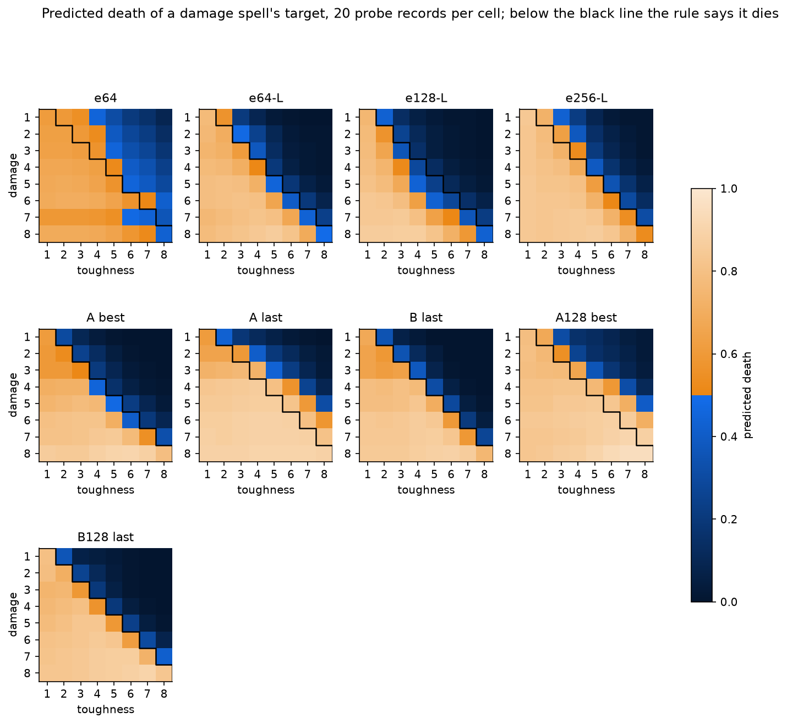

*Each cell is the predicted death of a damage spell's target, averaged over 20 real records with the spell's damage and the target's toughness edited. Orange cells predict a death more likely than not and blue cells less likely, brighter meaning more likely on both sides. The rule says the target dies on and below the black staircase. Arm `e64` trained without copies; every other panel trained with them. Data: `damage_grids.csv`.*

**Where the lethal boundary sits wanders from epoch to epoch at the full learning rate, and settles near the rule at a tenth of it.** Twenty more epochs at the same rate sharpen the boundary but move its position by up to a point of damage between consecutive epochs. A tenth of the rate holds it in a narrow band near the rule, from whichever checkpoint the run starts ([the boundary](#where-the-boundary-sits-wanders-between-epochs-at-the-full-learning-rate-and-settles-near-the-rule-at-a-tenth-of-it)).

**The validation loss and the probes disagree about which checkpoint is best.** In every continuation run, the probes rate the last epoch as good as or better than the epoch with the lowest card-disjoint loss, the one the run keeps. The loss rises late in training because the model grows more confident, not because it ranks outcomes worse. Gen-3 judges checkpoints by probes instead ([validation against probes](#the-probes-keep-improving-after-the-card-disjoint-loss-has-bottomed-out)).

**In combat, the model applies power against toughness softly, learns indestructible and most of deathtouch, and does not learn first strike.** The corpus lost every real blocked fight of the first-strike damage step to a collector bug, and the model never learned that a first striker survives the creature it kills first ([combat](#in-combat-the-model-applies-power-against-toughness-softly-learns-indestructible-and-deathtouch-and-not-first-strike)).

**Three combat keywords hold on every checkpoint, and double strike swings far beyond its sampling noise.** Lifelink and indestructible agree with real outcomes 97% of the time or more on every checkpoint, and trample 87% or more. Double strike ranges from below half to above four in five between checkpoints of one run, several times what its 294 records allow by chance ([gate 2](#three-combat-keywords-hold-on-every-checkpoint-and-double-strike-swings-far-beyond-its-sampling-noise)).

**Validation losses swing between epochs by about as much as a run improves, and a tenth of the learning rate cuts the swing several times over.** A difference of a tenth of a loss point between two checkpoints is within that swing ([training](#validation-losses-swing-between-epochs-by-about-as-much-as-a-run-improves)).

**No width of `e` beyond 64 has improved what the probes measure.** The 64-wide line has the lowest loss on unseen texts and the best probes. The wider lines have the lower loss on known texts in new games at most checkpoints, and the 128-wide and 256-wide arms' probes tie each other below the 64-wide arm's. Each line is one seed, so the gaps between them are not established, and the 256-wide continuation runs are still training ([width](#the-widths-trade-places-by-measure-and-one-seed-each-cannot-separate-them)).

**Gen-2's `e` holds a line's costs, timing and amounts far better than gen-1's, and the trunk still supplies deaths, damage and trigger firing.** The probes record measures where each kind of knowledge lives.

## Results

### Validation losses swing between epochs by about as much as a run improves

Both validation losses fall quickly for about ten epochs and slowly after that. From then on, single epochs land a tenth of a point or more above or below the trend, about as far as the trend falls in five to ten epochs. The validation samples are fixed, the same 2,048 records per stratum every epoch, so the swing is the model changing between epochs and not a different sample. Each run keeps its epoch with the lowest card-disjoint loss, marked with a star, so the kept epoch is partly the luckiest one.

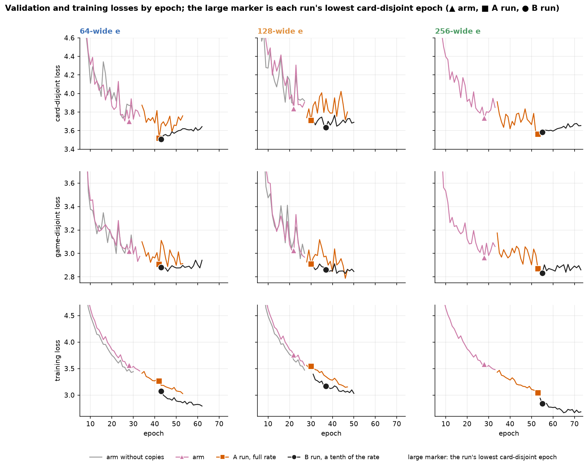

*Grey: the arm without lethality copies. Light to dark: the arm with copies, its continuation at the same learning rate (run A), and the continuation of run A's kept epoch at a tenth of the learning rate (run B). The bottom row is the training loss, averaged over each epoch's 5,000 steps; it runs about a tenth higher with lethality copies, which add records the corpus rarely shows. Data: `epochs.csv`.*

The card-disjoint loss swings more than the game-disjoint loss in almost every run. The card-disjoint stratum holds 500 texts the model never saw, and how well the model generalizes to each of them changes from epoch to epoch. The training loss moves by two to three hundredths in every run.

The training loss also shows why the validation losses swing. After a short warmup the learning rate stays at its peak for the whole run, so the weights never settle: each epoch ends at a different point near the bottom of the loss surface. The training loss is averaged over the 5,000 steps of an epoch and smooths that movement out, while a validation loss scores the single set of weights the epoch ended on. When runs B and B128 drop to a tenth of the rate, their training loss falls by about a tenth in the first epoch and by about two tenths within two, against run A and run A128 on the same shards. The weights move closer to the bottom once their steps are smaller.

At a tenth of the learning rate the swing shrinks between two and six times on card-disjoint loss and about three times on game-disjoint loss, while the training loss keeps the same small movement. Runs B and B128 are the only runs whose single epochs can be compared with each other at face value.

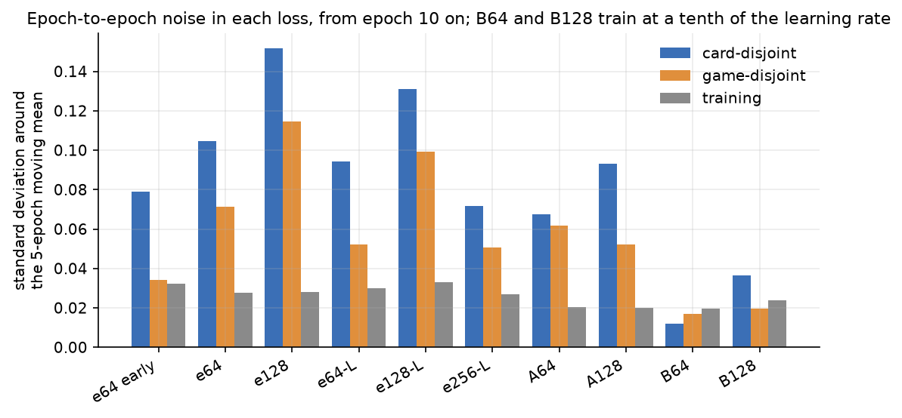

*Spread of each loss around its own five-epoch moving mean, from epoch 10 on. Data: `epochs.csv`.*

Two consequences carry through the rest of the record. A difference of a tenth of a point between two runs' kept epochs at the full rate is inside the swing and says little. The early stopper, which ends a run after five epochs without a new lowest card-disjoint loss, ended every arm while its trend was still falling, and every continuation run lowered its arm's loss further. Each run is one seed, so the level a second seed would settle at is not measured at all; the run plan's stage 6 describes what measuring it would take.

### The probes keep improving after the card-disjoint loss has bottomed out

In each continuation run, the last epoch has a higher card-disjoint loss than the kept epoch, yet the probes rate it as good or better. The chart plots each checkpoint's mean probe score against each validation loss, and an arrow joins each run's kept epoch to its last. Every arrow points right on the card-disjoint panel, toward a worse loss, and level or up, toward better probes. The probe mean is the model's own prediction on eight knowledge-probe questions, scored as AUC: the chance that a true case is ranked above a false one.

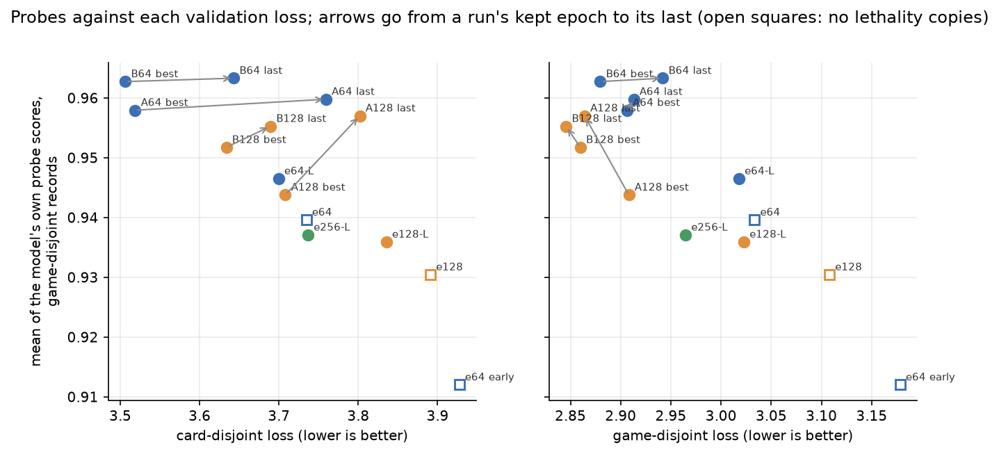

*Blue: 64-wide; orange: 128-wide; open squares: trained without lethality copies. Data: `checkpoints.csv`, `probe_ladder.csv` (rung 3, the model's own prediction, game-disjoint records).*

The card-disjoint loss rises because the model grows more confident, not because it ranks outcomes worse. Most of the rise is in the gate field, whether a card was affected at all, and in poison. On the same card-disjoint records, the probe asking whether a card is affected scores higher at the last epoch in three runs of four. Log-loss charges heavily for a confident miss, and a text the model never saw produces a few.

Across checkpoints of different runs, both losses track the probes. Lower-loss checkpoints have better probes, on either loss. Among the eleven checkpoints trained with lethality copies the card-disjoint loss tracks them better, because the 64-wide line wins on both the card-disjoint loss and the probes while the game-disjoint loss favours the wider lines. With eleven checkpoints, a rank correlation below about 0.6 cannot be told from none.

| rank correlation with the probe mean, sign set so that positive means agreement | card-disjoint loss | game-disjoint loss |
|---|---:|---:|
| all 14 checkpoints | +0.71 | +0.68 |
| the 11 checkpoints with lethality copies | +0.53 | +0.37 |

The two runs at a tenth of the learning rate show the same mechanism over time, and in opposite directions. Run B's card-disjoint loss is lowest at its first epoch and creeps up across the run, while run B128's falls for a few epochs and then holds level. Both runs read the same shards at matching epochs, and both training losses keep falling. Two effects separate them:

- **Run B started from a luckier checkpoint.** Each continuation starts from its parent run's kept epoch, the lowest point of a noisy series, so the starting loss is partly a favourable swing. Run A's epoch 42 sat further below run A's own trend than run A128's epoch 30 sat below run A128's. At a tenth of the rate the weights move away from that starting point toward the level the line trains to, and for run B that level is a little above the dip it started from.
- **Run B's rise is confidence on unseen texts.** Nearly all of it is in the gate field, whether a card was affected at all, while the zone outcome improves slightly and damage and life stay level. Run B's last epoch scores as well as its first on the probes, and its error against the death rule keeps falling. Run B128's gate loss falls slightly instead. It started from the checkpoint whose boundary leaned furthest toward a death, and its first epochs pull that boundary back, which is where its early gain comes from.

| at a tenth of the learning rate | run B (64-wide) | run B128 (128-wide) |
|---|---:|---:|
| starting checkpoint's card-disjoint loss, below its parent run's five-epoch mean | 0.16 | 0.10 |
| card-disjoint trend after the first three epochs, per ten epochs | +0.04 | 0.00 |
| game-disjoint trend, per ten epochs | +0.03 | −0.02 |
| training-loss trend, per ten epochs | −0.08 | −0.12 |
| affected gate's card-disjoint loss, first epoch → last | 1.06 → 1.15 | 1.16 → 1.13 |

*Data: `epochs.csv`, `fields_by_epoch.csv`.*

Run B's rise over the run, about a tenth of a point, is several times its epoch-to-epoch swing, so it is a trend rather than noise. It is not the extra epochs alone: over epochs 43 to 50, which both runs trained, run B still rises and run B128 barely moves. Whether the width or the seed separates the two runs cannot be told with one seed per width. The 256-wide continuation at a tenth of the rate starts from a third checkpoint at a third width.

Gen-3 therefore picks its checkpoints by a score built from the probes and from rule scenarios, rather than by the summed loss; the gen-3 draft records the design.

### The model compares damage with toughness only after training shows it the rule directly

Without help, the model predicts a creature's death from its toughness alone. The toughness sweep edits one hit creature's toughness from 1 to 8 on 20 real damage records and reads the predicted death. In arm `e64`, a 1-damage ping and a 3-damage spell give the same curve, falling between toughness 4 and 6. Each line should instead fall just after its own spell's damage.

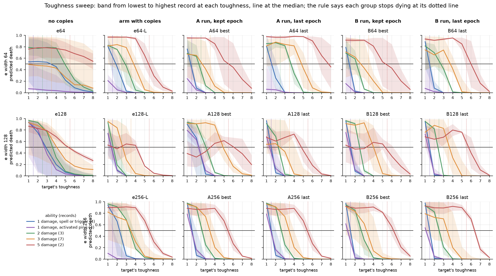

*One line per probe record. Dotted lines are activated pings for 1 damage. Data: `sweep_records.csv`, `toughness_sweep_records.csv`.*

The corpus rarely shows a damage spell falling short of its target's toughness. Forge's AI aims its removal at creatures it can kill, so a model fitting the corpus learns that "a small creature hit by removal dies" and has no reason to compare the amount with the toughness. Combat shows many more short hits, but there both numbers are on the board; a spell's amount reaches the trunk only through `e`.

| damage in 40 training shards | lethal | not lethal |
|---|---:|---:|
| a spell or ability's damage to a targeted creature | 170 | 36 |
| combat damage to a creature | 3,252 | 1,314 |

The fix is training copies labelled by the rule. A record qualifies when its acting ability deals one stated amount of damage, or -X/-X, and nothing in its chain can change whether the creature dies. Each copy redraws the amount and the hit creature's toughness from 1 to 8 and labels the death by rule 704.5f-g, so about half the copies are lethal. About one training record in four hundred qualifies, and `--lethality-copies 8` makes the copies about 2% of the records an epoch trains on. The target is the rule as written, not Forge's AI, so a label taken from the rule is what the model should learn.

With the copies, nearly every line falls at or within one point of its own damage, and the damage-by-toughness grid at the top of this record gains its diagonal. The card-disjoint loss did not get worse, so the copies cost nothing on the objective.

Three faults remain, and the grids show all of them:

- **The boundary is soft.** Where the damage exactly equals the toughness, the prediction sits between two fifths and four fifths rather than near one.
- **The lethal side tops out near 0.8.** That ceiling comes from the gate rather than from the death: on clearly lethal hits the predicted death given that the creature was affected is 0.99, and in a quarter of the records the model doubts that the targeted creature is affected at all.
- **Activated pings for 1 damage** are predicted to spare a toughness-1 creature by the 64-wide and 256-wide checkpoints; the 128-wide ones get them right. Width does not order this fault, so it is likely a property of each run rather than of the width.

The damage sweep reads the same rule from the other side: it fixes a toughness-4 target and re-encodes one spell's script with `NumDmg$` from 1 to 8. The rule puts the step between 3 and 4. Arm `e64` barely rises with the damage. With copies, every checkpoint rises steeply, and where it crosses one half moves from checkpoint to checkpoint, which the next section explains.

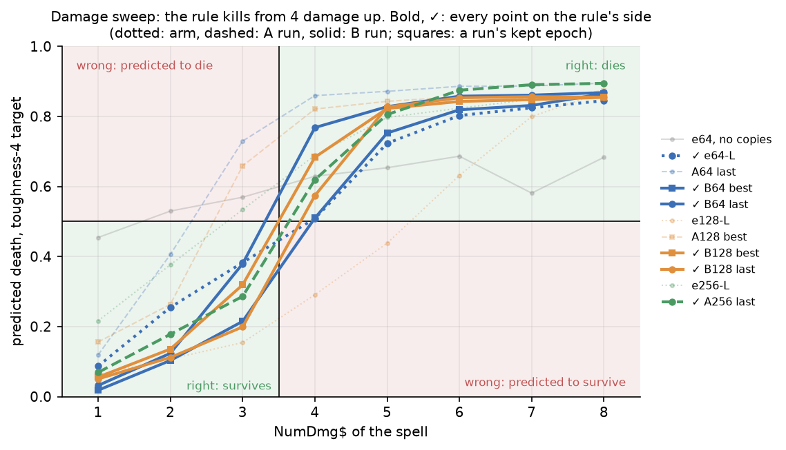

*Left: the damage sweep for six checkpoints. Right: the interpolated damage at which each checkpoint's prediction crosses one half; the green band is the rule's step. Data: `sweeps.csv` (sweep `damage_spell`).*

### Where the boundary sits wanders between epochs at the full learning rate, and settles near the rule at a tenth of it

At the full learning rate the boundary sharpens over twenty more epochs, but its position moves from one epoch to the next by more than that sharpening. The chart reads the same 40 qualifying training records at every epoch, with the predicted death of a hit lethal by one point, exactly lethal, and short by one point. A sharp boundary at the right place puts the red line near 1, the blue line near 0, and the orange line in between. Because the 40 records are the same every epoch, the movement is the model's, not a sample's.

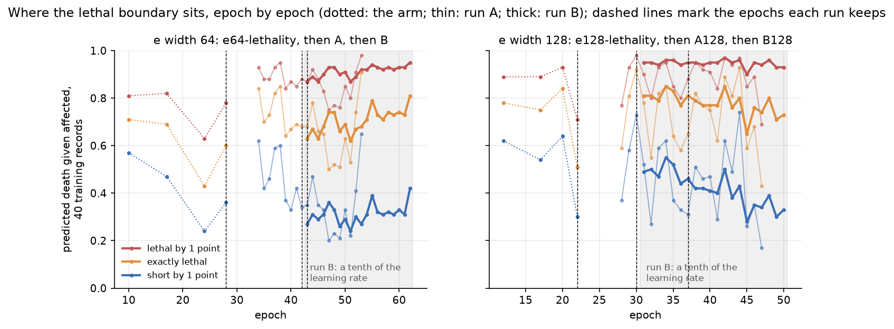

*Dotted: the arm's own checkpoints. Thin: run A, twenty more epochs at the full rate. Thick: run B, from run A's kept epoch at a tenth of the rate (grey band). Dashed verticals: the epoch each run keeps by card-disjoint loss. Data: `boundary_by_epoch.csv`.*

In run A128 a hit short by one point is predicted to kill anywhere from one time in six to three times in four, depending on the epoch. Run A's range is narrower but of the same kind. The epoch a run keeps can land anywhere in that range: run A128's kept epoch has the boundary moved furthest toward a death of any checkpoint, while run A's happened to land near the rule. Arm `e256-lethality`'s kept epoch also leans toward a death: its damage sweep crosses one half before 3 damage, where arm `e128-lethality`'s crossed after 5 and arm `e64-lethality`'s near the rule.

At a tenth of the learning rate the position settles. Run B128 started from run A128's misplaced epoch 30, pulled the boundary back within a few epochs, and then held it. In both run B and run B128 the gap between "lethal by one" and "short by one" holds near six tenths, and the error against the rule falls slowly. On the probe set's grids, the last epochs of runs B and B128 have the lowest error against the rule of any checkpoint; the training-records chart and the probe-set grids agree.

Dropping to a tenth of the rate is therefore what places the boundary. More epochs at the full rate do not.

### In combat the model applies power against toughness softly, learns indestructible and deathtouch, and not first strike

The combat grid asks the same question of a block that the damage grid asks of a spell. It takes 40 real one-on-one blocks from the validation strata, edits the attacker's power and the blocker's toughness, or the blocker's power and the attacker's toughness, from 1 to 8, and reads the predicted death. A keyword variant grants one creature a keyword and compares the prediction with the rule. The script is `scripts/effect_knowledge_probes/combat_grid.py`.

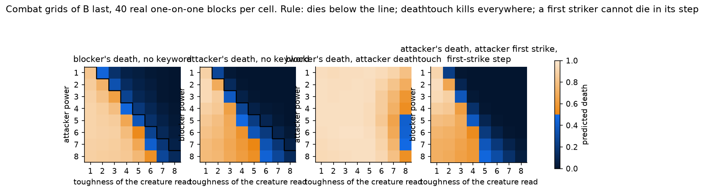

*Run B's last epoch, coloured as the damage grids: orange above an even chance of death, blue below. Rule: without keywords, the creature read dies on and below the staircase; with deathtouch every cell dies; in the first-strike step a first-striking attacker cannot die. Data: `combat_grids.csv`.*

Every checkpoint gets the direction of the plain rule right, with a boundary blurred over two to three points of toughness, as soft as the damage grid's. The attacker's death sits further from the rule than the blocker's on every checkpoint. The likely reason is in the data: a combat record's snapshot is taken at the step's first damage event, so the creature damaged first already shows that damage. In 26 of the 40 blocks the blocker is marked with exactly the attacker's power, and the attacker is never marked. When the lethal damage is already on the board, every checkpoint predicts the death nine times in ten or more; when the model must add the opposing power itself, it is far less sure. The grid clears both creatures' marked damage before editing, and gen-3 moves the snapshot to the start of the damage step.

A combat record covers one damage step, and the model predicts that step alone. The grid reads a first striker in the first-strike step, where it deals its damage and the creature it fights deals none, and a double striker's second hit in the regular step, with the first hit already marked on the blocker.

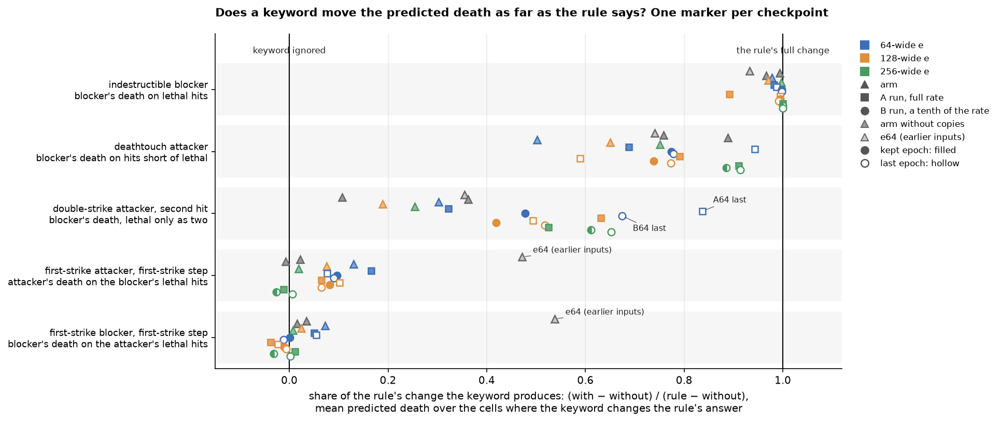

*Each dot is one checkpoint's mean predicted death over the cells the keyword changes; grey lines join the same checkpoint with and without the keyword. Data: `combat_grids.csv`.*

The keywords sort into three groups:

- **Learned outright: indestructible.** No checkpoint predicts an indestructible blocker's death more than one time in fourteen on cells where the damage is lethal.
- **Learned mostly: deathtouch and damage already marked.** Deathtouch moves the non-lethal cells most of the way to a death, by different amounts on different checkpoints, and fades at the blocker's highest toughness on every checkpoint. A double striker's second hit is read from the damage the first one marked, and the last epochs of runs A and B read it best.
- **Not learned: first strike.** In the first-strike step a first striker cannot die, yet every checkpoint on the corrected inputs predicts its death within a tenth of its death without the keyword, for an attacker and a blocker alike.

The corpus explains the last group. A collector bug lost the creature damage and deaths of every first-strike damage step, and the repair dropped the blocked first-strike fights it could not recover. The probe forks are the only blocked first-strike fights the model sees, and they do not teach the step. Gen-3 collects the first-strike step whole, and the gen-3 draft adds combat copies labelled by the rule as an option.

### Three combat keywords hold on every checkpoint, and double strike swings far beyond its sampling noise

Gate 2 asks, on the game-disjoint stratum, whether the model's predictions move the way a damage-step keyword moves the real outcome. A probe fork copies a real combat and strips the keyword from one creature. The gate counts how often the model's predicted change and the real change point the same way, and passes a keyword at 70% over at least 200 qualifying records.

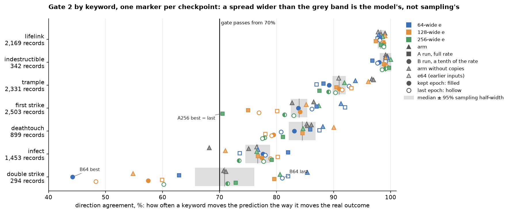

*Each label gives the median number of qualifying records and the 95% half-width that sampling alone would give at 80% agreement. The first run of arm `e64` scored first and double strike on the wrong damage step and is left blank for them. Data: `gate2.csv`.*

Lifelink and indestructible agree 97% of the time or more on every checkpoint, and trample 87% or more. Their rows vary by about as much as sampling allows, or a little more.

The other four move far more than sampling allows, so their variation is the model's:

- First strike ranges over about fifteen points on 2,503 records, whose sampling half-width is two.
- Deathtouch and infect each range over twelve to fourteen points.
- Double strike ranges from 44% to 85% on 294 records, eight times its sampling half-width. Within run B it fails at the kept epoch and passes at the last.

Nearly every qualifying first-strike and double-strike case is an unblocked attacker, read through the defending player's life, for the reason given in the combat section above. Neither the lethality copies nor the width moves any row consistently.

A keyword verdict from one checkpoint is therefore a draw from that range, and gate 2's pass or fail on double strike says little about the run.

### The large output fields plateau by epoch 20, and the small ones swing more than they improve

The fields with many records, such as whether a card was affected, its zone outcome and the keywords it gained, rise smoothly to a plateau between three quarters and seven eighths of their learnable loss. The small fields swing by tens of points from one epoch to the next. Explained deviance is the share of a constant prediction's loss the model removes: 0% is no better than always predicting the field's average.

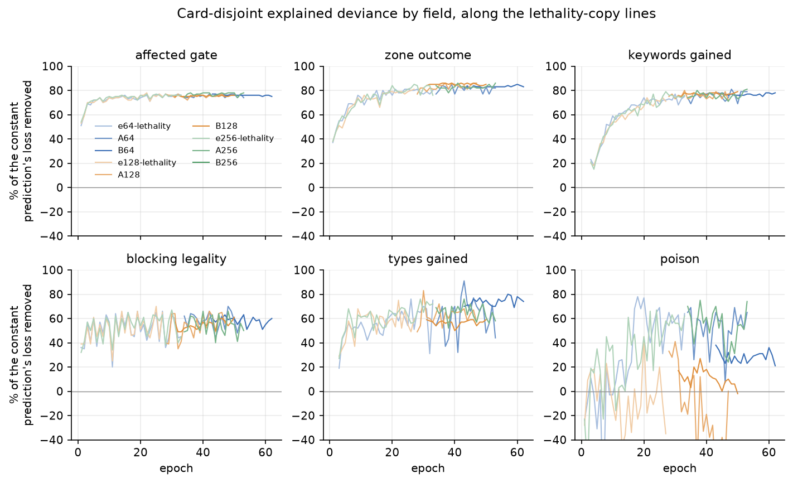

*Card-disjoint explained deviance per epoch along the lethality-copy lines. Data: `fields_by_epoch.csv`.*

Poison is the clearest case. It moves between a fifth and seven tenths of its loss on the 64-wide line from epoch to epoch, and the 256-wide arm stays in the same band. On the 128-wide line it rarely rises above two fifths and often falls below zero, worse than a constant prediction. Since the widest and the narrowest `e` agree, the 128-wide line's poison is more likely its seed's level than an effect of width. Types gained and blocking legality swing by about thirty points. A comparison of two checkpoints on any of these fields is mostly a comparison of two draws. Gen-3's field-normalized loss and its adaptive sampling address these fields directly.

### The widths trade places by measure, and one seed each cannot separate them

The 64-wide line has the lowest card-disjoint loss and the best probes at every stage it shares with the others, and the wider lines have the lower game-disjoint loss at most checkpoints. Each point in the chart is a checkpoint trained with lethality copies. Among the arms, the 256-wide arm's card-disjoint loss falls between the other two, its game-disjoint loss is the lowest of any arm, and its probes tie the 128-wide arm's.

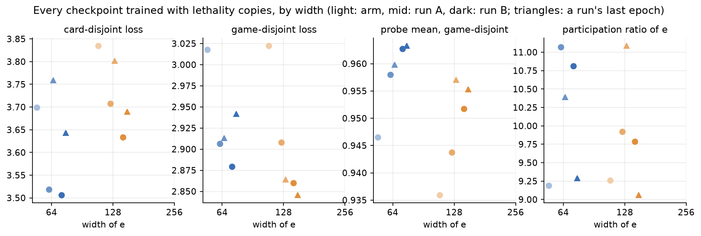

*Light: the arm; mid: run A; dark: run B. Circles: a run's kept epoch; triangles: its last. The 256-wide continuations join as they complete. Data: `checkpoints.csv`, `probe_ladder.csv`, `gate3.csv`.*

The card-disjoint gap between the 64-wide and 128-wide lines, about a tenth to two tenths of a point, is at the edge of the epoch-to-epoch swing at the full rate. The two lines keep it through both continuation runs, which makes it more than one lucky epoch. It could still be the two seeds' levels rather than the width.

A wider `e` does not spread its variance over more effective directions. Every checkpoint sits between 9 and 11 effective dimensions, the 256-wide arm at about 9.4, so the vector's extra width goes unused. A linear probe reads the stated amounts better from a wider `e`, which it would from any wider vector. An MLP probe reads damage, cost and counters on unseen lines slightly worse from the 256-wide `e` than from the narrower arms, and power change slightly better. On the death rule, combat, gate 2 and the board-abilities subsets, the 256-wide arm lands inside or at the edge of the range of the other checkpoints.

### Gen-2's `e` spreads over two to three times gen-1's dimensions, and reads a line's kind and amounts far better

The participation ratio counts the equally weighted directions that would give `e`'s spread of variance: 3.9 for gen-1 and between 7.5 and 11.1 for every gen-2 checkpoint. A linear probe reads a line's API type, its mana cost and each of its stated amounts far better from gen-2's `e`. The wider `e` reads the amounts better still, though a linear probe with more inputs fits more of any label, so the table bounds what width adds rather than measuring it. Gen-2 trains two heads that read `e` alone, one predicting the API type and one the stated amounts, so part of the gain is by construction; the probes record tests whether the trunk uses it.

| linear probe on `e`, all texts | gen-1 | `e64`, epoch 25 | run B, epoch 62 | run B128, epoch 50 | `e256-lethality`, epoch 28 |
|---|---:|---:|---:|---:|---:|
| API type, accuracy | 0.64 | 0.89 | 0.91 | 0.91 | 0.91 |
| mana cost, R² | 0.06 | 0.53 | 0.58 | 0.63 | 0.61 |
| damage amount, R² | 0.34 | 0.49 | 0.50 | 0.61 | 0.70 |
| counters amount, R² | 0.18 | 0.54 | 0.54 | 0.65 | 0.64 |
| life amount, R² | 0.09 | 0.32 | 0.33 | 0.40 | 0.45 |

*Data: `embedding_probes.csv`, `gate3.csv`.*

Gate 3 passes on every gen-2 checkpoint but one. The second run of arm `e64` put 30.03% of its variance on its top component, just past the gate's 30% limit. That component sorts lines by what they do, from damage and exile aimed at a creature to spell-copy and cast triggers, so it is a stretched direction rather than a collapse.

## What gen-3 takes from these results

The gen-3 draft, [`2026-XX-XX-effect-model-gen3-design.md`](2026-XX-XX-effect-model-gen3-design.md), carries each of these forward:

- **Rebalancing by rule**, so that no keyword or rule is rare in training, with rule-labelled copies where real records are too few. The lethality copies are the first case, and combat copies are proposed.
- **Checkpoints judged by probes and rule scenarios**, from the disagreement between the loss and the probes, with each field's loss divided by its constant prediction's.
- **The first-strike step collected whole, the combat snapshot taken before damage, and the block pairing in the input**, from the combat results.
- **Every line of a permanent on the board**, from the board-abilities results in the probes record.

## Design: what gen-2 changes from gen-1, and why

Gen-1 is the model trained on the corpus of 2026-09-17 (run `09.17f`, filed under `models/effects/runs/2026-09-17-full-textless-corpus/`), together with four baselines. Its design rationale is [`2026-09-04-ability-effect-model-design.md`](2026-09-04-ability-effect-model-design.md), called the design doc below. Each baseline trains on the identical pipeline and differs from gen-1 in one input, so each answers one question. `identity` gives every distinct ability text a free vector in place of the encoder's output, and asks whether the encoder reads text at all. `taxonomy` replaces that vector with a hash of the script's API type and parameter keys, and measures what reading a script's parameters adds over knowing its effect category. `state-only` zeroes every ability vector and gives each record kind its floor. `no-state` also removes the board, so the model can learn only each text's average effect.

The encoder has two surfaces. The script surface is the Forge script text, and the prose surface, the rendered rules text, is the fallback for a line with no script. A head is a network trained on top of a shared representation to predict one kind of output.

Each of the first ten sections below records one gap found while gen-1 trained, the evidence for it, and the change gen-2 makes. The three after them set how gen-2 is collected, evaluated and trained, and the run plan orders the work. Gen-2's gate figures are not compared with gen-1's figure by figure, because the corpus, the split and the encoding all change.

### The encoder reads only the first script line of an ability, so a trigger's effect never reaches it

On the script surface the encoder is fed one Forge script line per ability: the line the ability's
runtime trait was parsed from. An ability that Forge writes across several lines loses every line
but the first. For a triggered ability the first line is the trigger condition, and the effect is a
separate `SVar` line the trigger names through `Execute$`. Ajani's Pridemate encodes as the trigger
line alone:

```
Execute$ TrigPutCounter | Mode$ LifeGained | TriggerDescription$ Whenever you gain life, put a +1/+1 counter on CARDNAME. | TriggerZones$ Battlefield | ValidPlayer$ You
```

The `DB$ PutCounter | CounterType$ P1P1 | CounterNum$ 1` line that does the work is not in the text.
The model knows that this is a life-gain trigger which does something the description calls "put a
+1/+1 counter"; it does not see the counter type or the count as parameters.

The omission is near-universal for triggers and common for the rest.

| converted card corpus, excluding keyword lines | count |
|---|---:|
| lines with a script surface | 41,914 |
| triggered lines | 16,135 |
| triggered lines whose `Execute$` effect is absent from the encoded text | 16,098 |
| lines with a sub-ability chain below the first effect | 8,820 (21%) |
| chain length 1 / 2 / 3 / 4 or more sub-abilities | 5,595 / 2,247 / 698 / 280 |
| longest chain | 13 sub-abilities |
| median ratio of full-chain text to root text, chained lines only | 1.4× |
| 90th percentile of that ratio | 2.1× |

Modal abilities lose every mode. A charm's root line names its modes only by label, as in `Choices$
DBDmgC,DBDmgP`, and where it has a description, the description ends in the placeholder `ABILITY`
that Forge fills from the modes at runtime. The encoder sees that the ability offers a choice and
not what any choice does.

| charm lines | count |
|---|---:|
| charm lines in the converted card corpus | 783, on 781 cards |
| charm lines whose encoded text names no mode | 742, on 740 cards |

The mechanism is in the converter. `TraitScript.of` renders `script_text` from the trait's own
parameter map, and a trait's map holds only the line the trait was parsed from. For a trigger that
is the `T:` line. The effect the trigger executes is a separate `SpellAbility` reachable through
`getOverridingAbility()`, and for any ability the sub-abilities are reachable through
`getSubAbility()`. The converter already walks both chains: the sub-abilities become the
`sub_ability_links` index paths the record attribution uses, and the prose renderer walks the same
chain to find the description. Only the script text stops at the root.

The design doc's argument for the script surface assumed the whole mechanism was present. It gives
`Cost$`, `ValidTgts$`, `Mode$` and `NumDmg$` as the predicate structure every record supervises, and
it counts on paraphrases of one mechanism collapsing to one script. Neither holds for the effect
half of a trigger, because that half is never encoded. Gen-1 still sees the effect through the
description parameter: Forge attaches the rules text to the root line, so the prose is present for
all but about one line in eighty. The encoder is reading prose plus the trigger condition or the
first effect's parameters, and the rest of the mechanism reaches it only as English.

The description is not a full substitute. The design doc's third argument for the script surface is
synthetic script variants, which perturb a parameter and play the variant for engine ground truth of
a text that never existed. A variant that changes `CounterNum$ 1` to `CounterNum$ 2` on a trigger
produces a record whose encoded text is identical to the original, because the changed line is not
in the text. The variant records then teach the model that one text has two outcomes.

#### Gen-2 encodes the whole chain in resolution order

`script_text` becomes the concatenation of every script line the ability owns, in this order:

- the root line;
- for a trigger, the ability it executes through `Execute$`;
- each sub-ability in chain order, including a `RepeatSubAbility` where one exists.

Replacement effects get the same treatment through `ReplaceWith$`. A dedicated token separates the
segments. Each segment after the root opens with the label its parent referenced it by, so
`SubAbility$ SV2` in one segment and `SV2:` opening a later one give the model the link. The labels
are renumbered by position within the line, so the link survives and the author's name for the SVar
does not (next subsection). A charm's modes are not inlined into its root line. Each mode is encoded
on a line of its own (subsection on charms).

Four things follow from the change, and the third is the one that decides the order of work.

1. **The converter rewrites the sidecars but not the converted text.** `script_text` is a field of
   the sidecar, the `.provenance.json` file `convert` writes beside each converted card to map each
   rendered line to the Forge script it came from. The rendered prose does not change, so the
   byte-identity guarantee the sidecar contract makes holds.
2. **The script vocabulary is rebuilt.** `build-vocab --surface script` scans the sidecars' script
   lines; after the change those lines carry the chained segments and the separator token. Most
   parameter keys already appear on root lines, so the vocabulary grows by the numbered labels,
   one per position in the longest chain, and the rarer sub-ability parameters.
3. **The holdout is chosen on the chained text.** A text is held out by the hash of its masked
   template, the normalised script text with its numbers, `CARDNAME` and descriptions masked
   (section on gate 1), and the corpus's rarity table is keyed on the script text. Changing
   `script_text` changes every key. The holdout is therefore computed on the chained text before the
   new corpus is collected, which is the only point at which changing it costs no training games
   (section on collecting from scratch).
4. **Sequence length grows, and most chains stay well under the cap.** The encoder truncates at 512
   tokens, and the table above gives the growth on chained lines. The distribution of chain lengths
   in tokens is measured after the rebuild. A chain that exceeds the cap is logged rather than
   silently cut from the tail, because the tail of a chain is its last effect.

Prose stays as it is: the fallback for a line with no script, which is a keyword-derived line or a
synthetic land mana line, and nothing else.

Gen-2 does not build the design doc's paired-prose loss. That loss would pull a line's prose
encoding toward its script encoding, so that a card with prose but no Forge script would still get a
usable `e`. Gen-2 serves cards implemented in Forge, and every one of them has a script.

#### Gen-2 renumbers SVar labels by position, because the names authors give them carry no mechanism

Forge's card scripts name their SVars freely, and most names are used once. The table counts the
labels that `Execute$`, `SubAbility$` and `ReplaceWith$` reference across Forge's card scripts.

| SVar labels referenced in Forge's card scripts | count |
|---|---:|
| distinct labels | 3,488 |
| references | 36,501 |
| labels referenced once | 2,355 |
| labels referenced fewer than five times | 3,009 |

Labels kept as written damage the vocabulary. A label is one whole token, so a name used once
either takes a vocabulary slot of its own or reads as `[UNK]`. A label read as `[UNK]` no longer
links a reference to the segment it names, which is the only reason the label is in the text.

Labels kept as written also damage the holdout. Two texts that do the same thing under different
names, `SubAbility$ DBDraw` and `SubAbility$ DBDrawCard`, are different texts. The rarity table
counts them apart, and the holdout hashes them apart, so one twin can train while the other sits in
the card-disjoint stratum as an unseen text.

Gen-2 renames every chain label in a line's `script_text` to `SV1`, `SV2`, … in order of first
appearance. A label keeps its number everywhere in the line, so a reference and the segment it names
still match. Numbering restarts on every line. The rename covers the values of `Execute$`,
`SubAbility$`, `RepeatSubAbility$` and `ReplaceWith$`, each item of `Choices$`, and the label that
opens each segment. Amount SVars, such as the `X` of `NumDmg$ X`, are not chain links and keep their
names. What a label loses is redundant: `DBDraw` says "draw", and the segment it opens says
`DB$ Draw`.

#### Gen-2 encodes and records each mode of a charm as its own ability

A charm's outcome depends on which modes its caster chose, and no single text can show that choice.
The converter already emits one `option` line per mode beside the charm's root line. Gen-1's
sidecars give those lines no provenance key and no script text, and the provenance join resolves
every chosen mode to the root line. A charm resolution therefore acts through one text whose
outcome is damage on one record and a drawn card on another, depending on a choice the model never
sees.

Gen-2 makes each mode a separate ability, in four steps.

1. **Each `option` line carries its mode's chain.** Its sidecar entry holds the mode's provenance
   key and a `script_text` holding the mode's script line, opened by its label, followed by its
   sub-abilities. The root line keeps only its own script line: the choices, how many modes to
   choose, and whether a mode may repeat.
2. **Each mode gets its own `e`.** The effect model adds a learned option-kind embedding to every
   ability row that comes from an `option` line. Option rows follow their root row within the
   card's block, so the flag and the order link a mode to its charm.
3. **A patched worker records each chosen mode as its own effect.** A modal resolution becomes one
   cost record acting through the root line and one effect half per chosen mode, acting through
   that mode's `option` line. Each effect half carries only its mode's events and a snapshot taken
   just before that mode resolved. All of them share one `link_id`, which therefore joins a cost
   record with its effect halves rather than only a pair. A mode chosen twice, as a Pawprint charm
   allows, produces two effect halves.
4. **A degraded worker keeps the root line.** Without the engine hooks the collector cannot tell
   where one mode's events end and the next begin. A degraded worker writes one effect half
   through the root line carrying every chosen mode's events.

### Every outcome in the corpus is one Forge chose, so the model can learn abilities without learning targets

Every record comes from games in which both seats follow Forge's AI. The corpus is therefore
observational under one decision rule, one policy in reinforcement-learning terms. A resolution
record exists because Forge decided to take that action, and Forge takes an action only when it
already predicts the outcome it wants. In the records, "Lightning Bolt targets a creature" and "that
creature dies" are therefore almost the same event, and "Murder targets a creature" is never paired
with an indestructible target. A model reaches a good loss on that corpus by learning that Bolt
means death. It never has to learn that the target's toughness decides it, because no record shows
Bolt on a creature that survived. Combat records do show damage that failed to kill, and the effect
head carries some of what it learns there across record kinds. The part of its mapping that depends
on the ability is still learned only on the boards and targets Forge chose.

A corpus like this understates any measure of whether the encoder reads text. A lookup table learns
"Bolt means death" as well as the encoder does, so the encoder's margin over gen-1's identity
baseline is smaller than it would be on a corpus where the outcome depended on the target.

Off-policy play, in which one seat takes actions Forge's AI would not have chosen, is the cheap
general fix. Forge's rules engine computes every record's outcome, so an action Forge's AI would
never take still produces a correct record when it resolves. The fork probes already in the corpus,
games copied at the damage step and replayed with one keyword stripped from one creature, fix only
the damage-step keywords, and each further case would need its own fork machinery. The records
off-policy play adds are the ones the corpus lacks:

- Bolt on an 8/8, Murder on an indestructible creature, a player exiling their own creature. The
  ability resolves and the entity stays, or the wrong side loses something. These teach the effect
  head's affected-or-unaffected output and its zone-outcome field to read the target's state.
- Targeting through a ward cost the caster cannot pay. The cost record's outcome field already
  carries `countered`; the class is simply empty today.
- A 1/1 attacking into a 4/4, and blocks Forge would never assign, including the combats deathtouch
  decides, which Forge's combat AI declines (section on rare-keyword combats). Combat records are
  the observational complement, and random declarations reach the region Forge's attack logic never
  enters.
- "Tap target creature" on a creature that is already tapped. A resolution that changes nothing,
  which the corpus has never recorded.

#### Gen-2 collects one match in four with a seat that takes a random legal action at half its decisions

The random seat is Forge's AI with its choices overridden at the decision points that matter: the
spell or ability to play, its targets, the attackers to declare, and the blocks to assign. At each
of those points it acts at random with one probability, the same at every point, and then draws
from the legal options. Otherwise it takes Forge's ranked choice. Land drops, mana payment
and mulligans stay with Forge, because a random land drop produces no record the corpus lacks and
only makes the board less like one the model will be asked about. The other seat stays the standard
Forge AI, so the game keeps a shape Forge would produce and ends. Two random seats never play each
other.

The override lives in the connector, not in Forge. The match worker already builds both seats as
`LobbyPlayerAi` in `GamePlayer`, and Forge routes spell choice, target choice and combat
declarations through `PlayerControllerAi`, so the random seat is a controller subclass the worker
installs on one seat. Nothing on the `effect-record-hooks` branch changes.

A random draw picks one element at a time, because the legal attacks, blocks and target sets are
combinations too numerous to list and draw from.

| Decision | Random draw |
|---|---|
| spell or ability | uniform over the playable spells and abilities other than mana abilities |
| attackers | each creature that can attack does so with probability ½ |
| blockers | each creature that can block picks uniformly from no block and the attackers it may legally block |
| targets | a count uniform between the ability's minimum and maximum, then that many distinct legal targets |

A declaration Forge rejects as illegal is redrawn. After a fixed number of failed draws the seat
takes Forge's choice for that decision. The play draw never passes while something is playable,
because a pass produces no resolution record, and resolutions Forge would not choose are what the
random seat is for. Mana abilities are left out of the play draw because mana payment stays with
Forge. A mana ability drawn at random would tap a land for mana that nothing spends.

Four details are fixed in this design rather than left to the collection run.

1. **Records from the random seat carry a flag.** The flag lets the evaluation score the model
   separately on off-policy records, which is the number that says whether off-policy collection
   worked.
2. **Playability decision records are unaffected.** The `decision` subkind records the rules'
   verdict on every candidate, not the action the seat took, so a random seat produces the same
   decision records a Forge seat does. Nothing in that class needs the flag.
3. **One match in four has a random seat, and it acts at random at half its decision points.** The
   random seat produces rare outcomes for common texts, and the attacks Forge's AI would not make,
   which are the only source of block decisions against such attacks once what-if queries are not
   collected (section on what-if queries). On-policy games supply everything else, so the two share
   one corpus. The two settings multiply to one eighth, the expected share of one seat's decisions
   taken at random per match played. A seat that acted at random at every point would lose most games early, and its boards would say
   little about the boards the model is asked about.
4. **Random-seat games are played in both collections.** They appear in the training collection,
   played from pools depleted of every card that carries a held-out text, and in the full-strength
   collection, played from complete pools, that supplies the card-disjoint stratum. The off-policy
   records of training therefore have held-out counterparts to be scored on.

Two limits are accepted. Random targets on a wide board mostly produce uninformative no-ops, so the
share of useful records per game is lower than under Forge's play. And random attacks and blocks
cost the random seat life and creatures, so its games run shorter and its boards are thinner than
Forge's. The probability of acting at random sets how far both go. The stage 2 pilot, at one match
in eight and a quarter of the decisions, yielded too few block decisions against random attacks
to replace the what-if queries, which is what sets the values above (Outcome, stage 2).

### The rarity weight is flat for 97% of texts and nothing balances rule families, so rare texts and rare rules train least

The rarity weight the trainer applies within a class does nothing for the tail of the curated
corpus. Curation is the `build-corpus` step that selects which collected records enter the training
corpus. It fills each class, a record category such as the effect halves of resolution records or
the legality records, to a fixed share of the corpus. A record is weighted by the inverse square
root of the games its text was seen in, with a ceiling of twenty times the weight of the
most-observed text. The most-observed texts are the five basic-land mana abilities, each seen in
about ninety thousand games. Measured against that reference, the ceiling binds for every text seen
in fewer than about 228 games, which is 97% of the rarity table. A text recorded in one game and a
text recorded in two hundred receive the same weight. Only the mana abilities, the enters-tapped
replacement and the eight hundred or so texts above that line weigh less. The figures below are from
the manifest of the corpus gen-1 trained on.

| gen-1 corpus manifest | |
|---|---:|
| texts in the rarity table | 31,561 |
| most-observed text (`Add {B}`), games | 91,133 |
| 99th / 95th / 50th percentile, games | 447 / 153 / 11 |
| texts seen in one game | 2,639 (8%) |
| texts seen in four games or fewer | 8,681 (28%) |
| texts at the weight ceiling | 30,740 (97%) |

Under the flat weight, a rare text reaches the encoder about a hundred times less often than a
common one. A curated shard holds 2,000 records. An epoch, one pass of the training schedule, visits
256 shards in 5,000 training steps of 32 records each, so it consumes about a third of each shard it
visits. The weighted shuffle decides which third, heaviest first. With a flat table that draw is
uniform, so a text's share of an epoch is its share of the records that survived the per-text cap.
The cap is 200 records, and a text seen in one game contributes one to three.

The per-text cap is the only setting that changes the mix of texts in the curated corpus, and it
acts only on the most common texts. The cap drops about three of every five resolution-effect
records read and about half or more in every other ability-keyed class. A cap is a ceiling and never
a floor, so curation cannot add tail records. What it can do is stop the common texts from crowding
them out, and today it does that only down to two hundred records per text.

| class | records read | kept | dropped by the cap |
|---|---|---|---|
| resolution-effect | 2,226,674 | 233,317 | 1,311,253 |
| resolution-cost | 1,832,641 | 61,719 | 943,357 |
| trigger | 1,864,406 | 62,447 | 936,613 |
| continuous | 1,354,894 | 92,007 | 875,225 |
| rewrite | 187,434 | 54,130 | 101,220 |

#### Gen-2 sets the weight ceiling against the 99th-percentile text and logs what the tail receives

The ceiling is expressed against the text at the 99th percentile of games rather than the single
most-observed one. With the reference at about 450 games, a one-game text weighs about twenty times
the reference and the ceiling barely binds, which is what the ceiling was written to do: stop a
single text from dominating a batch without flattening everything below it. The mana abilities and
the few hundred texts above the reference weigh less than it, which is where they belong. The rarity
table in the manifest does not change; only the trainer's reading of it does.

Nothing reports today whether training reaches the tail. The manifest's unique texts per output show
only whether curation kept it. The trainer's epoch line therefore gains the share of records trained
by rarity bucket of their text: one game, two to four, five to nineteen, twenty or more.

#### A per-text weight shows a mechanism once per variant, so a keyword with few variants stays rare

Equalising texts does not equalise mechanisms. Every "deal N damage to target X" script is its own
text, so the damage mechanism reaches the encoder once for each of its variants, and a keyword
written on a handful of cards reaches it a handful of times however heavily each of its texts is
weighted. The weight fix above removes the bias between texts and leaves this one untouched. The
table groups the rarity table's texts into rule families: by Forge API type, trigger mode or
keyword.

| rule family | distinct texts | games |
|---|---|---|
| ChangesZone triggers | 5,393 | 312,514 |
| Pump | 1,989 | 73,949 |
| DealDamage | 1,224 | 66,343 |
| Flying | 608 | 20,153 |
| Suspend | 52 | 3,095 |
| Ninjutsu | 22 | 738 |
| Cascade | 11 | 1,052 |
| Dredge | 7 | 602 |
| Cypher | 0 | 0 |

Under equal per-text weights the damage family gets well over a hundred times the attention of
dredge.

#### Gen-2 balances the curated corpus across rule families, as close to uniform as the records allow

The embedding should carry a comparable understanding of every rule of the game, not a picture of
how often each rule comes up in Forge's games. The ideal is the same number of examples for every
rule. No mapping from records to the numbered rules of the comprehensive rules exists, but Forge
implements roughly one class per rule mechanism. Each record kind therefore takes its family from
the mechanism vocabulary Forge already uses, and a keyword line's family is the keyword whatever the
record kind.

| Record kind | Family |
|---|---|
| resolution, effect and cost halves | the acting ability's API type |
| trigger | the trigger mode |
| continuous | the static mode |
| rewrite | the replacement type |
| combat | the damage-step keywords present in the fight, or none |
| playability | the mode of the static that forbids it, or else the verdict that failed |

A playability verdict that fails on mana has no static behind it, and neither does one that fails
for want of a target. Where no static is responsible, the first verdict that failed names the
family: cannot be played, unaffordable, or no legal target. Without that rule, every unaffordable
and every untargetable candidate would share one family with the candidates that pass.

`build-corpus` gives every family within a class the same target number of records. A family with
more records than the target is cut down to it. A family with fewer is written whole, and each of
its records is repeated up to a reuse cap. Each family therefore receives the target or its records
times the reuse cap, whichever is smaller.

The reuse cap is what stops uniformity from turning into memorization, in which the model predicts
from the identity of a text rather than from what the text says. Dredge has seven texts in about six
hundred games. A budget equal to that of the ChangesZone triggers would replay those few cards and
boards hundreds of times, and the model would learn the cards rather than the rule.

The per-text cap counts copies as well as distinct records. A record repeated four times counts four
against its text's cap of two hundred, so no text is replayed past the cap. A family made of a few
texts therefore stays short rather than filling its target with them, and its shortfall goes on the
list below.

A family short of its target is a collection problem rather than a sampling one. Cypher has no
record at all, and no weight reaches it. The manifest reports each family's available records, its
target, the records written, the repeats and the shortfall. The shortfall list is the target list
for `collect-coverage` and `collect-variants`.

Inside a family, the text weight and the per-text cap of the previous subsections balance the texts.
The epoch line reports the share of records trained per family beside the share per rarity bucket.
The validation results are reported per family and averaged over families, so the evaluation weighs
the rules the way training does.

#### Within a family, curation balances the outcomes as well as the texts

A family's records are balanced over a coarse outcome signature: which pairs of zone outcome and
changed-or-not occur among the affected entities. Lightning Bolt killing its target and Lightning
Bolt leaving it standing then appear in comparable numbers. On-policy play records almost only the
first.

The signature ignores how many entities share a pair, so that a mass effect is not split by board
size. A wrath that kills three creatures and one that kills seven produce the same outcome on boards
of different sizes. If counts entered the signature, each board size would become a cell with its
own share, and the rare large boards would be repeated to fill it.

Balancing the outcomes changes which boards the model sees and not the right answer on any of them,
because most outcomes follow from the board under the rules: Bolt on a creature with three toughness
always kills it. It shifts the head only where the outcome depends on a player's choice, such as
which creature an opponent sacrifices, and that choice is Forge's policy rather than a rule.

The minority outcomes come mostly from the random seat, so this balance is what turns the random
seat's games into training signal. The random-seat flag is not itself a curation key: the signature
selects the minority outcomes directly, from whichever seat produced them. The manifest records the
on-policy and off-policy record counts per class beside the existing per-class counts.

### The training noise on the ability vector is under 1% of its length, so it does not stop the effect head memorizing texts

Gen-1's noise on `e` is too small to stop the effect head memorizing texts, because nothing keeps
`e` small and the noise does not scale with it. The design doc's first memorization lever keeps `e`
small and noisy in training, so that the effect head cannot use `e` as a precise per-text lookup key
("Coverage and memorization are separate tail problems, and both get levers" in the design doc).
Gen-1 implements only the noise half. The encoder adds Gaussian noise with a fixed standard
deviation of 0.05 to each of the 64 coordinates (`e_noise` in `ability_encoder.py`). `e` is a linear
projection of the encoder's output, restrained only by the optimizer's weight decay, a pull of every
weight toward zero by a factor of 0.01 of the learning rate per step. A larger `e` makes the same
absolute noise relatively smaller, and the effect head reads `e` through a linear layer, which
absorbs any scale.

In the trained gen-1 encoder the vectors are large enough that the noise no longer matters. The
figures are over every row of the shipping cache under `output/effects/abilities/cardsfolder/`, with
the taxonomy baseline's files left out. The noise moves a vector by less than a hundredth of its
length. Along the ninth principal direction, the weakest the encoder uses, the spread of the vectors
is almost ninety times the noise.

| shipping ability cache | |
|---|---|
| vectors | 66,142 |
| length, mean | 53.4 |
| length, 10th / 50th / 90th percentile | 40.5 / 54.3 / 64.4 |
| length, shortest | 23.6 |
| standard deviation of one coordinate, over all vectors | 6.8 |
| standard deviation along the ninth principal direction (design doc Outcome) | 4.4 |
| noise, standard deviation per coordinate | 0.05 |
| noise, expected length in 64 dimensions | 0.40 |

The effect head can therefore tell texts apart at a precision far finer than the typical distance
between two of them, which is the lookup the lever was meant to make expensive. In gen-1 only the
design doc's other four levers acted against memorization.

#### Gen-2 draws the noise with the covariance of the `e` vectors, estimated as a running average

Five fixes are open, and they differ in whether the encoder can still escape the noise.

- **Normalizing each `e` to a fixed length before the noise.** The fixed noise then has a scale it
  cannot escape. It also discards length, which ranges over a factor of nearly three in the shipping
  cache and may carry information. It changes the vectors the cache stores, so every consumer reads
  a different `e`.
- **A penalty on the length of `e` in the loss.** It adds a second weight, and the balance between
  that weight and the noise is what sets the noise's effective size.
- **One noise level for every direction, proportional to the average spread of `e`.** Rescaling `e`
  as a whole then changes nothing. The encoder can still widen a few directions, though. The noise
  is sized to the average, so along those directions it is small against the spread, and they can
  carry a precise per-text key. The same reward for piling variance into a few directions is what
  gate 3's concentration check flags.
- **Noise in each coordinate proportional to that coordinate's spread.** Widening one coordinate no
  longer helps. The coordinates are arbitrary axes, however. A signal laid along a diagonal across
  many coordinates meets noise smaller relative to its spread by up to the square root of the width
  of `e`.
- **Noise with the covariance of the `e` vectors.** The noise is wide along the directions in which
  the vectors spread widely and narrow along the others, diagonals included. The ratio of noise to
  spread, the noise ratio, is then the same along every direction, and no reshaping of `e` changes
  it.

Gen-2 takes the last. Five details settle it.

1. **The covariance is measured around the mean, with the gradient stopped.** A common offset added
   to every vector separates no two texts, so it must not raise the noise. With the gradient
   stopped, the covariance is treated as a constant when the loss is differentiated, so the noise
   cannot become a path through which the loss changes `e`.
2. **The covariance is a running average over recent batches.** One batch spans at most one
   direction fewer than it has distinct texts. A batch with fewer distinct texts than `e` has
   dimensions would leave some directions without noise, and those directions could carry a key. One
   batch's estimate also varies with the batch size, which differs between sweep arms that fit the 8
   GB card differently. The average starts from the first batch's covariance.
3. **The noise ratio ramps up over the first epoch.** It rises linearly from zero to its value, the
   same way in every arm. Early in training `e` grows quickly and the running average lags behind
   it, which makes the noise smaller than intended rather than larger. The ramp makes the start of
   training independent of that lag.
4. **The noise moves from the encoder to the batcher.** It is applied to the vectors the batch
   carries, which is where the running average is kept.
5. **The noise ratio comes from a pilot on the gen-1 corpus.** Gen-1's effective ratio per
   coordinate was under a hundredth, from an absolute noise of 0.05 against a spread of 6.8. The
   pilot trains at ratios of 0.05, 0.1 and 0.2 with the auxiliary head of the next section switched
   on. It reads each run's results on unseen texts and the concentration of its `e`. Every sweep arm
   then uses the chosen noise ratio.

The cache and its consumers do not change. The noise is applied in training only, and the encoded
`e` keeps its form and its unconstrained scale.

Gate 3 is where the change should show. Gate 3 caps the share of the embedding's variance on its top
principal component. Under noise with the covariance of the `e` vectors, the noise ratio is the same
along every direction, so widening one direction separates no more texts. The encoder separates the
most texts by spreading them over as many directions as it can. The change is therefore expected to
lower the top component's share, and gate 3 reports whether it does.

### The ability vector keeps less of an ability's amounts and costs than a hash of its parameter keys

Gen-1's `e` holds less about amounts and costs than a hash that records only which parameters a
script sets. The figures are linear probes from the design doc's Outcome. The taxonomy hash holds
every parameter key's presence and no value.

| Property | Metric | gen-1 `e` | taxonomy hash |
|---|---|---:|---:|
| damage amount | R² | 0.34 | 0.55 |
| mana in the activation cost | R² | 0.06 | 0.33 |

Lightning Bolt's nearest neighbours show that the amount is lost. They are the same sentence with 1,
2, 4, 5, 6, 7, 10 and X damage, all at a cosine similarity of at least 0.997.

The effect head's loss rarely depends on the number. Forge casts Bolt mostly at creatures it kills,
so on the records the corpus holds, three damage and four have the same outcome. Costs are
supervised only through the cost halves of resolution records and the playability verdicts, and few
of the effect head's output fields score either. The outcome balancing above makes the amount matter
more often, but nothing in the loss asks `e` for a cost at all.

#### Gen-2 adds an auxiliary head, used in training only, that reads from `e` the values the script states

The auxiliary head reads `e` alone and predicts numbers parsed from the script:

- damage dealt, power and toughness change, counters placed and cards drawn;
- the mana cost by colour, plus its generic part;
- whether the cost taps or sacrifices.

The labels come from the sidecar's script parameters, for every segment of the chain, at no cost. A
label is masked where the script states no fixed number, as with X. The head follows the pattern of
the script-API head, gen-1's training-only head that predicts each script's API type from `e`: a
small loss weight, used in training only, and filtered out at save time.

Costs come from the line's `Cost$` alone. A spell's mana cost is printed on the card rather than on
any line, and it pays for the whole card, so no line is labelled with it. A spell line's mana-cost
labels are masked even when an additional cost puts mana in its `Cost$`, as in Bone Splinters'
`Cost$ B Sac<1/Creature>`. The effect head reads the card's mana value and colours from the board
snapshot and relates them to the card's abilities itself.

The weight is the one setting to watch. Gen-1's `e` predicted observed outcomes better than the
parsed script features did, because it groups abilities by what they do rather than by how their
scripts are written. A large weight would pull `e` back toward the parser's grouping.

The game agent reads `e` through the cache, and the amounts and costs are what it needs to weigh one
card against another. The knowledge probes that read amounts and costs from `e` become a check that
the head did its job. The probes that ask whether the model uses an amount against a toughness stay
independent of it.

### Gate 1 scores fewer than half of the held-out texts, and a third of the recorded ones have a numeric twin in training

Held-out texts are chosen by hash over the converted texts, not over the recorded ones, and nearly
half of them were never recorded. Sealed self-play never cast the cards that carry them, and
`collect-coverage` keeps held-out cards out of its decks by design, so nothing fills the gap. Of the
texts that were recorded, a third were seen in four games or fewer. The eligibility rule, which
holds out a text only if at most eight cards carry it, excludes almost nothing, because nine texts
in ten are on exactly one card.

| held-out texts, gen-1 | count |
|---|---:|
| held-out texts | 735 |
| with any record | 393 |
| with a gate-one resolution record | 342 |
| recorded, seen in one game | 43 |
| recorded, seen in two to four games | 82 |
| recorded, seen in five to nineteen games | 142 |
| recorded, seen in twenty games or more | 126 |
| converted texts carried by one card | 33,456 of 36,981 |

The validation sample that selects checkpoints is dominated by the well-recorded held-out texts. The
sample is drawn by smallest record hash, which is uniform over records, and the gate-one slice holds
about eighteen thousand records over its 342 texts. The resolution slots of the 2,048-record sample
therefore go to the texts with the most records, and a text seen in one game holds a few at most.
Gate 1 itself averages over entities and records, not over texts. The same well-recorded texts
therefore decide all three of its margins over the identity baseline: affected-entity F1,
zone-outcome accuracy and count deviance. Gate 1 therefore measures how the model reads the
well-recorded held-out texts. How it reads a held-out text recorded in a single game is measured
nowhere.

A third of the recorded held-out texts have a twin in training. A twin is a training text that is
identical once numbers, `CARDNAME` and the description parameters are masked, such as `NumDmg$ 2`
held out beside `NumDmg$ 3` in training. This masked form is the text's template. Corpus-wide, two
recorded texts in five share a template with another. The identity baseline cannot exploit a twin,
because it keys on the exact text. The encoder can, and reading `NumDmg$` is what it should do. A
gate averaged over held-out texts of which a third are one number away from a training text measures
interpolation between twins more than reading. The design doc's four-way stratified report does not
isolate these twins: its numeric-extrapolation and novel-combination strata are different cases.

| numeric twins | count |
|---|---:|
| recorded held-out texts | 393 |
| with a training text equal up to numbers, names and descriptions | 137 |
| recorded texts corpus-wide | 31,561 |
| sharing such a template with another recorded text | 13,320 |

#### Gen-2 holds out whole templates and reports unseen texts per text and per rule family

Four changes. The first two change how the card-disjoint sample is drawn and how its results are
reported. The third changes the holdout key, which acts at collection time. The fourth is a coverage
round that gives the held-out texts enough records to score.

1. **The card-disjoint sample is drawn per held-out text.** Its resolution slots fill round-robin
   over the held-out texts, a fixed number of records per text by smallest hash within the text,
   until the class quota is met. Every recorded held-out text is then in the sample, and the loss
   that selects checkpoints weighs a one-game text comparably to a hundred-game one. The
   card-disjoint stratum already caps games per held-out text for the same reason; this is the same
   rule one level down.
2. **Results on unseen texts are reported per text and by bucket.** A per-text mean sits beside the
   per-record numbers. The buckets are the rarity bucket of the held-out text's games and the rule
   family of the text, and the family results are also averaged over families. The family view is
   what shows a keyword the model reads badly, which a mean over the damage spells would hide. The
   memorization gap is the gap between a family's results on the game-disjoint stratum, whose texts
   trained, and on the card-disjoint stratum, whose texts did not. Gate 1 itself is not computed,
   because gen-2 trains no identity baseline (section on baselines).
3. **The holdout key is the masked template.** A text is held out when the hash of its template
   falls below the holdout fraction, a number of templates per thousand (`--holdout-permille`), so a
   text's numeric twins go with it and every held-out text is unseen in training, numbers included.
   The template is taken from the chained script text, and the new corpus is depleted against it
   (section on collecting from scratch). Chain labels need no mask, because the encoding text has
   already renumbered them (subsection on SVar labels). The eligibility rule counts the cards that
   carry any text of the template, not the cards of one text: a template such as `Pump +N/+N until
   end of turn` spans thousands of cards, and holding it out would deplete them all. The holdout
   fraction is set against the share of cards the holdout depletes, which `holdout-cards` reports
   before collection starts. The build lists the held-out texts with no gate-one record and those under a floor of
   five games, which is the target list for the next point.
4. **A coverage round over the held-out cards alone.** `collect-coverage` gains the inverse of
   `--exclude-cards`: a run restricted to the held-out cards, writing full-strength records. Every
   game it produces names a held-out card, so the split rule routes it to the card-disjoint stratum
   on its own. The round runs until every held-out text with a castable carrier reaches the floor.
   The held-out texts it reports as still under the floor are the ones no game can cover.

### Keyword expansion builds the cache from definitions gates 1 and 2 never score, and misses every keyword whose name is not a single token

Keyword expansion replaces a keyword token with its definition, the reminder text Forge prints for
the keyword ("New keywords are handled by expansion dropout over their definitions" in the design
doc). It has four defects. The cache and the gates read different encodings of every keyword line. A
keyword whose name does not become a single token never finds its definition: every hyphenated
keyword, and every multi-word keyword the vocabulary does not already know. The definition inserted
is a damaged template. And `build-vocab` scans Forge's generated keyword scripts into the script
vocabulary, though no expansion reads them. A fifth gap is in the evaluation: gen-1 withheld no
keyword, so the check that a keyword is read through its definition measured nothing. The evidence
comes from `scripts/effect_embedding_probes/keyword_expansion.py`, with its outputs in
`output/effects/reports/keyword-expansion-20260919/`. What the analysis found about the encoder
itself is in the design doc's Outcome, in "A keyword token encodes only loosely like its own
definition" and "An unknown keyword expands only when its name is one word".

The shipping cache encodes every known keyword as its definition, while the effect head trained on
the keyword token three times in four and gates 1 and 2 score the token every time. The expansion
probability is the chance that a known keyword is replaced by its definition, and each caller sets
its own. Training uses 0.25. Validation and gates 1 and 2 go through `SurfaceBatcher` with 0.
`encode-abilities`, which builds the cache, uses 1.0, so that two runs of the command write the same
file. An unknown keyword is expanded at every probability. Forty keyword rows of the shipping cache
match the full expansion at a mean cosine of 1.0000 and the unexpanded encoding at 0.77. Gate 3, the
ward canary (the distance between ward and the card lines that spell out its effect), the embedding
probes and the deployed head all read the cache. For a keyword line, each of them therefore reads an
input the head saw only a quarter of the time in training, and never the input gates 1 and 2 scored.

Expansion also fires on a keyword word inside other lines, such as a grant's description, so the
cache moves more than the keyword lines. Keyword lines move furthest. Cosine similarity below is
between a text's unexpanded and fully expanded encodings, 1 for the same direction.

| unique script texts in the corpus | 37,106 |
|---|---:|
| changed by full expansion | 7,658 (20.6%) |
| of which keyword lines | 1,925 |
| of which other lines naming a keyword | 5,733 |
| cosine over changed texts, median / 10th percentile / minimum | 0.968 / 0.748 / −0.662 |
| cosine over changed keyword lines, median / 10th percentile | 0.893 / 0.371 |
| cosine over changed other lines, median / 10th percentile | 0.979 / 0.868 |
| share of a text's 10 nearest neighbours that the other encoding keeps, 500 changed texts | 0.33 |

Expansion finds a definition through the token the tokenizer produced, so a keyword whose name is
not a single word expands only if the vocabulary already knows it. A multi-word name becomes one
token, `first_strike`, only by matching a merged vocabulary entry, which exists only for known
keywords. A hyphenated name never expands: the tokenizer cuts `Jump-start` at the hyphen and the
definition is filed under `jump-start`. Jump-start, web-slinging and beam me up never expand, on 24
lines. Starting intensity, on 20 more, has no reminder text to expand to. The same mismatch between
a display name and its token disables `HOST_BODIED_KEYWORDS`, the list of keywords whose body is
printed on the host card and which are never to expand. It spells `level up` and `read ahead` with a
space, the tokens are `level_up` and `read_ahead`, and both expand, on 26 and 10 lines.

The definition inserted is damaged in four ways.

- `_instantiate` strips only `%s`. The 38 templates written with `%d` or `%1$s` keep the specifier
  as tokens: toxic's reads "also get % d poison counters".
- No caller passes the line's own values. `expand_keywords` accepts `instance_values` and nothing
  supplies them, so a template loses its value and the line's parameter is left dangling after the
  sentence.
- 16 definitions contain `[UNK]`, the placeholder token the encoder reads for any word missing from
  the vocabulary. `build-vocab` scans the definitions but keeps only the 5,000 most frequent tokens,
  and 21 words of reminder text fall below that cut: `encoded`, `promise`, `specified` and
  `teammate` among them.
- Five templates (enlist, increment, read ahead, station, web-slinging) use the typographic
  apostrophe `’`, which becomes a token of its own rather than the `'` every other text uses.

| keyword line | what the encoder reads under expansion |
|---|---|
| `Toxic:1` | players dealt combat damage by this creature also get % d poison counters . : 1 |
| `Ward:2` | whenever this permanent becomes the target of a spell or ability an opponent controls , counter it unless that player . : 2 |
| `Enchant:Creature` | target a % 1 $ s as you cast this . this card enters attached to that % 1 $ s . : creature |
| `Start your engines` | if you have no speed , it [UNK] at 1 . it [UNK] once on each of your turns when an opponent loses life . max speed is 4 . |

No expansion reads Forge's generated keyword scripts, yet `build-vocab` scans them into the script
vocabulary. Both surfaces expand to the reminder template: `_definition_text` returns it, and no
code substitutes the generated script.

#### Gen-2 builds the cache with known keywords left as tokens

`encode-abilities` expands at probability 0, the setting validation and gate 2 use. The choice keeps
what 1.0 was chosen for: an unknown keyword still expands at every probability, so the cache stays
deterministic and a new set still reads through its definitions. It also makes the cache the input
the head saw three times in four in training and the one validation and gate 2 score. Expanding at
1.0 in training as well would make the two agree the other way, but it removes the keyword token the
design keeps, and the design doc's Outcome shows the encoder has learned that token as a symbol of
its own rather than as its definition.

1. **One setting, read by both callers.** The probability for scoring and for the cache is one
   constant that `SurfaceBatcher`'s scoring path and `AbilityEncoderRunner` both read, just as
   `SurfaceBatcher.text_of` is the one definition of the encoding text. Each caller setting its own
   value is how the cache and the gates came to read different inputs.
2. **The geometry is measured again.** Gate 3, the ward canary and the embedding probes are re-run
   on the new cache. Their keyword lines then describe the keyword token, which is what the head
   reads.

#### Gen-2 recognises a keyword line by its display name, not by a vocabulary token

The definition is looked up by the display name, the part of a keyword line's script text before its
first colon, matched case-insensitively against the definitions table. The whole name is replaced,
however many tokens it split into, and the text after the colon becomes the line's instance values.
A keyword word inside another line keeps the token path it has now.

1. **The match is checked against the sidecar.** The batcher sees only the encoding text, so the
   match is made on the text. The corpus build asserts that every text it matches belongs to sidecar
   lines whose `script_api_type` is `Keyword`. The sidecar's `line_kind` is not the key: it is the
   converter's category, `alternate cost` for jump-start.
2. **The host-bodied list is checked on the same path.** It compares display names, so level up and
   read ahead are excluded as the list intends.
3. **The keywords that never expand today are the test.** Jump-start, web-slinging and beam me up
   must each expand both with and without a merged vocabulary token for their name.

#### Gen-2 fills each template with its line's values, strips every format specifier and reserves the definition words

1. **Instance values are filled.** The values after the colon fill the placeholders in order, and
   `%1$s` repeats its value at each use. Forge formats some values before filling them: ward's `%s`
   stands for a clause such as "pays {2}", not the bare `2`. Those formatted strings come from
   Forge, recorded per keyword by `extract-keyword-definitions`, rather than being rebuilt in
   Python.
2. **Every specifier is stripped where no value fills it.** The pattern covers `%s`, `%d` and the
   positional forms, and no expansion leaves a `%` token.
3. **The apostrophe is normalised.** `’` becomes `'` when the definitions are loaded.
4. **The definition words are reserved in the vocabulary.** `build-vocab` seeds every word of every
   template after stripping, as it already seeds `[PAD]` and `[CLS]`, so `--target-size` cannot cut
   them. The build asserts that no definition expands to `[UNK]`. The reservation lands in the
   script-vocabulary rebuild that the chain encoding and the camel-case split (tokenizer section)
   already require, so it costs no rebuild of its own.

#### Gen-2 keeps the reminder template on both surfaces and stops scanning generated scripts

The generated script is not yet worth expanding to. It is the root line of the keyword's trait
alone. Prowess's is its `SpellCast` trigger condition without the +1/+1 it grants, and no trigger
among the 75 scripts carries the effect it executes: the same first-line gap the chain section
describes. Its description parameter holds the reminder text anyway. And only 75 of the 202 keywords
have one, so expanding to it would read three keywords in five in one language and the rest in
another.

1. **The template stays the definition on both surfaces.** The generated script is revisited once
   `extract-keyword-definitions` renders the whole chain, as the converter will for card lines.
2. **`build-vocab` stops scanning generated scripts**, so the capped vocabulary counts only text the
   encoder reads.

#### Gen-2 withholds one keyword, so the zero-shot check has something to measure

The zero-shot keyword check is the only test that a keyword the model never trained on is read
through its definition, which is how a new set's keyword reaches the model. Gen-1 withheld no
keyword, so the check reported nothing. The design doc's Outcome adds a reason to run it: an unknown
keyword's expansion lands far from the vector of the trained keyword it defines.

1. **Every sweep arm withholds the same keyword.** `train-effect-model --withhold-keyword` keeps its
   token out of training and expands every occurrence to its definition. The keyword is chosen
   before the sweep, among the script-generated keywords new sets introduce, with enough records in
   the corpus for its fields to be scored.
2. **The check measures.** The evaluator today names the withheld keyword and stops. Gen-2 adds the
   measurement the design doc specifies: the effect head's per-field results on records where the
   withheld keyword acts or sits on the board, beside the same fields for keywords that trained.

### The script tokenizer is never called, and the prose grammar that runs in its place splits selectors better

`AbilityTokenizer.tokenize_script` is the tokenizer written for the script surface, and no code
calls it. Encoding for the cache (`ability_encoder_runner.py`) and encoding during training
(`surface_batching.py`) both pass the script text to `tokenize`, the prose grammar. The vocabulary
is built with the prose grammar too. `build-vocab --surface script` hands the script lines to the
shared price-predictor vocabulary builder, which splits them with `MtgTokenizer`. The design doc
counts a script tokenizer that splits compound selectors such as `Creature.nonDragon+OppCtrl` among
the costs of the script surface, in the design doc's section "The script is the primary surface;
prose is the paired secondary".

The prose grammar already makes that split. It ends a word at every character that is not a letter
or an underscore, so `.` and `+` end a word and are kept as tokens of their own. `tokenize_script`
makes the same cut at `.` and `+` but drops the separators, and before cutting it keeps letters,
digits and `-` together in one run. A sign then either vanishes, so `NumAtt$ +1` reads as `1`, or
fuses with its number into `-1`. A threshold fuses with its digit, so `powerGE4` becomes one token
and the 4 never reaches the numeric embedding, the encoder's separate input path that reads a
number's value. The vocabulary was built with the prose grammar, so every fused token is unknown to
it.

| script text | `tokenize` (runs) | `tokenize_script` (never called) |
|---|---|---|
| `ValidTgts$ Creature.nonDragon+OppCtrl` | validtgts $ creature . nondragon + oppctrl | validtgts $ creature nondragon oppctrl |
| `NumAtt$ +1` | numatt $ + 1 | numatt $ 1 |
| `NumDef$ -1` | numdef $ - 1 | numdef $ -1→[UNK] |
| `CounterType$ P1P1` | countertype $ p 1 p 1 | countertype $ p1p1→[UNK] |
| `ValidTgts$ Creature.powerGE4` | validtgts $ creature . powerge 4 | validtgts $ creature powerge4→[UNK] |

Measured against the shipping vocabulary `models/effects/vocab-script.txt`, the unused tokenizer
produces more than twice the unknown tokens of the one that runs. The sample is 5,000 script lines
from randomly drawn cards. "Parameters only" is the same lines with the text of every
`*Description$` parameter removed, which leaves the part of a line the script tokenizer was written
for.

| on 5,000 script lines | `tokenize` | `tokenize_script` |
|---|---|---|
| unknown-token rate, whole line | 0.34% | 0.85% |
| unknown-token rate, parameters only | 0.47% | 1.12% |
| lines with at least one unknown token | 413 (8%) | 824 (16%) |
| tokens per line, mean (median), whole line | 32.5 (34) | 30.4 (31) |
| tokens per line, mean (median), parameters only | 18.4 (20) | 17.6 (19) |

Neither grammar splits compound words, and compound words are where the unknown tokens come from.
Forge writes restrictions and SVar labels in camel case: `nonDragon`, `YouCtrl`,
`TrigDestroyYourLand`. Both grammars cut only at characters that are not letters, so each compound
is one token. `YouCtrl` and `OppCtrl` share nothing, and `nonDragon` shares nothing with the
`dragon` token the prose surface knows. In the parameters-only sample, camel-case compounds are
about one token in six and three quarters of the unknown tokens. For nearly two thirds of those
unknown compounds, every part is already in the vocabulary.

| parameters only, `tokenize`, 5,000 script lines | |
|---|---|
| tokens | 92,191 |
| tokens from a camel-case compound | 15,612 |
| distinct compound tokens | 1,174 |
| unknown tokens | 433 |
| unknown tokens that are compounds | 327 |
| unknown compounds whose parts are all in the vocabulary | 205 |

#### Gen-2 deletes the script tokenizer and splits camel-case compounds on the script surface

`tokenize_script` is removed rather than wired in, because the grammar that runs keeps the signs,
separators and digits it loses. The prose grammar gains one rule on the script surface: a word is
also cut where a lowercase letter is followed by an uppercase one, so `nonDragon` reads as `non
dragon` and `YouCtrl` as `you ctrl`.

1. **The vocabulary scan and the tokenizer apply the same rule.** `build-vocab --surface script`
   already stages the script lines as a text file for the shared builder, so it applies the split to
   that staged text. The price predictor's `MtgTokenizer` does not change. `tokenize` applies the
   rule when the loaded vocabulary is a script vocabulary, which `surface_of` already determines
   from the vocabulary path.
2. **The rule lands with the chain encoding's vocabulary rebuild.** The chain change rebuilds the
   script vocabulary anyway. The holdout hash reads the normalised script text rather than its
   tokens, so this rule does not move the held-out set.
3. **The measurement above is repeated on the rebuilt vocabulary.** The build log reports the
   unknown-token rate on the parameters and the number of distinct compound parts, so the rebuild
   shows whether the unknown compounds went away.
4. **Chain labels stay whole.** The chain encoding links a segment to its parent by its numbered
   label (subsection on SVar labels). Read by the prose grammar, `SV2` becomes `sv 2`, and the digit
   reaches the numeric embedding as if it were an amount. The tokenizer therefore keeps whole the
   values of `Execute$`, `SubAbility$`, `RepeatSubAbility$`, `Choices$` and `ReplaceWith$`, and the
   label that opens each segment. `build-vocab` reserves `sv1` up to the longest chain's label
   count, so the vocabulary size setting cannot drop one.
5. **A counter type is one token.** The prose grammar reads `CounterType$ P1P1` as `p 1 p 1`, so the
   digits of a counter type reach the numeric embedding as if they were amounts. On the script
   surface a counter type's value stays whole, `p1p1` or `m1m1`, in the tokenizer and in the
   vocabulary scan alike.

### Two build settings leave gate 2 and the trainer short of rare-keyword combats

Gate 2 cannot score six of its eight keywords for want of records, and two `build-corpus` settings
decide how many records it and the trainer get. The game-disjoint stratum that gate 2 reads is 1,000
games drawn uniformly. Curation keeps combat records for training at one rate whatever the fight.
The design doc's section [on why deathtouch and indestructible combats are
scarce](2026-09-04-ability-effect-model-design.md#deathtouch-and-indestructible-combats-are-scarce-because-few-creatures-carry-the-keywords-and-forges-combat-ai-avoids-the-combats-deathtouch-decides)
gives two causes: few creatures carry the keywords, and Forge avoids the combats deathtouch decides.
Both settings act on the first cause only. The random seat acts on the second.

#### Gen-2 draws the game-disjoint stratum toward games with rare-keyword combats

A uniform draw of 1,000 games holds too few of the rare keywords' combats for gate 2. The counts
below are gate 2's qualifying records on gen-1's stratum, against a floor of 200.

| Keyword | Qualifying records, 1,000 uniform games |
|---|---:|
| first strike | 47 |
| deathtouch | 69 |
| trample | 179 |
| indestructible | 19 |
| wither | 11 |
| infect | 73 |

Drawing the stratum toward the games that hold these combats gives gate 2 enough records without
enlarging the stratum. A game enters the stratum when a hash of its `game_id` falls under a
threshold, and the threshold is higher for a game that holds a qualifying combat for a keyword short
of the floor. The cost falls on training. Wither qualifies about once per hundred games in the
stratum above and about twice per hundred over both of gen-1's validation strata. A corpus of
gen-1's size therefore holds roughly 1,300 to 2,600 wither combats, and reaching 200 takes between a
thirteenth and a seventh of them out of training. The other keywords lose less.

The rule depends only on the game, so a rebuild over a grown corpus keeps every game it already
placed in the stratum and only adds new ones. The seeded sample `build-corpus` draws today redraws
the whole stratum whenever the corpus grows. That would move the games the knowledge probes read
into training, and the probes would score later models on boards they trained on.

The stratum over-represents rare-keyword games, so its results are reported per rule family and
averaged over families, the balance training is built to. The manifest records which games entered
for a keyword, so a figure over the stratum can also be read without them.

#### Rule-family balancing gives the rare-keyword combats their own budget

Gen-1's curation cannot favour a deathtouch combat over an ordinary one. It keeps 158,348 of the
1,066,917 combat records it reads, 15%, and chooses them by a hash of the record id, so the choice
is uniform over fights. The per-text cap and the rarity weight never see a combat record, because a
combat record carries no acting ability text.

On the 1,000 game-disjoint games, a damage-step keyword appears in about a quarter of combat
records, and the five rarest in about one in twelve.

| Combat records, 1,000 game-disjoint games | Records | Share |
|---|---:|---:|
| all | 8,762 | 100% |
| with any of the eight damage-step keywords | 2,051 | 23.4% |
| with deathtouch, double strike, indestructible, infect or wither | 740 | 8.4% |

Gen-2 balances combat records by the family table of the rarity section. A combat's family is the
set of damage-step keywords present in the fight, so a wither fight and a fight between two vanilla
creatures receive the same target. The manifest's per-family counts show how far each keyword's
combats fall short of it.

### Most `blockers` records are the AI's what-if queries, and nothing in a record says which kind it is

The collector writes a legality record every time Forge's AI computes a legal attacker or blocker
set, not only when a player declares. Forge computes those sets while planning in its main phases,
at upkeep, and while the attacking AI simulates how the defender would block each candidate
attacker. Only one `blockers` record in twenty-two is taken at a real blocking decision. Two in
three `attackers` records are.

A record counts as a real decision here by the same test as the design doc's avoidance analysis. An
`attackers` record is real when its snapshot phase is `combat_declare_attackers` and its actor is
the active player. A `blockers` record is real when its phase is `combat_declare_blockers` and its
anchor attacker is attacking. The counts are over both validation strata, 6,848 whole games.

| Snapshot phase | `attackers` records | `blockers` records |
|---|---:|---:|
| upkeep | 267 | 9,017 |
| draw | 26 | 1,819 |
| main 1 | 987 | 15,231 |
| beginning of combat | 1,250 | 31,040 |
| declare attackers | 4,813 | 55,317 |
| declare blockers | 0 | 6,050 |
| combat damage, first-strike damage, end of combat | 0 | 810 |
| main 2 | 0 | 7,977 |
| end of turn, untap | 0 | 761 |
| total | 7,343 | 128,022 |
| real decisions | 4,813 (65.5%) | 5,895 (4.6%) |

The legality answer in a what-if record is still a rules fact about the board in its snapshot. The
query that produced it is hypothetical, but the verdict of which creatures may attack or block is
not. No `attackers` record in either stratum lists a tapped or summoning-sick creature as a legal
attacker, and no `blockers` record lists a tapped creature as a legal blocker. The legality head
therefore learns nothing false from them. What it learns from is a class dominated by planning
queries about combats Forge was only considering, and a record gives no way to tell the two kinds
apart.

Two further collector rules shrink the real decisions the corpus holds.

- De-duplication keys on the subkind and the payload, the list of legal ids, and ignores the board.
  The collector's comment says only byte-identical records collapse, but a record from a later turn
  with the same legal creatures on a different board is dropped as a duplicate. A what-if query
  earlier in the same turn can consume the key, so the real decision that follows it is dropped too.
- After de-duplication, `--legality-rate` keeps one record in ten. The two validation strata hold
  fewer than one real declare-attackers decision a game.

#### Gen-2 marks each legality record as a real decision or a what-if, as collection metadata

The collector applies the test above as it writes each record. It knows the phase, the active player
and whether the anchor attacker is attacking in the game's combat, and it writes an envelope flag
naming a what-if query.

#### Gen-2 includes the board in the legality de-duplication key

The key becomes the subkind, the payload and the snapshot, the same three parts
`allowDistinctRecord` already hashes for the other record kinds. The repeats the de-duplication was
written for, the AI re-asking during one combat evaluation, share a board and still collapse. A
later turn with the same creatures on a different board is kept.

That the re-asks share a board is an assumption, and the pilot collection tests it before the full
run. If the snapshot carries the attack declarations the AI is simulating, each re-ask has a board
of its own. The legality class then grows back toward the four fifths of the corpus it held before
the collector de-duplicated legality records.

#### Gen-2 records every real decision and collects no what-if queries

The real decisions are exempt from `--legality-rate`, and the rate applies to what-if queries only.
Real decisions happen only at the two declare steps of each turn, so exempting them adds little
volume. They are also the only legality records that join to the combat that follows, which is what
a measurement of Forge's attack and block choices needs.

The rate defaults to 0, so no what-if query is collected. A what-if's verdict is true, but which
queries reach the corpus is not representative of play. The AI asks about one combat many times
while it plans an attack. The rate is drawn for each query before de-duplication, so a query asked
`K` times survives with probability `1 − (1 − rate)^K`. The kept queries are therefore weighted by
how long the AI deliberated over a board, which favours the wide boards it plans longest. The one
thing they hold that real decisions lack is blocks against attacks the AI considered and rejected.
Those blocks reach the corpus instead as real block decisions against the random seat's attacks, on boards the
game actually reached.

Curation splits the legality class equally over the halves the corpus holds, so a corpus without
what-ifs fills the class from real decisions. The manifest records the real and what-if counts per
subkind, and the evaluation reports the legality fields on real decisions separately.

### Gen-2 collects its corpus from scratch, because the holdout and the random seat both act at collection time

A holdout cannot change without new games, because depletion freezes it into the games when they are
played. The training games are drawn from pools depleted of every card that carries a held-out text,
which is what lets a text-keyed holdout cost no training games. Gen-2 changes both inputs to the
holdout. The encoded text becomes the whole script chain, and the holdout unit becomes the masked
template. A new holdout applied to games depleted against the old one would move most of them out of
training, by the arithmetic in the design doc's section [on depleting the
pools](2026-09-04-ability-effect-model-design.md#the-held-out-set-is-built-by-depleting-the-pools-not-by-discarding-games).
The off-policy random seat also needs games played with it.

Everything collection fixes is therefore settled before the first game:

- the holdout: masked templates of the chained script text with its labels renumbered, with the
  eligibility rule counted per template (section on gate 1);
- per-mode modal records: each chosen mode of a charm recorded through its own `option` line
  (subsection on charms);
- the two new envelope fields, the random-seat flag and the what-if legality flag. Each is
  collection metadata, like `mode`, `fork` and `synthetic`, and never reaches the model. Each is
  additive, so the frozen-schema contract test gains one line per field, and both are in the schema
  before the first record;
- the random seat's share of games (off-policy section), and its probability of acting at random as
  the pilot leaves it;
- the rule that places a game in the game-disjoint stratum, which depends only on the game itself
  (section on rare-keyword combats).

A pilot of a few hundred games runs before the full collection, and the run plan says what it
checks.

### Gen-2 trains no baselines, because the knowledge probes measure what the baselines measured

The four baselines cost about two days of GPU time against the gen-1 corpus, and they answer
questions about the design rather than about one model. Gen-1 settled three of them. Reading the
text lowers the card-disjoint loss by about a third from the board-alone floor. The encoder's
margins over memorization clear every gate-1 threshold, the narrowest by nearly a factor of two.
Knowing an ability's API type and parameter keys recovers about two fifths of the encoder's gain.
None of gen-2's changes is expected to reverse these findings.

Each baseline's measurement has a stand-in that costs no training run and is computed on every sweep
arm.

| Baseline | What it measured | Gen-2 stand-in |
|---|---|---|
| `identity` | whether the encoder reads text rather than recalling it | the memorization gap, per rule family |
| `taxonomy` | what reading a script's parameters adds over its effect category | probes from `e` to the API type and the parsed parameters, beside the same probes from the parsed features themselves |
| `state-only` | what the board alone predicts | the probes record's board-only probe, which reads the board features with every `e` zeroed |
| `no-state` | whether conditioning on the board yields a better `e` | the state-dependence probe, which asks whether `e` predicts how much a text's outcome varies across boards |

The `no-state` question was never answered. Gen-1's `no-state` run zeroed the acting ability's
vector along with the board, so no gradient reached its encoder. The state-dependence probe is the
first measurement of the claim the design rests on: that training `e` against the board yields a
better `e`.

Without an identity checkpoint, `evaluate-effect-model` reports gate 1 as skipped and runs gates 2
and 3 and the checks it reports without a threshold, such as the ward canary. It already behaves that way when no `--variant-checkpoint identity`
is given.

### Gen-2 is a sweep over the width of `e` and the size of the encoder, compared by hand

Gen-2's training time goes to a sweep rather than to baselines. The main axis is the width of `e`.
The encoder's depth and width are a second axis where time allows. Arms are compared by hand after
the runs, and no selection rule is fixed in advance.

Three things keep the arms comparable.

- **One corpus and one split.** Every arm trains on the same `build-corpus` output, so a difference
  between arms is a difference between models.
- **The same settings outside the swept axis.** The noise ratio and its ramp, the auxiliary head's
  weight, the withheld keyword and the curriculum are the same in every arm. The curriculum is the
  schedule on which the sparse output fields join the loss. The running-average covariance keeps the
  noise level independent of the batch size an arm needs to fit 8 GB.
- **Measures that do not grow with the width of `e`.** A probe that reads a wider vector has more
  inputs and scores higher for that alone, so every probe on `e` is reported against a control of
  the same width, a fixed random vector per text (probes record). Concentration is compared by
  participation ratio, the number of equally weighted directions that would give the same spread.
  The top component's share is not comparable across widths.

A wider `e` is also a cheaper per-text key for the head to memorize, so each arm's memorization gap
is read beside every gain it shows. The comparison draws on:

- each arm's knowledge-probe scorecard;
- the card-disjoint results per rule family, and the memorization gap;
- gates 2 and 3, the ward canary and the zero-shot keyword check.

Strategic value, such as a card's win rate, is not compared: it is the game agent's to learn.

### Run plan: a pilot before the full collection, and the gen-1 work while collection runs

The plan has six stages. Stage 0 reads only gen-1's artifacts and can overlap stages 1 to 3. Every
later stage needs the one before it.

#### Stage 0 — on the gen-1 corpus

Both runs read the gen-1 corpus, whose manifest keys texts on the root line alone. They therefore
run against gen-1's sidecars: before `convert` is re-run in stage 1, or against a copy of
`output/cardsfolder/` and `output/tokenscripts/` kept aside for them.

1. **The knowledge probes on the gen-1 checkpoint**
   (`models/effects/runs/2026-09-17-full-textless-corpus/latest.pt`), following the probes record's
   run plan. This is the harness's first run, and it finishes before any gen-2 arm needs it.
2. **The noise pilot.** Three short runs at ratios 0.05, 0.1 and 0.2, with the ramp and the
   auxiliary head on. The auxiliary head reads root-line labels only, since gen-1's sidecars carry
   no chain. The chosen ratio is fixed for every sweep arm.

#### Stage 1 — the text and the holdout

1. `python -m effects extract-keyword-definitions`, recording Forge's formatted value strings per
   keyword.
2. `python -m price_predictor convert`, writing sidecars whose `script_text` is the whole chain
   with its labels renumbered, and whose `option` lines carry their modes.
3. `python -m effects build-vocab --surface script`. The build log's unknown-token rate on the
   parameters is the check on the camel-case split, and the build asserts that no definition expands
   to `[UNK]`.
4. `python -m effects holdout-cards` with the template key. The share of cards it depletes sets the
   holdout fraction before anything is collected.
5. `python -m sealed generate-pools --exclude-cards` with that list.

#### Stage 2 — the pilot collection

1. A few hundred games of `python -m sealed match-outcomes --effect-records`, with the random seat
   in one game of eight and both new envelope fields.
2. `python -m effects validate-corpus` on the first minutes, and `python -m effects field-coverage`
   on the pilot, which shows whether both new fields vary.
3. `python -m effects build-corpus` over the pilot shards into a scratch directory. Its manifest
   answers three questions:
   - Does each family hold enough records of the minority outcomes to balance on?
   - Does the legality class stay near its gen-1 size under the board-keyed de-duplication, or grow
     back toward four fifths of the corpus?
   - Do the on-policy and off-policy counts and the real and what-if counts look as intended?
4. The random seat's probability is raised only if the minority outcomes are too few.

#### Stage 3 — the full collection

1. Depleted sealed self-play with the random seat, for training.
2. Full-strength collection with the random seat, for the card-disjoint stratum.
3. `python -m effects collect-coverage --training-corpus` over the cards self-play never reaches.
4. The coverage round restricted to the held-out cards.
5. `python -m effects collect-variants`.

Each run gets `validate-corpus` over its first minutes.

#### Stage 4 — the corpus build

1. `python -m effects build-corpus` with rule-family balancing, outcome balancing and the
   game-disjoint stratum drawn toward rare-keyword combats.
2. The manifest's shortfall list goes back to `collect-coverage` and `collect-variants`, and its
   list of held-out texts under the floor goes back to the coverage round. The corpus is then
   rebuilt. The game-disjoint stratum keeps its games across the rebuild.
3. The final build is the one every sweep arm reads.

#### Stage 5 — the sweep, and the checks on each arm

For each arm, in order:

1. `python -m effects train-effect-model --corpus <build> --withhold-keyword <keyword>`, at the
   arm's width of `e` and size of encoder. The epoch line's shares per family and per rarity bucket
   show whether the tail is reached.
2. `python -m effects encode-abilities`, with known keywords left as tokens.
3. `python -m effects evaluate-effect-model`: gates 2 and 3, the ward canary, the nearest
   neighbours and the zero-shot keyword check. The role-polarity check and the matched real-versus-fork check run if the corpus holds mana
   and fork records. Gate 1 reports as skipped.
4. The gen-1 embedding probes in `scripts/effect_embedding_probes/`, against the arm's cache:
   `build_texts.py` first, then `effect_profiles.py`, `pca_directions.py`, `lexical_probes.py`,
   `linear_probes.py`, `type_merging.py`, `neighbours.py` and `keyword_expansion.py`. Their
   `taxonomy` columns have no gen-2 counterpart, and the parsed-script features stand in for them.
   `pca_directions.py` adds the participation ratio.
5. The knowledge probes, following the probes record's run plan.

The arms are then compared by hand, and the Results section records the comparison.

#### Stage 6 — a difference between arms counts only where it exceeds the noise between runs

Each arm is a single training run with one seed, so two arms can differ by chance alone. Whether
this stage runs is decided once the sweep's results are in; it is worth its cost only when arms
land close together.

Three sources of variation make two equally good arms score differently, and one run measures
only two of them.

| source | what varies | measured from one run |
|---|---|---|
| validation sample | the card-disjoint loss of one model on another sample of held-out texts | yes, by resampling the held-out texts |
| movement within a run | the loss from one epoch to the next as the weights keep changing | yes, from the epochs on the plateau |
| seed | the level a run settles at, from its initial weights, data order, dropout and noise | no; it needs a second run |

The epochs on the plateau set a floor, not the whole margin. Two arms that differ by less than
their epoch-to-epoch movement cannot be told apart. Seed variance is usually larger, because a run
with another seed tends to sit at another level for the whole run rather than only wobble
differently, and nothing inside one run shows that offset. Consecutive epochs start from each
other's weights, so their spread also understates the noise in their mean. On arm `e64`'s first
run the plateau's movement was about a tenth of a loss point.

| arm `e64`, first run, epochs 14 to 20 | mean | standard deviation |
|---|---:|---:|
| card-disjoint loss | 4.06 | 0.11 |
| of it, the output fields | 3.58 | 0.12 |

The comparison then takes three steps, each run only if the one before leaves the answer open.

1. **A paired comparison on the same records.** Both arms' checkpoints score the same card-disjoint
   records. The difference is taken per held-out text, because the records of one text are
   correlated, and bootstrapped over texts for a confidence interval. Pairing removes most of the
   sample's noise, since both models face the same hard and easy texts. The arms already train
   with one seed, so they also read the same shards in the same order. Arms are compared on the
   mean of their last few epochs as well as on their best one, because the best of about twenty
   noisy epochs reads lower than the model's true level, and more so in a noisier run.
2. **Agreement across measures.** A wider arm that wins on the card-disjoint loss, on most rule
   families and on the knowledge probes' rung 1 minus rung 1w is more convincing than one that wins
   on a single number, although all of them come from the same run.
3. **A second seed of one arm.** One extra run gives a rough estimate of the spread between seeds,
   σ, and three give a usable one. A difference between two arms is then read against about √2·σ.

No script performs step 1 yet.

#### Three pieces of tooling the run plan assumes do not exist yet

- **The zero-shot measurement.** `evaluate-effect-model` names the withheld keyword and measures
  nothing on it.
- **The embedding probes take a checkpoint and a cache.** The scripts read gen-1's paths and the
  taxonomy baseline's cache. Each arm needs its own.
- **The participation ratio in `pca_directions.py`.**

## Details

### The runs and the checkpoints

Every gen-2 run trains on the stage-4 corpus (digest `b3adb69a2950`) with an encoder of four layers 256 wide, a noise ratio of 0.1, cascade withheld, seed 1255389894, 32 records per batch and 5,000 batches per epoch. An arm stops after five epochs without a new lowest card-disjoint loss and keeps that epoch. A continuation run trains a fixed twenty epochs, keeps every epoch's checkpoint, and is probed at both its kept epoch and its last. Every directory below is under `models/effects/runs/`, and each holds its logs, each opening with its command line and commit, and its probe reports; a continuation's last-epoch probes are in the same directory name with `-last` appended.

| run | what it is | width of `e` | lethality copies | learning rate | epochs | kept epoch | directory |
|---|---|---:|---:|---:|---|---:|---|
| `e64` (earlier inputs) | the first arm, on the inputs before the corrections below | 64 | — | full | 1–20 | 15 | `2026-10-gen2-e64-earlier-inputs/` |
| `e64` | the first arm again, on the corrected inputs | 64 | — | full | 1–30 | 25 | `2026-10-gen2-e64/` |
| `e128` | `e64` at twice the width | 128 | — | full | 1–27 | 22 | `2026-10-gen2-e128/` |
| `e64-lethality` | `e64` with lethality copies | 64 | 8 | full | 1–33 | 28 | `2026-10-gen2-e64-lethality/` |
| `e128-lethality` | `e128` with lethality copies | 128 | 8 | full | 1–27 | 22 | `2026-10-gen2-e128-lethality/` |
| run A | `e64-lethality` continued | 64 | 8 | full | 34–53 | 42 | `2026-10-gen2-e64-lethality-ext20/` |
| run B | run A's epoch 42 continued | 64 | 8 | a tenth | 43–62 | 43 | `2026-10-gen2-e64-lethality-lr0.1/` |
| run A128 | `e128-lethality` continued | 128 | 8 | full | 28–47 | 30 | `2026-10-gen2-e128-lethality-ext20/` |
| run B128 | run A128's epoch 30 continued | 128 | 8 | a tenth | 31–50 | 37 | `2026-10-gen2-e128-lethality-lr0.1/` |
| `e256-lethality` | `e128-lethality` at width 256 | 256 | 8 | full | 1–33 | 28 | `2026-10-gen2-e256-lethality/` |
| runs A256 and B256 | the 256-wide continuations | 256 | 8 | | in progress | | `2026-10-gen2-e256-lethality-ext20/`, `-lr0.1/` |

Each run reads the same shards in the same order as the run it continues would have, since every draw is seeded by the step's place in the run. Data: `runs.csv`, `checkpoints.csv`.

### Fixes the runs forced, in the order they surfaced

#### The noise pilots set the noise ratio at 0.1, from the caches rather than the losses (2026-10-08)

Three three-epoch pilots on gen-1's corpus, at noise ratios of 0.05, 0.1 and 0.2 and with the same seed, could not be told apart on validation loss: the three ratios differ by about 2%. Their caches could. At 0.1 the top principal component takes the smallest share of the variance and the participation ratio is the highest. At 0.2 a single direction carries more of the variance than gate 3 allows, though the mean pairwise cosine is lowest. One reading is that under heavy noise the encoder moves its signal onto one high-variance axis the noise cannot swamp; the pilots do not test it. The value head, which reads `e` alone, gets worse as the noise grows. Data: `noise_pilot.csv`, `gate3.csv`.

#### The first pilot collection showed every gen-2 mechanism working, and two problems (2026-10-09)

The pilot played 833 games and wrote 321,792 records, and `validate-corpus` held all twenty of its judged invariants. Gen-2 holds a resolution's record through the state-based check that follows it, so the record carries the deaths its own damage causes. Gen-1 wrote none of these: none of 565 lethal-looking resolution damage events in a sample of gen-1's shards carried its death.

- **A fork split a creature spell by its own enters trigger's modes.** A fork that forces a creature spell also resolves the creature's modal enters trigger, and it counted the trigger's modes as the spell's. A fork now counts a mode only when its charm resolves to the forced ability's own provenance key.
- **Block decisions against random attacks were too few to replace the AI's what-if queries.** The random seat, a player that takes a random legal action at a share of its decisions, attacked at random at only a quarter of its decisions. Collection therefore stops recording what-if queries, and the random seat plays one match in four and acts at random at half its decisions. In the second pilot, real AI blocks against random attacks grew about twentyfold, and games with a random seat kept the length of games between two Forge AIs.

Data: `pilot_collections.csv`.

#### The second pilot ran every gen-2 command on gen-2 records, and five defects surfaced (2026-10-09)

The second pilot wrote 2,698 games and 812,800 records in 30 minutes on 12 workers, and then went through curation, training, encoding, evaluation and both probe suites. Its 300-step training run tested that the commands run, not what the model learns.

- **Pumps were recorded as instant, in gen-1 and gen-2 alike.** The collector wrote `instant` for any event whose script declared no `Duration$`, though Forge ends a pump at end of turn unless the script says otherwise. An undeclared duration is now the one Forge applies.
- **A charm line carrying several roots keyed its modes under the first one alone.** Two triggers sharing one charm, such as Appa's enters and attacks triggers, render as one line carrying both keys. Each mode line now carries the mode under every key of its charm line.
- **One runaway game produced magnitudes in the millions.** A Bristly Bill game doubled every creature's +1/+1 counters until one resolution added 2,098,760 power, and its shard trained at a loss ten thousand times its neighbours'. Every count and signed amount is now scored at no more than 40, in the losses, the constant-predictor floor and the evaluation, and the records are left unchanged.
- **Legality families were combinations of rules rather than rules.** A board's restricting static modes were joined into one family name, so every stacked combination founded a family with an equal share of the budget. A legality record now belongs to the rarest single mode on its board, and the pilot's 45 families became 28 single rules.
- **Two evaluation tools read the wrong input.** The decodability battery matched no card because of letter case, and `scorer-smoke-test` spliced in the shipping cache whatever checkpoint it was given. Both are fixed.

#### The encoder pads each group of 32 texts to its own longest, so every arm trains at gen-1's batch size (2026-10-13)

The first arm ran out of the 8 GB of GPU memory early in its first epoch. A training step encodes every ability text on its records' boards, a hundred to three hundred texts, and gen-2 encodes an ability's whole chain, which can reach the encoder's limit of 512 tokens. Padded to the step's longest text, every short line cost as many positions as the long one. The encoder now sorts a step's texts by length and encodes them in groups of 32, each padded to its own longest. Padding is masked out of attention, so each text encodes exactly as before.

| | padded to the step's longest | grouped by length |
|---|---:|---:|
| records per batch | 16 | 32 |
| share of the encoder's input that is padding | 79% | 22% |
| highest GPU memory in one step | 6.4 GB, out of memory | 2.9 GB |

#### The first arm trailed gen-1 on the output fields where gen-2's targets are larger or new

On the 46 output-field terms, the comparable part of the two generations' losses, arm `e64` matched gen-1 for ten epochs and then trailed it by a tenth to a quarter of a point. Gen-2's corpus puts more of its constant-prediction loss in fields the ability text decides, and less in the gate. `pt_duration` is a target gen-1 never had in practice, because gen-1 recorded every pump as instant. On keywords gained, the template holdout leaves a held-out keyword grant no near-twin in training. Data: `gen1_vs_e64_field_terms.csv`.

| field, epoch 18, card-disjoint | floor, gen-1 | floor, gen-2 | loss, gen-1 | loss, arm `e64` |
|---|---:|---:|---:|---:|
| gate | 5.05 | 4.63 | 1.164 | 1.169 |
| keywords gained | 0.43 | 0.57 | 0.065 | 0.164 |
| +1/+1 counters | 0.12 | 0.43 | 0.026 | 0.079 |
| `pt_duration` | 0.00 | 0.23 | 0.000 | 0.043 |
| mana deltas, six fields | 0.10 | 0.41 | 0.024 | 0.049 |

The floor is a field's constant-predictor loss: the loss of always predicting the field's average.

#### The first arm exposed three faults in the model's inputs, and the arm trained again on corrected ones (2026-10-14)

The corrections are computed from fields the records already hold, so the corpus was neither collected nor built again. The first run's directory keeps the record of the uncorrected inputs.

- **Three input vocabularies missed the names the collector writes.** The model one-hot encodes a record's phase, a permanent's counters and its keywords against fixed lists, with a final slot for anything else. Five of the thirteen phases, the +1/+1 and -1/-1 counters and two keywords were spelled differently in the records, so 35% of records fell into the "other" phase and 58% of counters into the "other" counter type. The inputs now map each collector name onto its slot.
- **The damage an ability deals reached `e`, but not in a form the trunk can compare with a toughness.** Two changes give both sides of the comparison one form. The board's amounts gain thermometer codes, which write the value n as n ones followed by zeros, so a single dot product with a one-hot of t tests "at least t". The value head learns each stated amount as forty "at least k" targets, which pushes `e` to carry the amount the same way.
- **The first-strike damage step's outcomes were never collected.** The collector recognized combat damage by the phase name containing `COMBAT_DAMAGE`, which Forge's `COMBAT_FIRST_STRIKE_DAMAGE` does not. In that step only damage to players was recorded. `scripts/repair_first_strike_steps.py` repairs the built corpus from each record's own damage events. It drops every blocked first-strike fight, whose creature damage and deaths are gone. The collector now tests both names. Data: `first_strike_repair.csv`.

Three evaluation checks were corrected at the same time:

- Gate 2 scores first strike and double strike on the first-strike step, where the keyword makes its difference.
- Probe amount labels are capped at 40, so Jumbo Cactuar's +9,999 power no longer decides a probe's R².
- The affordability sweep sets the acting player's lands to match the mana it gives them.

A power cut stopped the retrained arm at epoch 9. Training now rewrites a resume file at the end of every epoch, and `--resume` continues from it bit for bit.

#### The combat grid has to read one damage step at a time (2026-10-19)

The combat grid's first version granted first strike and double strike on regular-step boards and scored them against a rule spanning both steps. A record covers one step, and the model predicts that step alone, so the grid now sets the step marker to match the keyword and reads each step against its own rule. Only regular-step records qualify as the grid's base, which left the same 40 blocks qualifying. The grid also clears the damage a combat snapshot already shows, which the combat results describe.

## Data and charts

Every file below is in [`2026-09-18-effect-model-gen2/`](2026-09-18-effect-model-gen2/README.md), whose README gives each file's columns and source in full. `scripts/effect_gen2_report/build_data.py` writes the data from the run directories, and `scripts/effect_gen2_report/make_charts.py` draws the charts from the data alone.

| file | contents |
|---|---|
| `data/runs.csv`, `data/checkpoints.csv` | every run, and every probed checkpoint with its validation losses |
| `data/epochs.csv` | every epoch's training and validation losses, gate F1, zone accuracy and deviance |
| `data/fields_by_epoch.csv` | every epoch's card-disjoint loss and explained deviance per output field |
| `data/damage_grids.csv` | the damage-by-toughness grids |
| `data/boundary_by_epoch.csv` | the lethal-boundary metric on 40 training records, per epoch |
| `data/combat_grids.csv` | the combat grids, per keyword variant |
| `data/gate2.csv`, `data/gate3.csv` | gate 2 per keyword, gate 3 and the participation ratio |
| `data/probe_ladder.csv`, `data/sweeps.csv`, `data/sweep_records.csv` | the knowledge probes' scores and sweeps, which the probes record discusses |
| `data/embedding_probes.csv` | the embedding probes on each cache |
| the other `data/*.csv` | the smaller tables of the fixes above |
| `charts/*.png` | every chart in this record and the probes record |
