# Ability effect model — knowledge probes

## TL;DR

The effect model's losses and gates cannot say what game knowledge a checkpoint holds, or whether it lives in the ability vector `e`, which a game agent would reuse, or in the trunk. Probes on gen-1 and seventeen gen-2 checkpoints find that gen-2's `e` holds what a line states, such as its costs and timing, and on its own answers pump duration and affordability. The trunk answers deaths and trigger firing, and a wider `e` does not move deaths into `e`. The model counts mana without checking its colour, and predicts far fewer cards drawn than a script states. On most board questions the probe rather than `e` may be the limit, so no question yet makes a firm case for moving work into `e`. Where the rules make the board matter, the model's predictions follow it for damage against toughness and only weakly for sweepers.

## Background

The effect model's losses and gates cannot say what game knowledge a checkpoint holds, or whether that knowledge lives in the ability vectors or in the body of the model that reads them. Gen-3 needs the second answer most. It aims to hold as much of the model's knowledge as possible in the vectors, so it has to know which work to move there. This record covers a suite of probes that asks the model what it knows about Magic, and where in the model that knowledge lives.

The model learns from effect records: Forge, the open-source Magic rules engine, plays both sides of sealed games, and each record holds the board before an event, such as an ability resolving, and what the event changed. Every ability on a Forge card is a line of script. An encoder turns each ability into one vector `e`. An effect head reads the `e` vectors together with the board and predicts what the ability does to every card and player, and its shared body, which every prediction passes through, is the trunk. The model is described in the gen-2 record, [`2026-09-18-effect-model-gen2-improvements-design.md`](2026-09-18-effect-model-gen2-improvements-design.md), and its original design in [`2026-09-04-ability-effect-model-design.md`](2026-09-04-ability-effect-model-design.md).

### Knowledge in `e` survives into the game agent, and knowledge that lives only in the trunk may not

Where knowledge lives matters because `e` is the part that gets reused. The game agent ([`2026-09-12-game-playing-agent-design.md`](2026-09-12-game-playing-agent-design.md)) would reuse the ability encoder through its cache, which stores one precomputed `e` per ability line. It may retrain the trunk or replace it. Whatever the trunk re-derives from the board every time it computes a prediction is then lost to the agent, which has to learn it again from its own much weaker training signal.

One vector per ability is also easier to interpret. It can be inspected, compared with another ability's vector and reused by any consumer without running a board through the trunk.

### The embedding probes read only `e`, gen-1's text taught it nothing about blocking, and the design's central claim was never tested

The existing embedding probes in `scripts/effect_embedding_probes/` read `e` alone, so they cannot say what the trunk adds to it. They label each text from its script or from its effect profile, the shares of its resolutions in which affected entities died, changed zone, took damage and so on. They show that the encoder keeps which kind of outcome an ability produces and loses its amounts and costs.

Gen-1 learned least about evasion and blocking. Gen-1's two blocker fields score exactly at the level of the state-only baseline, the gen-1 model trained with every ability vector zeroed so that it predicts from the board alone. The text taught the model nothing about who may block whom.

The claim the model design rests on had never been tested: that training the encoder against the board yields a better `e` than training it on text alone. The model design record's `no-state` baseline was meant to test that claim by reading the acting ability's text without the board. It zeroed the board and every ability vector, the acting one included. Its encoder therefore never trained.

### The trunk reads each ability's `e` in a slot of its own beside the board

The trunk is a transformer: a stack of layers in which every input slot can draw on every other. It reads one slot for the game (`[GLOBAL]`), one per player (`[PLAYER]`), an `[ACT]` slot holding the acting ability's `e`, and a block for each object in the board snapshot. A card block is a `[CARD]` slot followed by the `e` of each spell or activated line the object carries, its ability slots. A permanent's statics, triggers and replacements are never in a block. Small output heads read the trunk and predict each output field, such as whether an entity dies or how much damage it takes. The affected gate is the output field that gives the model's predicted chance that a card or player is changed at all. A verdict head answers yes/no questions about the acting ability, such as whether it is affordable and whether a trigger fires.

![Diagram of the effect model. A Forge script passes through a tokenizer and the ability encoder to a vector e of width 64, 128 or 256. In training only, noise is added to e, an MLM head reads the encoder's tokens, and value, API-type and parameter-key heads read e alone. e feeds the [ACT] slot and the ability slots of each object's block in the trunk's input, beside [GLOBAL], two [PLAYER] slots and [CARD] slots. Statics, triggers and replacements are never in a block. A six-layer trunk feeds the created-objects, verdict and per-entity heads. Numbered badges mark where read-out ladder rungs 0, 1, 1w, 1o, 2 and 3 read, and a panel shows the three ablation scopes.](2026-09-18-effect-model-gen2/charts/diagram-model-and-probes.png)

*Dashed parts exist only in training. The MLM head, a masked-language-model head, trains the encoder to restore hidden words of the script. The rose badges mark the input each rung of the [read-out ladder](#the-read-out-ladder-measures-the-share-of-the-models-knowledge-e-carries-from-the-board-alone-to-the-models-own-answer-method-a) probes, and the slot rows of the ablation panel show which slots each [ablation](#replacing-e-in-the-frozen-trunk-measures-how-much-the-trunk-relies-on-it-and-supports-the-ladder-method-b) scope replaces.*

## Description of the experiment

The suite has three goals. The first is to find game knowledge the model encodes beyond what the embedding probes show. The second is to measure how much of that knowledge lives in `e` and how much in the trunk. Gen-3 aims to hold as much of the knowledge as possible in `e`, so this measurement shapes gen-3's architecture. The third is to compare the arms of gen-2's width sweep, its runs over the width of `e`.

The suite has three methods and a set of board sweeps, and each reads probe items drawn from games kept out of training ([the strata](#probe-items-come-from-two-strata-of-games-kept-out-of-training-frozen-once-per-corpus)). Unlike the embedding probes, it also reads the trunk and compares the two.

- **The read-out ladder (method A)** fits probes to inputs taken from progressively deeper in the model, from the board alone to the trunk's output, and sets them beside the model's own answer. It measures how much of the model's knowledge `e` alone carries, and how much `e` adds over a random vector of its width.
- **Ablations (method B)** replace `e` in the trained model and measure how much each output field's loss rises. The loss is the prediction error the model was trained to minimise.
- **Board sweeps** edit one input of a real record, such as a target's toughness or the mana a player has, and read how the model's prediction moves.
- **Method C** would train a shallow trunk on frozen `e`, and stays off by default ([why](#a-shallow-trunk-trained-on-frozen-e-would-imitate-the-game-agents-reuse-of-the-encoder-and-stays-off-by-default-method-c)).

### The probes cover what an ability does to the board, in ten families, and leave strategic value to the game agent

The encoder's job is to capture an ability's immediate effect on the board. Strategic value, such as a card's win rate or its price, is out of scope for two reasons. The training corpus does not contain it, so the model has no signal to learn it from. Learning it is the game agent's job.

The ten families below are what the probes ask about. Each label comes from a source that exists without the model: the parsed script, or an outcome observed in the effect-record corpus.

| Family | Probe questions | Label sources | Where reported |
|---|---|---|---|
| Magnitudes and thresholds | damage, power and toughness change, counter and life amounts; whether the effect kills a creature of toughness *t*; each amount per mana of cost | parsed script parameters; observed outcomes in resolution records | [ladder](#e-alone-carries-pump-duration-and-affordability-and-the-trunk-answers-the-other-board-questions) (dies, damage taken); [line properties](#gen-2s-e-holds-whether-a-line-taps-or-sacrifices-almost-perfectly-and-its-timing-and-most-of-its-amounts-well); [`e` over a random vector](#e-adds-most-over-a-random-vector-of-its-width-on-what-a-line-states-and-next-to-nothing-on-deaths-trigger-firing-and-block-legality); the toughness and damage sweeps in [the gen-2 record](2026-09-18-effect-model-gen2-improvements-design.md#the-model-compares-damage-with-toughness-only-after-training-shows-it-the-rule-directly) |
| Mana production | colours produced, amount, any colour, spending restrictions, conditional production | the script's mana parameters; the `mana_produced` events of mana resolution records | [`e` over a random vector](#e-adds-most-over-a-random-vector-of-its-width-on-what-a-line-states-and-next-to-nothing-on-deaths-trigger-firing-and-block-legality) only; observed mana not measured |
| Mana usage | the ability's own mana cost; cost reducers and taxes on other spells; whether it is affordable on a given board | the line's `Cost$`, which labels no spell line, because a spell's mana cost belongs to its card; playability decision records | [ladder](#e-alone-carries-pump-duration-and-affordability-and-the-trunk-answers-the-other-board-questions) (affordable); [colour](#colour-the-model-counts-the-mana-a-player-has-and-barely-checks-its-colour); [sweeps](#the-affordable-verdict-never-clearly-passes-one-half-and-a-sweepers-predicted-deaths-rise-by-a-fifth-per-creature-added); [line properties](#gen-2s-e-holds-whether-a-line-taps-or-sacrifices-almost-perfectly-and-its-timing-and-most-of-its-amounts-well) (total cost) |
| Timing and non-mana costs | instant speed, a tap cost, a sacrifice or life cost | the script | [line properties](#gen-2s-e-holds-whether-a-line-taps-or-sacrifices-almost-perfectly-and-its-timing-and-most-of-its-amounts-well); [`e` over a random vector](#e-adds-most-over-a-random-vector-of-its-width-on-what-a-line-states-and-next-to-nothing-on-deaths-trigger-firing-and-block-legality) (life cost) |
| Interactions | whether ability A's event fires ability B's trigger, over pairs of lines | trigger records joined to resolution records | [ladder](#e-alone-carries-pump-duration-and-affordability-and-the-trunk-answers-the-other-board-questions) (trigger fires); one pair probe in [`e` over a random vector](#e-adds-most-over-a-random-vector-of-its-width-on-what-a-line-states-and-next-to-nothing-on-deaths-trigger-firing-and-block-legality); otherwise not measured |
| Side | whose permanents and resources the effect changes: its controller's, the opponents', or both | the side of each affected entity in resolution records; the script's target and player restrictions | [ladder](#e-alone-carries-pump-duration-and-affordability-and-the-trunk-answers-the-other-board-questions) (card affected); [`e` over a random vector](#e-adds-most-over-a-random-vector-of-its-width-on-what-a-line-states-and-next-to-nothing-on-deaths-trigger-firing-and-block-legality) |
| Evasion and blocking | which defending creatures may legally block a given attacker | legality records of the `blockers` subkind | [ladder](#e-alone-carries-pump-duration-and-affordability-and-the-trunk-answers-the-other-board-questions) (may block); [evasion](#evasion-the-model-knows-an-evasive-attacker-is-hard-to-block-and-which-blocker-answers-it-only-for-horsemanship-and-fear) |
| Target legality | whether an ability may target a given permanent that has hexproof, shroud, protection or ward | the legal-target sets of playability decision records | [ladder](#e-alone-carries-pump-duration-and-affordability-and-the-trunk-answers-the-other-board-questions); [targeting](#targeting-the-model-follows-who-controls-a-target-and-barely-checks-the-card-type-a-restriction-names) |
| Duration and repeatability | whether a change lasts until end of turn, stays, or comes as a counter; whether the ability can be used again | the events' duration field; the line kind and whether the cost taps or sacrifices | [ladder](#e-alone-carries-pump-duration-and-affordability-and-the-trunk-answers-the-other-board-questions) (pump duration); [line properties](#gen-2s-e-holds-whether-a-line-taps-or-sacrifices-almost-perfectly-and-its-timing-and-most-of-its-amounts-well) (repeatable); [`e` over a random vector](#e-adds-most-over-a-random-vector-of-its-width-on-what-a-line-states-and-next-to-nothing-on-deaths-trigger-firing-and-block-legality) |
| State dependence | how much a text's outcome varies across the boards it resolved on | the spread of each text's observed outcomes across its resolution records | [state dependence](#e-alone-predicts-little-of-how-much-a-texts-outcome-varies-between-boards) |

The first five families extend what the embedding probes show to thresholds, to mana and to pairs of abilities, and they ask the same questions of the trunk.

The last five families each cover a property the first five leave out.

- **Side** is the property that separates removal from a pump spell and a sweeper from an anthem. The fifth principal component of gen-1's `e` vectors already follows the opponent's share of affected entities, and no existing probe asks about it.
- **Evasion and blocking** is where gen-1 learned least ([gen-1's blocker fields](#the-embedding-probes-read-only-e-gen-1s-text-taught-it-nothing-about-blocking-and-the-designs-central-claim-was-never-tested)).
- **Target legality** decides whether a removal spell can be aimed at all.
- **Duration and repeatability** separate abilities whose immediate effect is identical: a +1/+1 counter and a pump until end of turn, or a repeatable activation and a one-shot spell.
- **State dependence** tests the claim the model design rests on: that training the encoder against the board yields a better `e` than training it on text alone. No earlier baseline tested it ([the `no-state` baseline](#the-embedding-probes-read-only-e-gen-1s-text-taught-it-nothing-about-blocking-and-the-designs-central-claim-was-never-tested)).

### The read-out ladder measures the share of the model's knowledge `e` carries, from the board alone to the model's own answer (method A)

The ladder is the headline because its share answers the question gen-3's architecture turns on: whether a piece of knowledge sits in `e` or in the trunk.

The ladder asks one question, such as "does this creature die?", of six inputs taken from progressively deeper in the model, and each input is a rung. A question is about one card on the board, the card asked about, or about the acting ability itself. A question whose answer depends on the board is a board question.

- **Rung 0, the board alone.** The input features the trunk receives, with every `e` zeroed, concatenated into one vector:
  - the game: turn, phase and step, whose turn it is and who holds priority, the kind of record;
  - the acting ability's slot without its `e`: the announced X, the number of modes, targets and choices;
  - the acting player and one opponent: life, cards in hand, library and graveyard, poison, mana available by colour;
  - each player's objects in the snapshot, as the average of their card features;
  - for a question about one card, that card's own features: card types, supertypes and colours, mana value, power and toughness with their boosts and counters, marked damage, counters, zone, tapped and summoning sick, combat status, keyword flags, whose it is, whether it is targeted.
- **Rung 1, the board plus `e`.** Rung 0's vector with three `e` vectors appended. The first is the acting ability's. The second is the average `e` of the spell and activated lines of the card asked about; its keywords, such as indestructible, are already among rung 0's keyword flags. The third is a partner's, where the question has one: for a trigger, the line whose event fired it, where [the interaction join](#interaction-labels-come-from-joining-triggers-to-resolutions-because-no-trigger-record-names-the-ability-behind-its-event) finds one, and for a blocker, the attacker's average `e`. The vectors are only concatenated; no transformer combines them with the board.
- **Rung 1w, the width control.** Rung 1 with each `e` replaced by a fixed random vector of the same width, one per text.
- **Rung 1o, the oracle.** Rung 0 plus the numbers the acting line's script states, and its partner's: damage, power and toughness change, counters placed and removed, cards drawn, mana cost by colour, and whether the cost taps or sacrifices. It carries nothing else of the line, such as what kind of effect it is or how long it lasts, and none of the lines of the card asked about.
- **Rung 2, the trunk's output.** The trained trunk's output at the `[CARD]` slot of the card asked about, or at `[ACT]` for a question about the ability: one vector the transformer computed after attending over the whole board, every card's ability vectors included.
- **Rung 3, the model's own answer.** The trained model's output head applied to that same trunk output, with no probe. For damage taken it is the predicted amount alone, because every item took damage.

Rungs 0 to 2 are not read by the model's output heads. Each is read by a probe fitted afresh for one question on one input. The probe is a two-layer MLP (multi-layer perceptron: layers of weighted sums with a non-linear function between them, which can read a relationship a linear model misses). A probe's score says how much of the answer its input holds in a form a small network can read.

The share `e` carries is (rung 1 − rung 0) / (rung 3 − rung 0): the fraction of the distance from the board alone to the model's own answer that `e` closes without the trunk. A share near 1 means `e` carries the knowledge, and a share near 0 means the trunk supplies it. Rungs 1w and 1o are controls on rung 1. Every rung is scored so that higher is better. The share is computed only above a minimum gap, and interpreted only where the oracle rung allows ([the rule](#the-share-e-carries-is-interpreted-only-where-the-oracle-shows-a-probe-could-use-the-true-numbers)).

A probe is scored by AUC for a yes/no question, the chance that a true case scores above a false one, so 0.5 is chance. An amount is scored by R², the share of its variance the prediction explains, where 0 is no better than predicting the amount's mean.

A property of a line that does not depend on the board, such as the damage it deals or its mana cost by colour, gets a short ladder. Its rungs are `e` alone, read as rung 1, the width control as rung 1w, and the trunk's output at `[ACT]` as rung 2. A line property a probe reads much better from the trunk's output at `[ACT]` than from `e` is one the trunk re-derives from context, and one `e` could have held.

The per-layer view would probe the output of each trunk layer in turn. It shows at what depth a fact appears, which feeds the sizing of gen-3's trunk.

### Replacing `e` in the frozen trunk measures how much the trunk relies on it, and supports the ladder (method B)

Method B runs each frozen model, with its weights as trained, over the validation samples and reports each output field's loss increase when `e` is replaced by one of three substitutes. It scores the per-entity output fields and not the verdict head.

| Replacement for `e` | What the loss increase measures |
|---|---|
| noise matched to the vectors' mean and covariance | whether the trunk relies on `e` at all |
| the mean `e` of the line's API type, the first word of its script, which names the effect it runs, such as `DealDamage` | whether it relies on `e` beyond the API type |
| the `e` of the other text whose vector lies closest | how sensitive it is to fine differences between texts |

The same replacements are applied in three scopes: every ability slot, the `[ACT]` slot alone, and the ability slots of the card blocks alone. The comparison shows whether the trunk leans on the acting ability's vector or on the vectors of the abilities around it.

Ablation measures reliance, not location. A trunk can lean on `e` and still do the work itself: it may need `e` to know which ability it is looking at and then compute everything else from the board. The ladder is the headline for that reason, and the ablation supports it.

#### A collector bug leaves every static, trigger and replacement out of the card blocks, so a second ablation measures what their absence costs

A collector bug leaves a permanent's statics, triggers and replacements out of the snapshot. Every line of a permanent was meant to be listed, but the collector fills a card block's lines from Forge's list of the card's spell and activated abilities alone ([the fix](2026-XX-XX-effect-model-gen3-design.md#the-snapshot-should-list-every-line-of-a-permanent-not-only-its-spell-and-activated-abilities)). The full ablation cannot show what such an unlisted line costs. Its card-block replacement costs almost nothing because the lines that would matter were never in the card blocks, and the records where they matter are a small part of its sample. Who may block a creature, and what a destroy turns into, are the two places the missing lines matter most. About a quarter of the permanents on the battlefield in card-disjoint records carry such a line on their current face, triggers most often.

| battlefield permanents in 1,500 records of the first card-disjoint shard, counted once per record | count |
|---|---:|
| sampled | 24,363 |
| with a trigger, a non-keyword static or a replacement | 6,394 |
| with a trigger | 3,882 |
| with a non-keyword static | 3,010 |
| with a replacement | 1,274 |

The board-abilities ablation runs method B on six subsets of the validation strata instead. Each pairs records where an unlisted line decides the answer with a control of the same kind where none does. A resolution is recorded in two halves, the cost paid and the effect, and the resolution subsets read the effect half.

| subset | records |
|---|---|
| legality-static | attack or block legality, a creature kept out by a static that is not a keyword line, such as Pacifism |
| legality-keyword | the same, kept out by keyword lines only, such as protection, which the keyword flags carry |
| legality-none | the same, nobody kept out |
| resolution-replacement | an effect half, with a replacement line on a permanent other than the source |
| resolution-static | an effect half, with a non-keyword static on another permanent and no replacement |
| resolution-none | an effect half, with no static, trigger or replacement line on any other permanent |

Gen-2's corpus was collected with the bug, so its records lack the missing lines. The gen-3 draft records the fix to the collector, the code in Forge that writes effect records. The subsets' losses on gen-2's checkpoints are the baseline that change is measured against. A model that reads the lines should lower the loss on legality-static and resolution-replacement toward their controls, and its card-block ablation there should rise above zero.

### The share and the ablation together say which families gen-3 must move into `e`

Each pattern of share, reliance and oracle rung points to one next step: a change to gen-3's architecture, more corpus records, or a stronger probe. [What gen-3 takes from the probes](#gen-3-inherits-two-board-questions-already-in-e-and-no-firm-case-for-moving-another-into-it) applies the rule.

- A family with a low share and high reliance is one where the trunk does work `e` could carry. Gen-3 then moves that work into `e` in one of two ways. It can add auxiliary heads, extra output layers that predict the family's labels from `e` alone, so that only `e` can satisfy their training signal. Or it can use a thinner trunk that cannot re-derive the knowledge itself.
- A family that no rung predicts well is knowledge the model lacks altogether. That is a corpus problem, not an architecture problem, and the fix is records that show the effect.
- A family whose oracle rung stays below rung 3 needs a stronger probe before its share says anything.

The design fixes no cut-off for a low or a high share, so shares are compared family against family rather than against a fixed threshold.

### Board sweeps edit one input of a real record and read where the full model's prediction steps

A threshold that depends on the board is probed by a board sweep. The board sweep takes a real record, edits one input over a range of values, and reads the full model's prediction at each value. A model that knows the threshold shows a step at the right value.

- **Toughness sweep.** A damage ability sits in the acting slot. One target creature's toughness runs from 1 to 8, and the sweep reads the predicted death probability for that creature. A model that knows Lightning Bolt shows a step between toughness 3 and toughness 4.
- **Affordability sweep.** An ability sits in the acting slot. The acting player's untapped production runs from none to more than enough, and the sweep reads the predicted affordable verdict. The verdict should step at exactly the cost: `{2}{R}` needs three mana, one of them red.
- **Board-size sweep.** A sweeper sits in the acting slot. The number of opposing creatures runs from 0 to 8, by copying a creature entity of the record's board, and the sweep reads the predicted deaths summed over the board. They should rise one for one. This is the scaling calibration the model design record asks for.
- **Damage sweep.** The board stays fixed with a target of toughness 4. The acting text is one damage spell's script with `NumDmg$` set from 1 to 8, and the checkpoint's own encoder encodes each version. The predicted death should step between 3 and 4. The toughness sweep moves the board, and the damage sweep moves the text. The damage sweep therefore tests whether `e` carries the amount in a form the trunk can compare with toughness. Run on a triggered damage ability as well, it also tests gen-2's whole-chain encoding, which encodes every script line an ability owns as one text. On a triggered ability the damage amount sits in a sub-ability's script line, and only whole-chain encoding brings that line to the encoder.

### A shallow trunk trained on frozen `e` would imitate the game agent's reuse of the encoder, and stays off by default (method C)

Method C trains a deliberately shallow trunk on frozen `e`, with one transformer layer or none, and compares it with the full model. It is the closest imitation of the game agent reusing the encoder with a trunk of its own.

Method C costs several GPU hours per checkpoint, against under twenty minutes for the rest of the suite. Two training runs of the same shallow trunk also differ by chance, so its result compares less well between checkpoints than the ladder's probes, whose architecture and settings are fixed across checkpoints. It therefore runs only behind a flag.

### Probe items come from two strata of games kept out of training, frozen once per corpus

Every model trained on one corpus is probed on the same items, drawn from two validation strata and frozen once per corpus. Each corpus withholds the two strata from training, whole games at a time ([diagram](2026-09-18-effect-model-gen2/charts/diagram-validation-strata.png), [the gen-2 record](2026-09-18-effect-model-gen2-improvements-design.md#two-validation-strata-keep-whole-games-out-of-training-and-one-of-them-holds-texts-the-model-never-trained-on)). The card-disjoint stratum holds games that contain a held-out card, whose ability texts the model never trained on. The game-disjoint stratum holds games the model never saw whose ability texts it did train on. A property of a line is read on two sets of texts: the held-out lines, the texts of held-out cards, and the trained lines, every other text.

The probe set is frozen, and the interaction join rate measured, before the first run on a corpus, since both are properties of the corpus. Gen-1's set is built over gen-1's corpus, against gen-1's provenance sidecars, and gen-2's once over gen-2's final corpus for every arm.

### Every probe is scored on cards or texts it was never fitted on

Each probe is fitted on four fifths of the items and scored on the fifth it never saw, five times over. Items about one card are split by that card. Items about the acting ability, and line properties, are split by their text. A probe is therefore never scored on a card or text it was fitted on. Rungs 0, 2 and 3 use the same folds as rung 1, so the rungs of one question are comparable. On a question about one card the acting ability's text can still fall on both sides of a split, which matters for the width control below.

Folds are split by the card or text an item is about because `e` is a fixed function of the text. A probe fitted on some records of a text and scored on other records of the same text could read the label off which text it is, and that lookup would inflate rung 1. A question about one card pools that card's lines, so its folds are split by card, as the embedding probes already group them.

### A random vector of `e`'s width separates what `e` holds from what its width buys

Rung 1 minus rung 1w measures what `e`'s content adds to a probe beyond the extra inputs its width brings. A probe that reads a wider vector has more inputs, and it scores higher on that account alone. Rung 1w gives the probe a vector of the same width with no content, a fixed random vector per text. On a line property the folds are split by text, so such a vector carries nothing from one text to another, and rung 1w measures width alone. On a question about one card the folds are split by card, and the acting text can fall on both sides. Rung 1w then gives each acting text a fixed code, and the probe can learn that text's usual answer from it. On those questions the comparison is between `e` and a code that names the acting text.

#### The arms are compared on what their `e` holds, and the share answers where knowledge lives

The arms of gen-2's width sweep are compared on rung 1 minus rung 1w, which says what each arm's `e` holds. The share is not used for that comparison, because its denominator is each arm's own rung 3, so an arm with a weaker head shows a larger share. The share answers where knowledge lives, for gen-3's design. The gen-2 record compares the arms' own answers.

### The share `e` carries is interpreted only where the oracle shows a probe could use the true numbers

The share is computed only where rung 3 exceeds rung 0 by at least 0.05, a minimum gap fixed before the first run. Below that gap the denominator is near zero, and the model knows no more than the board. Gen-1 already has such fields. The state-only baseline is the trained-model counterpart of rung 0. Reading the text gains nothing over it on the two blocker fields, and one percentage point on damage taken. The raw rungs are printed for every question either way.

A low share has two possible causes. Either `e` lacks the answer, or a probe cannot combine `e` with the board, as when it must compare a damage amount with a toughness. The oracle rung separates the two, because it hands the probe the true numbers in place of `e`. A share below nine tenths is interpreted only where the oracle rung closes at least half the gap. Below that, even the true numbers leave the probe far from the model's answer, and the probe is the limit.

The oracle rung was built for the thresholds, where a probe that cannot combine `e` with the board was expected: there the probe must compare an amount with a toughness.

#### A share above 1 means the probe reads the question from `e` better than the model's heads do

The probe is fitted to this one question alone, while the model's heads are trained on every output field together. The probe can therefore extract the answer from `e` better than the heads do. A share above 1 says that `e` holds the answer at least as readably as the model applies it.

### Both probes are fixed across every checkpoint, and the MLP's share is the headline

Rungs 0 to 2 use a fixed pair of probes: a linear probe and a two-layer MLP of fixed width. Its hyperparameters, the settings chosen before fitting such as its width, learning rate and regularisation strength, are fixed once for every checkpoint. A difference in a rung between two checkpoints then reflects the models and not the probe.

Every rung reports both probes' scores, and the share and the arm comparison are computed once per probe type. One computation never mixes the two types across rungs, because a ratio of a linear score to an MLP score would compare two different instruments. The MLP's share is the headline: the game agent reads `e` through non-linear layers, so the MLP's score is the closer measure of what it can use. The linear share shows whether a fact sits in `e` in a form a linear read-out finds.

### Four families need labels assembled from several corpus records or fields

#### Interaction labels come from joining triggers to resolutions, because no trigger record names the ability behind its event

No trigger record names the ability that caused its event, so the interaction label is built by a join ([the counts](#fewer-than-one-fired-trigger-in-ten-joins-to-a-resolution-because-most-are-caused-by-a-spell-being-cast)). A fired trigger record carries its pending event. The resolution record in the same game whose events contain that event names the ability that produced it. That ability and the trigger's line form a positive pair. The join rate is the share of fired trigger records whose pending event the join finds in a resolution record.

Pairs the join cannot reach are mined from the scripts. A death trigger paired with a sacrifice outlet, or a lifegain trigger paired with a lifegain ability, is a positive pair by construction. Trigger records that were evaluated and did not fire are the negatives. They occur naturally in the corpus, because the collector records non-fired evaluations of the same event type.

#### Playability decision records carry everything affordability and target legality need

A decision record is enough to recompute whether a candidate ability was affordable. Each candidate carries its `affordable` flag and its `cost_after_adjustment`, and each player carries `untapped_production` and `floating_mana` by colour. The mana-usage family reads both its labels and the affordability sweep from these fields. The same records carry each candidate's legal-target set, which labels the target-legality family.

#### State dependence is labelled from the spread of each text's own outcomes

A text's state-dependence label, its outcome spread, is how much its observed outcome varies across its resolution records. Each record's outcome is summarised by the effect-profile statistics the embedding probes use. The label is the spread of those statistics across the text's records. In the probe fit, each text is weighted by n/(n+5), where n is its number of resolutions, so a text seen once counts for little.

"Draw a card" scores near zero. A sweeper, whose deaths follow the size of the opposing board, scores high. A probe that reads this label from `e` shows whether training against the board left a trace in the vector.

### Probe items are keyed by provenance, so one frozen probe set serves every checkpoint trained on a corpus

Every probe item is keyed by its provenance, never by its text. Gen-2's whole-chain encoding changes every line's text, so a probe item keyed by text in gen-1 would match nothing in gen-2, while its provenance key still names the same trait. The provenance key `(script_file, face, trait_kind, index_within_kind)` names the Forge script, the card face, the kind of trait and the trait's position among its kind that a line was rendered from. A provenance sidecar is the file `convert` writes beside each converted card, mapping each provenance key to its rendered line.

Four parts of the suite let it compare checkpoints.

- **A model adapter** takes any checkpoint and resolves its vocabulary, its cache and its width of `e`.
- **A frozen probe set** enumerates the probe items, their labels and the games they come from once per corpus, and hashes them into the digest each scorecard records.
- **Probe games no later corpus build trains on.** The card-disjoint games name a held-out card, so no build ever trains on them. Gen-2's `build-corpus` places a game in the game-disjoint stratum by a rule that depends only on the game, so a rebuild over a grown corpus keeps every game-disjoint probe game out of training as well.
- **A scorecard comparison** reads several scorecards and sets them side by side, per family and per rung.

### The suite runs on the trained model unchanged, from a script directory the gen-2 spec describes

`EffectModel.forward` takes `e_vectors` as an argument of its own and returns the trunk's output at every slot, so an ablation passes a different tensor and the ladder reads the returned outputs, with no change to the model. The suite lives in `scripts/effect_knowledge_probes/` beside the embedding probes, and its normative description is the probe-tooling section of [`../specs/2026-10-06-ability-effect-model-gen2.md`](../specs/2026-10-06-ability-effect-model-gen2.md).

### Each checkpoint runs the probes that read only the cache first

Each checkpoint is probed once its cache of `e` vectors exists: gen-1 first, and each gen-2 checkpoint after its training finishes. Each probing run reads the cache first, so a broken cache or a wrong adapter shows before any GPU time goes to the trunk. The order is:

1. the line properties and the state-dependence probe, from the cache alone, with their width controls;
2. the trunk's output at `[ACT]` for every line property, and rungs 0 to 3 for every board question, on both strata;
3. the four board sweeps;
4. the ablation, over the validation samples.

The per-layer view comes after the ablation, on the families with a low share. After the last arm, `compare` ranks the arms on rung 1 minus rung 1w per family, beside the memorization gap, how much better an arm does on texts it trained on than on held-out ones. Gen-1 and gen-2 are read against each other by direction only, because they are probed on different corpora.

## Result

**`e` carries what a line states, and adds next to nothing over a random vector on deaths, trigger firing and block legality.** A probe is a small network fitted to read one answer from one input. From the board and `e` alone, without the trunk, a probe recovers nearly all of what the model knows about whether an ability is affordable and how long a pump lasts. Against a random vector of the same width, which carries no content, `e` gains the most on a line's costs, amounts, timing and the side its effect lands on. On deaths it gains almost nothing at widths 64 and 128 and less than nothing at width 256, so four times the width does not move deaths into `e`. On deaths, trigger firing, affected cards, target legality and damage taken, a probe on the trunk's output reads about as much as the model's own answer. On these questions the probes cannot say whether `e` holds what they need. Whether a creature may block is known from the board alone, partly because gen-2's labels for it record which creatures the AI had already planned to block with ([the read-out ladder](#e-alone-carries-pump-duration-and-affordability-and-the-trunk-answers-the-other-board-questions), [`e` over a random vector](#e-adds-most-over-a-random-vector-of-its-width-on-what-a-line-states-and-next-to-nothing-on-deaths-trigger-firing-and-block-legality)).

**Gen-2's `e` holds whether a line taps or sacrifices almost perfectly, and its timing and most of its amounts well, where gen-1's held little of these.** Costs and timing transfer to held-out lines, the texts of cards the model never trained on. Power and toughness changes do not ([line properties](#gen-2s-e-holds-whether-a-line-taps-or-sacrifices-almost-perfectly-and-its-timing-and-most-of-its-amounts-well)).

**A probe on `e` alone predicts under a fifth of how board-dependent one text is compared with another, and the design does not require more.** On held-out lines it predicts nothing, where gen-1's `e` predicted a quarter. The design needs `e` to carry what the board is checked against, and leaves the checking to the trunk. The direct test is whether predictions follow the board where the rules say they should: the board sweeps find damage against toughness followed and sweepers followed weakly ([state dependence](#e-alone-predicts-little-of-how-much-a-texts-outcome-varies-between-boards)).

**The trunk relies on the acting ability's `e`, and replacing the `e` of the abilities on the board costs nothing, as expected.** Replacing the acting ability's `e` with noise costs as much as replacing every `e`. The board's ability slots hold only spell and activated lines, which rarely change what another ability does. What restricts an ability is on the card itself, its keywords included ([ablation](#the-trunk-relies-on-the-acting-abilitys-e-and-replacing-the-e-of-the-abilities-on-the-board-costs-nothing-as-expected)).

**A restriction the board snapshot does not list costs the model the most on attack legality, on every checkpoint.** A collector bug gives each permanent only its spell and activated abilities in the snapshot, so a Pacifism reaches the model as an enchantment with no text. Where such a static keeps a creature from attacking, the attack-legality loss is between one and a half and four and a half times its loss with no restriction ([board abilities](#a-restriction-the-board-snapshot-does-not-list-costs-the-model-the-most-on-attack-legality)).

**The model knows an evasive attacker is hard to block, but pairs it with the blocker that answers it only for horsemanship and fear.** Intimidate is read as fear, reach barely answers flying, and shadow and "can't be blocked" change nothing. The predicted chance of any block is low, because the block labels the model trained on mark many legal blocks as forbidden ([evasion](#evasion-the-model-knows-an-evasive-attacker-is-hard-to-block-and-which-blocker-answers-it-only-for-horsemanship-and-fear)).

**The model follows who controls a target, and barely checks the card type a restriction names.** A creature that loses its creature type stays a legal target of "target creature" ([targeting](#targeting-the-model-follows-who-controls-a-target-and-barely-checks-the-card-type-a-restriction-names)).

**The model counts the mana a player has and barely checks its colour.** One land fewer lowers the affordable verdict, the model's predicted chance that a spell can be paid for, four to ten times as much as one land of the wrong colour. Two extra lands of the wrong colour make an uncastable spell look more affordable than a castable one. The affordable label the model trained on carries some of Forge's AI cost policy as well as the rules ([colour](#colour-the-model-counts-the-mana-a-player-has-and-barely-checks-its-colour)).

**The model knows which player draws, discards or mills and where a moved card goes, and barely uses the number of cards the script states.** Six cards drawn are predicted as about two. Retargeting a draw, discard or mill moves only part of the predicted effect to the new player ([zones](#zones-the-model-knows-which-player-draws-discards-or-mills-and-where-a-moved-card-goes-and-barely-uses-the-number-of-cards)).

**The affordable verdict never clearly passes one half as the affordability sweep adds mana, on every gen-2 checkpoint.** The verdict rises with the mana given. The model still separates affordable candidates from unaffordable ones almost perfectly, so it reads affordability partly from something the sweep does not set ([sweeps](#the-affordable-verdict-never-clearly-passes-one-half-and-a-sweepers-predicted-deaths-rise-by-a-fifth-per-creature-added)).

**A sweeper is predicted to kill about one creature in five, on every gen-2 checkpoint.** The board-size sweep adds opposing creatures one at a time, and the predicted deaths rise by about a fifth of a death per creature, where a sweeper kills one per creature ([sweeps](#the-affordable-verdict-never-clearly-passes-one-half-and-a-sweepers-predicted-deaths-rise-by-a-fifth-per-creature-added)).

**Only pump duration and affordability already live in `e`, and no other board question has a share firm enough to move it there.** Deaths and affected cards show the pattern that calls for moving work into `e`: the board plus `e` carries little of the model's answer, and the trunk's loss rises steeply without the acting `e`. On both, the probe rather than `e` may be the limit, so a stronger probe has to confirm the share first. Block legality is a labelling problem, which gen-3's collection fixes ([what gen-3 takes](#gen-3-inherits-two-board-questions-already-in-e-and-no-firm-case-for-moving-another-into-it)).

Method C, the per-layer view, most of the interaction family and observed mana production were not measured. Method C, a shallow trunk trained on frozen `e`, never ran, and neither did the per-layer view, which would probe each trunk layer in turn. The interaction family, whether one ability's event fires another's trigger, is reported only through the interaction join rate and one pair probe. The observed-mana label counted mana events rather than mana and scored no rung ([the gen-2 record](2026-09-18-effect-model-gen2-improvements-design.md#the-observed-mana-probe-label-counted-mana-events-rather-than-mana)). The linear probes' scores are in the data and not discussed.

This record reports where the model's knowledge lives, and the probes aimed at single rule families: evasion, targeting, mana colour, card movement, and the board sweeps. The gen-2 record judges gen-2's training changes and the rules they targeted: the death rule, the lethal boundary, the combat grid, gate 2, checkpoint selection, the losses and the width of `e`. Gate 2 is the gen-2 record's check that combat keywords move predictions the way they move real outcomes.

Gen-1 and seventeen gen-2 checkpoints were probed. Medians are taken over the fourteen gen-2 checkpoints trained with lethality copies, extra training records whose deaths are labelled by the rule, unless a table says otherwise. Every chart shares one key for the width of `e` and the stage of training ([checkpoints and key](#gen-1-and-seventeen-gen-2-checkpoints-from-twelve-runs-were-probed-and-every-chart-shares-one-key)). All the data is in [`2026-09-18-effect-model-gen2/`](2026-09-18-effect-model-gen2/README.md), shared with the gen-2 record, and every chart is drawn from it by `scripts/effect_gen2_report/make_charts.py`.

### `e` alone carries pump duration and affordability, and the trunk answers the other board questions

On two board questions `e` carries the answer: how long a pump lasts and whether an ability is affordable. On the other board questions a probe on the trunk's output reads about as much as the model's own answer or more, and the board plus `e` reads far less. The oracle closes little of the gap on those questions, so the ladder cannot tell whether `e` lacks the answer or the probe cannot use it.

| question, card-disjoint records | item | share carried by `e`, median over 14 checkpoints | range | share a random vector closes, median | share the oracle closes, median | share interpreted |
|---|---|---:|---|---:|---:|---|
| how long a pump lasts | a permanent whose power or toughness a resolution changed: does the change end at end of turn | 1.01 | 0.90–1.06 | 0.10 | 0.24 | yes, `e` closes the gap |
| affordable | a candidate in a playability decision: can its controller pay for it | 0.93 | 0.85–0.97 | 0.45 | 0.85 | yes |
| damage taken | a creature a resolution damaged: how much damage, scored by R² | 0.56 | 0.46–0.75 | 0.13 | 0.15 | no |
| legal target | a battlefield permanent in a targeting decision: is it a legal target | 0.51 | 0.19–0.58 | −0.63 | 0.03 | no |
| trigger fires | an evaluated trigger: does it fire | 0.30 | 0.22–0.36 | 0.10 | 0.15 | no |
| legal target, protected | the same, for a permanent with hexproof, shroud, protection or ward | 0.28 | 0.17–0.41 | −0.22 | −0.15 | no |
| card affected | a battlefield permanent in a resolution: does the resolution change it at all | 0.23 | 0.16–0.37 | −0.12 | 0.05 | no |
| dies | a creature a resolution damaged: does it die | 0.20 | 0.04–0.30 | 0.16 | 0.04 | no |
| may block | a creature in a block-legality record: may it block this attacker | — | — | — | — | no share: the model scores no better than the board alone |

*MLP probes. A negative share means the rung scores below the board alone. Data: `probe_ladder.csv`.*

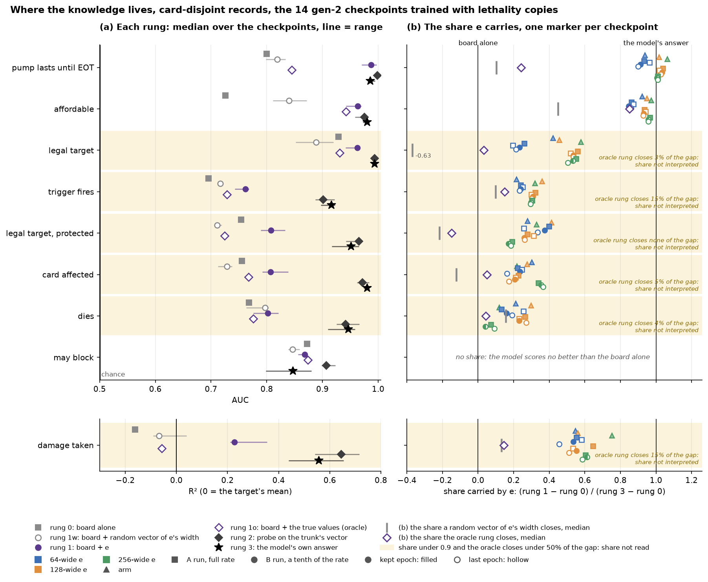

*(a) Each rung's median over the 14 checkpoints with copies, card-disjoint records, drawn as the rung's own name; the stroke spans the checkpoints. Yes/no questions are scored by AUC, damage taken by R² on its own axis. (b) Each checkpoint's share carried by `e`, in the shared key. The grey tick labelled 1w marks the median share a random vector of `e`'s width closes, and the dashed purple tick labelled 1o the median share the oracle rung closes. Shaded rows are the questions whose share is not interpreted. May block has no share, because the model's answer scores no better than the board alone. Data: `probe_ladder.csv`.*

- **What the line states, `e` carries.** How long a pump lasts turns on the script, and whether an ability is affordable turns on its cost. Rung 1 closes nine tenths or more of the gap on both at the median, with no trunk. On affordability, a random vector of `e`'s width closes nearly half the gap by itself, so `e`'s content accounts for about half of that share.
- **On the other board questions the trunk answers, and the ladder cannot say whether `e` could.** Deaths, trigger firing, which cards are affected, target legality and damage taken all depend on the board. On each, a probe on the trunk's output reads about as much as the model's own answer, or more on damage taken, and the board plus `e` reads far less. The oracle closes a twentieth of the gap or less on deaths, affected cards and target legality, and about a seventh on triggers and damage taken. A probe on the board and the true numbers therefore stays far from the answer, and a low share may be the probe's limit rather than `e`'s. The oracle carries only the stated numbers, and it scores below rung 1 on every question but may block, where the two are level.
- **On deaths, `e` adds no more than a random vector of its width.** Rung 1 and rung 1w score the same on deaths at the median, and on the four 256-wide checkpoints rung 1 scores below rung 1w ([`e` over a random vector](#e-adds-most-over-a-random-vector-of-its-width-on-what-a-line-states-and-next-to-nothing-on-deaths-trigger-firing-and-block-legality)).
- **Whether a creature may block is known from the board alone, partly because the labels come from the AI's block plan.** A probe on the board alone scores about as well as one on the board plus `e`, and a few hundredths below one on the trunk's output. On card-disjoint records the model's own answer scores no better than the board alone, and below it on most checkpoints, so no share is defined. More than half of the gen-2 corpus's "may not block" labels name a creature the AI had already planned to block another attacker with, and the snapshot shows that planned block ([the gen-2 record](2026-09-18-effect-model-gen2-improvements-design.md#most-block-legality-labels-that-say-a-creature-may-not-block-describe-the-ais-unfinished-block-plan), [chart](2026-09-18-effect-model-gen2/charts/planned-block-labels.png)). A probe can therefore predict the label from the plan without knowing any rule.

Rungs 2 and 3 read the same trunk output in two ways, and they agree on every question but damage taken and may block. The probe at rung 2 is fitted to one question alone. The output head at rung 3 was trained on every output field at once, and is what the model actually answers. A gap between them can be knowledge the trunk holds and the model's own answer does not use. It can also come from where the probe is fitted. The probe is fitted on the stratum it is scored on, so on card-disjoint records it learns from labelled examples of texts the head never trained on. On may block, the model's answer trails the rung-2 probe on card-disjoint records and matches it on game-disjoint ones. That pattern points to the probe learning the held-out cards' restrictions from its own fitting data. On damage taken, a probe reads about two thirds of the variance from the trunk's output, and the model's own damage field a little over half at the median and up to two thirds.

On game-disjoint records the oracle still closes under a fifth of the gap on the same board questions at the median, so the same rule leaves their shares uninterpreted there too. Pump duration and affordability keep median shares above nine tenths there.

Gen-1 and gen-2 were probed on different corpora, so they compare by direction only. Gen-1's `e` carried affordability as gen-2's does. Gen-1 could not be asked about deaths at all, because its corpus never recorded a death caused by a resolution.

### `e` adds most over a random vector of its width on what a line states, and next to nothing on deaths, trigger firing and block legality

`e` beats a random vector of its width by a large amount on nearly every property a line states, and by the least on the board questions the line does not settle. Rung 1 minus rung 1w is that comparison ([the width control](#a-random-vector-of-es-width-separates-what-e-holds-from-what-its-width-buys)). Among line properties, mana production is the exception. On deaths, trigger firing and block legality `e` adds a few hundredths of AUC at most, and on affected cards and target legality up to an eighth.

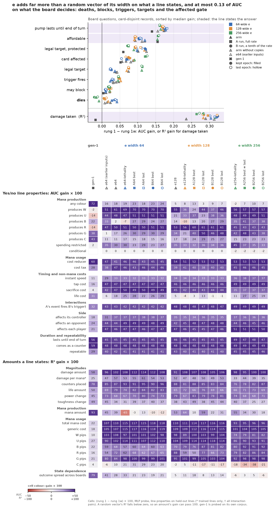

*Every value is rung 1 minus rung 1w from the MLP probe. Top: the board questions on card-disjoint records, one marker per checkpoint in the shared key, rows sorted from the largest median gain over the gen-2 checkpoints to the smallest. Shaded rows are the three board questions whose answer the line states. Damage taken is an amount, so its gain is in R² and sits apart, below a thin divider. Bottom: the line properties on held-out lines, as (rung 1 − rung 1w) × 100 per checkpoint, except damage per mana (trained lines only) and the interaction pair, whether one line's event fires another's trigger (all pairs). The yes/no properties are AUC gains and the amounts R² gains, and each block is coloured in its own unit. Purple is a gain and red a loss. The colour reaches full strength at an AUC gain of 0.5, the largest an AUC can gain over chance, and at an R² gain of 1. A random vector's R² falls below zero, so an amount's gain can pass 100. Gen-1 is probed on its own corpus. Data: `probe_ladder.csv`.*

- **Deaths do not move into `e` with width.** On deaths `e` adds at most four hundredths of AUC at widths 64 and 128, and less than nothing at width 256, where a random vector of the same width scores higher. Trigger firing gains a few hundredths at every width. Four times the width of `e` therefore does not move what decides deaths or triggers into the vector.
- **Pump duration gains more than any board question whose answer the line does not state, and affordability does so only at width 256.** Pump duration leads them on every checkpoint. Affordability gains about as much as target legality under protection on the 64-wide and 128-wide checkpoints, and clearly more on the 256-wide ones. Damage taken, the third board question whose answer the line states, gains about three tenths of R², a unit of its own. The damage amount, the duration and the cost are written in the script.
- **Costs and amounts gain the most, timing and side clearly, and mana production least.** The total cost, the generic cost and most coloured pips, the coloured mana symbols of a cost, gain the most. The side an effect lands on, its controller's, an opponent's or both, gains about as much as the timing and the costs that tap or sacrifice. The amount of mana a line produces swings from a large gain to a large loss between the 64-wide checkpoints.
- **Gen-1's `e` gains far more on three properties.** On the amount of mana a line produces, whether it produces any colour, and how much a text's outcome varies across boards, gen-1's `e` beats a random vector by far more than any gen-2 checkpoint. It also beats every gen-2 checkpoint by a smaller margin on six more, among them colourless mana production and whether a change lasts until end of turn or comes as a counter. The two generations were probed on different corpora.
- **The 128-wide and 256-wide `e` score below a random vector on colourless pips** on most checkpoints, while the 64-wide `e` gains on them.

Rung 1 minus rung 1w is also how the arms of the width sweep, gen-2's runs over the width of `e`, compare on what their `e` holds. The gen-2 record compares the arms' own answers to the probe questions ([width](2026-09-18-effect-model-gen2-improvements-design.md#the-64-wide-and-256-wide-runs-split-the-measures-and-the-128-wide-runs-trail-on-the-probes-at-every-stage)).

### Gen-2's `e` holds whether a line taps or sacrifices almost perfectly, and its timing and most of its amounts well

A probe reading `e` alone, with no board and no trunk, recovers whether a line taps or sacrifices nearly perfectly on every gen-2 checkpoint. On trained lines it ranks whether a line is instant speed correctly nine times in ten, and whether it is repeatable nearly always. Gen-1's `e` read whether a line sacrifices or is instant speed not far above chance on held-out lines. The width control sits near chance on every yes/no property in the chart and below zero on every amount, so the gains are content and not width.

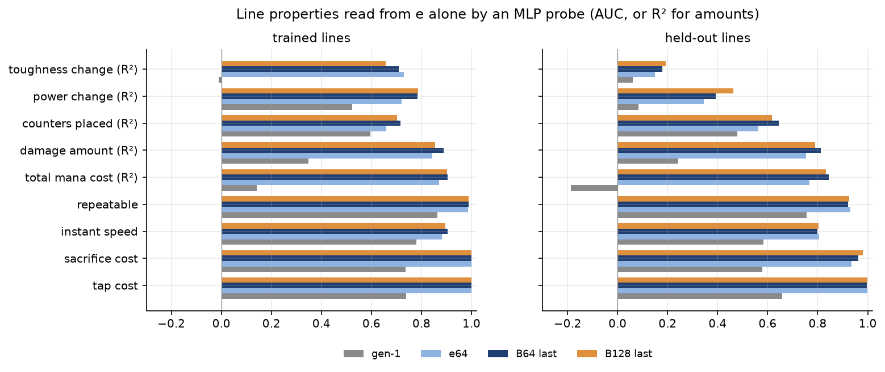

*Seven checkpoints in the shared key: gen-1, the three arms with copies, and the last epochs of runs B64, B128 and B256. Each segment runs from the score on trained lines (small dot), texts the model trained on, to the score on held-out lines (marker), texts it never saw. The grey tick is the same probe on a random vector of `e`'s width, on held-out lines. The bottom row, below the divider labelled state dependence, is the outcome spread across boards, scored by R² like the amounts ([state dependence](#e-alone-predicts-little-of-how-much-a-texts-outcome-varies-between-boards)). Data: `probe_ladder.csv` (rungs 1 and 1w, MLP, strata `trained` and `held-out`; the bottom row from family `state-dependence`).*

Amounts transfer less well than costs, and a wider `e` does not change that. The damage amount and the total mana cost read nearly as well on held-out lines as on trained ones. Power and toughness changes read well on trained lines and poorly on held-out ones, with toughness change at a quarter of its variance or less. The 256-wide arm reads damage, cost and counters on held-out lines slightly worse than the 64-wide and 128-wide arms, and power change slightly better.

The gains over gen-1 cannot be credited to one change, because gen-2 changed two things that both reach `e`. Its encoder reads an ability's whole chain of script lines. Two heads that read `e` alone also train it in gen-2, one predicting the API type and one the amounts the script states. The probes cannot separate the two. The gen-2 record reads the same kinds of property from gen-1's and gen-2's `e` with a linear probe, a straight-line fit from `e` to a property ([the gen-2 record](2026-09-18-effect-model-gen2-improvements-design.md#gen-2s-e-spreads-over-two-to-three-times-gen-1s-directions-and-a-linear-probe-reads-a-lines-kind-cost-and-amounts-from-it-far-better)).

Every gen-2 held-out score is a little high. About one held-out text in eight also trains on a card that is not held out, such as Flying, so the held-out lines mix in trained texts ([the gen-2 record](2026-09-18-effect-model-gen2-improvements-design.md#the-knowledge-probes-filed-trained-texts-as-held-out-lines)).

### `e` alone predicts little of how much a text's outcome varies between boards

A probe on `e` alone predicts under a fifth of how board-dependent one text is compared with another, and nothing on held-out lines. The label is a text's outcome spread. Each resolution of a text is summarized by eight numbers: the log of one plus the number of entities it affected, and the shares of those entities that died, took damage, changed zone, changed power or toughness, gained or lost counters, changed life, or drew cards. The spread is the standard deviation of each number across the text's resolutions, averaged over the eight. A spread of 0 means the text did the same thing on every board: "draw a card" scores near 0, and a sweeper, whose deaths follow the size of the opposing board, scores high. The probe's score is R², the share of the variation in spread between texts that it predicts. An R² of 0 is no better than predicting the average spread, and below 0 is worse. On trained lines gen-2's probes predict from a sixteenth to just over a sixth of that variation, the least on the 256-wide continuation runs. On held-out lines R² falls below zero on every gen-2 checkpoint but `e64 (earlier inputs)`, which sits at zero, while gen-1's `e` predicted a quarter. The two generations were probed on different corpora, so they compare by direction only.

| outcome spread across boards, R² of an MLP probe | trained lines | held-out lines |
|---|---:|---:|
| gen-1's `e` | 0.18 | 0.24 |
| gen-2's `e`, median over 17 checkpoints | 0.16 | −0.16 |
| gen-2's `e`, range | 0.06 to 0.17 | −0.24 to 0.03 |
| a random vector of `e`'s width, gen-2 | −0.42 to −0.19 | −0.38 to −0.18 |
| a random vector of `e`'s width, gen-1 | −0.36 | −0.54 |

*Gen-2 has 2,044 trained and 307 held-out lines with the label; gen-1 has 2,028 and 155. The bottom row of the [line-properties chart](#gen-2s-e-holds-whether-a-line-taps-or-sacrifices-almost-perfectly-and-its-timing-and-most-of-its-amounts-well) draws the same probe for gen-1 and six gen-2 checkpoints, from trained to held-out lines. The outcome-spread row of the [`e` over a random vector](#e-adds-most-over-a-random-vector-of-its-width-on-what-a-line-states-and-next-to-nothing-on-deaths-trigger-firing-and-block-legality) chart shows it as a gain over the random vector. Data: `probe_ladder.csv` (family `state-dependence`).*

The low score does not show that `e` fails to carry what the trunk needs to read the board. The design needs `e` to carry the parts of a text the board is checked against, such as the toughness limit in "destroy each creature with toughness 2 or less". The trunk does the checking. Nothing in the design needs `e` to hold a single number for how much the board matters to a text. The label is also noisy. A text seen twice gets its standard deviation from two outcomes, and a text's outcomes vary with the AI's choice of target as well as with the board.

The direct test is whether the model's predictions follow the board where the rules say they should, and stay put where they should not. The board sweeps answer part of it. Once lethality copies show the rule, predicted death follows toughness against damage ([the death rule](2026-09-18-effect-model-gen2-improvements-design.md#the-model-compares-damage-with-toughness-only-after-training-shows-it-the-rule-directly)). A sweeper's predicted deaths rise by only a fifth of a creature per creature added, where the rule adds one ([the sweeps](#the-affordable-verdict-never-clearly-passes-one-half-and-a-sweepers-predicted-deaths-rise-by-a-fifth-per-creature-added)). Whether a text the board cannot change, such as "draw a card", gets the same prediction on every board was not measured. The claim the model design rests on, that training the encoder against the board gives a better `e` than training it on text alone, remains untested ([the `no-state` baseline](#the-embedding-probes-read-only-e-gen-1s-text-taught-it-nothing-about-blocking-and-the-designs-central-claim-was-never-tested)).

### The trunk relies on the acting ability's `e`, and replacing the `e` of the abilities on the board costs nothing, as expected

Replacing `e` with noise matched to the vectors' mean and covariance raises the loss most on the affected gate, keywords gained and power change, and it raises it just as much when only the `[ACT]` slot is replaced. Replacing only the `e` in the card blocks' ability slots costs nothing measurable, on every gen-2 checkpoint as on gen-1.

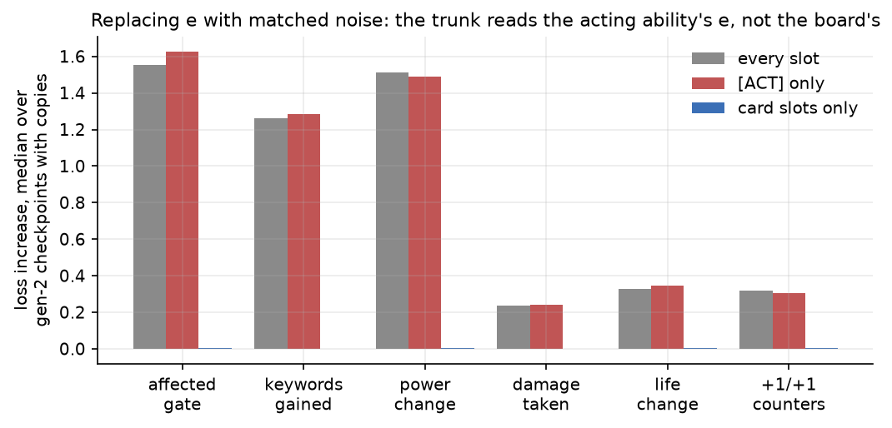

*One panel per replacement: noise matched to the vectors' mean and covariance, the mean `e` of the line's API type, and the `e` of the nearest other text. Per field, one marker per checkpoint with copies for each scope: every ability slot, the `[ACT]` slot alone, and the ability slots of the card blocks alone. Medians under 0.1 are printed. Data: `ablation.csv`.*

The zero for the card blocks is the expected result, not a sign that the trunk misses something. A card block's ability slots hold only that permanent's spell and activated lines, and those rarely change what another ability does when it resolves. What restricts an ability's targets or effect is almost always on the card itself: its types, colours, power and toughness, and its keywords, which the card's keyword flags carry. Flying for "destroy each creature with flying" and hexproof or shroud for a targeted spell are flags, not lines. A text such as "target creature with no abilities" asks whether a card has lines at all, not what they say. The lines on other permanents that do change outcomes are statics, triggers and replacements, and a collector bug leaves them out of the card blocks ([what their absence costs](#a-restriction-the-board-snapshot-does-not-list-costs-the-model-the-most-on-attack-legality)).

The two other replacements show what the trunk takes from `e`. The `e` of the nearest other text costs little on any field, so fine differences between similar texts matter little to the trunk. The mean `e` of the line's API type costs nearly as much as noise on keywords gained. Every keyword grant shares the `Keyword` API type, so the type's mean says that a keyword is granted and not which.

The ablation shows which `e` the trunk uses, not what the trunk works out from it. The trunk needs the acting `e` to know which ability it is looking at. The read-out ladder shows a probe on the trunk's output answering the board questions that the board plus `e` does not.

### A restriction the board snapshot does not list costs the model the most on attack legality

Where a static the snapshot does not list keeps a creature from attacking, every checkpoint's attack-legality loss rises well above its loss with no restriction. A collector bug gives each permanent only its spell and activated abilities as lines in its card block, though every line was meant to be listed. A permanent's statics, triggers and replacements reach the model only through what they have already done to the board: an anthem's +1/+1 is in the toughness, a granted keyword is in the flags. A Pacifism shows the model an enchantment attached to a creature and no text, and a Rest in Peace an enchantment that does nothing. The board-abilities ablation pairs records where an unlisted line decides the answer with a control of the same kind where none does, 600 records per subset ([the subsets](#a-collector-bug-leaves-every-static-trigger-and-replacement-out-of-the-card-blocks-so-a-second-ablation-measures-what-their-absence-costs)).

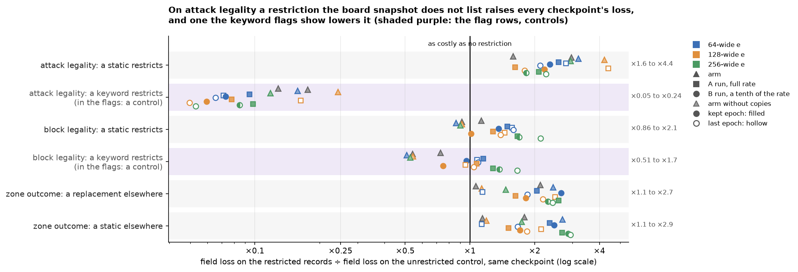

*Each marker is one checkpoint's loss on the field named, on records where the restriction or line is present, divided by its loss on the unrestricted control of the same kind. A marker right of ×1 means the unlisted line raises the model's loss. The two shaded keyword rows are controls: the card's keyword flags show those restrictions to the model. The range at the right spans the checkpoints. Data: `board_abilities.csv`.*

- **Attack legality is the clearest case.** Where a static that is not a keyword keeps a creature from attacking, as Pacifism does, the loss is between one and a half and four and a half times the unrestricted loss. Every checkpoint's restricted loss sits above every checkpoint's unrestricted one. A keyword restriction, which the card's keyword flags carry, is the easiest case of the three.
- **Block legality follows the same order with smaller gaps.** On the arms a static restriction costs about as much as no restriction, and on the continuation runs up to about twice as much.
- **On resolutions, a replacement or a static on another permanent about doubles the zone-outcome loss at the median.** These are the records where a destroy turns into an exile, or does nothing.

On the restricted subsets, noise in the card blocks moves the charted fields' loss by six hundredths at most, in either direction, because the lines that would matter are not in the card blocks to begin with. The subsets differ in more than the unlisted line, since a board with Pacifism is a different game state from one without. The gaps therefore bound the cost of the missing text rather than measure it exactly.

### Evasion: the model knows an evasive attacker is hard to block, and which blocker answers it only for horsemanship and fear

Every gen-2 checkpoint lowers the predicted chance of a block when the attacker gains flying, horsemanship or fear, and all but one when it gains intimidate. Only horsemanship and fear are also tied to the blockers that answer them. The evasion grid takes 40 real block-legality records from the validation games, one per game, in which the blocker was legal and neither creature has an evasion keyword. It grants the attacker one keyword and gives the blocker one trait, then reads the model's predicted chance that this blocker may block this attacker. The rule's answer is computed for every edited record. The script is `scripts/effect_knowledge_probes/evasion_grid.py`.

The evasion grid is not part of the plan: it was added after the first runs, as were the targeting, colour and zone probes below. Each of the four edits or scores real validation records and reads the full model, as the gen-2 record's damage and combat grids do for the death rule and combat.

The absolute level of the prediction is not a probability to read at face value. Even with no keyword and no trait, where every block is legal, arm `e64-lethality` predicts about one in ten, run B64's last epoch about one in three and run B256's last epoch about one in two. The model learned that level from block labels that mark many legal blocks as forbidden ([the read-out ladder](#e-alone-carries-pump-duration-and-affordability-and-the-trunk-answers-the-other-board-questions)). The comparisons below are therefore within each checkpoint: how much a blocker trait lifts the prediction against an attacker with the keyword, against how much it lifts it against an attacker without one. These rankings within a row compare edits of one record and are less exposed to the labels than the absolute level.

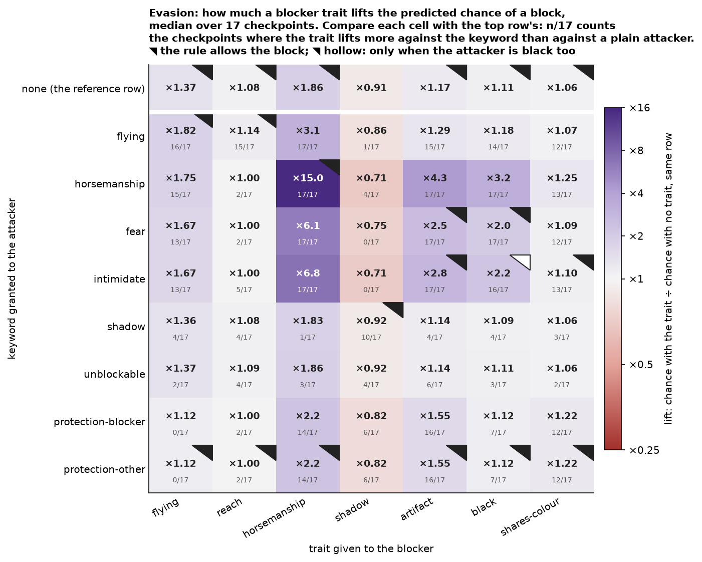

*Each cell's text is the median over the 17 gen-2 checkpoints of the lift: the predicted chance of a block with the blocker's trait, divided by the chance with no trait, against the same attacker. The top row is the reference, the lift against an attacker with no keyword. The colour compares each cell with the reference. It is the median over checkpoints of the cell's lift divided by the top row's lift in the same column, on a log scale from ×0.5 to ×8. The top row is therefore neutral. Purple marks a trait that lifts the prediction more against the keyword than against a plain attacker, and red one that lifts it less. Under each lift, n/17 counts the checkpoints where the trait lifts the prediction more against that keyword than against a plain attacker. A black corner marks a block the rule allows, and a hollow corner a block it allows only when the attacker is black too. Data: `evasion_grid.csv`.*

- **Horsemanship and fear are paired with their answers.** A horsemanship blocker lifts the prediction several times more against a horsemanship attacker than against a plain one, and an artifact or black blocker does the same against fear, on every checkpoint.
- **Intimidate is read as fear.** An artifact blocker answers it, as the rule says. A black blocker answers it too, which the rule allows only when the attacker is black as well. A blocker that shares the attacker's colour, the answer the rule names, barely registers.
- **Flying is only half paired.** A flying blocker answers a flying attacker somewhat more than a plain one. Reach, which the rule treats exactly like flying here, lifts the prediction hardly more than no trait at all.
- **Some traits read as "a good blocker" whatever the attacker.** A horsemanship or flying blocker lifts the prediction against every attacker, a plain one included, though neither trait matters against a plain attacker.
- **Shadow and "can't be blocked" change nothing.** Granting either leaves the row nearly identical to the plain one. A shadow blocker is predicted to block a little less against every attacker, and not more against a shadow one, which is why the shadow row ranks below chance.
- **The two protection rows are identical by construction.** The keyword flags carry protection without its colour, so protection from the blocker's colour and protection from another colour give the model the same input.

Ranking the allowed blocks against the forbidden ones within each attacker row gives one AUC per keyword. Horsemanship ranks near perfectly on every checkpoint, fear well above chance, flying and intimidate near chance, and shadow below it. No width and no stage of training moves the pooled ranking off about 0.6, so what the model knows about evasion was settled early and did not change with the continuation runs.

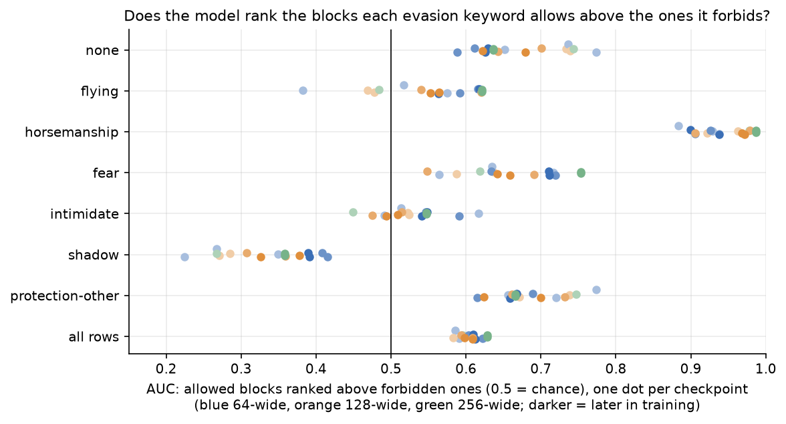

*AUC of the predictions on the blocks a row allows against the ones it forbids, over the grid's cells and records, in the shared key. "Can't be blocked" and protection from the blocker's colour allow no block and have no ranking. Data: `evasion_ranking.csv`.*

### Targeting: the model follows who controls a target, and barely checks the card type a restriction names

On real targeting decisions the model separates legal targets from illegal ones almost perfectly, whatever the restriction, but much of this rests on what a target looks like rather than on the restriction's own condition. The targeting probe, added after the first runs, takes 1,500 real targeting decisions from the validation games, at most three per game. Each battlefield permanent on the board is an item, labelled legal or not by Forge's own list of legal targets. The model's answer is the affected gate at that permanent's slot. Items are grouped by the acting ability's `ValidTgts$` restriction and by the kind of condition it states. The script is `scripts/effect_knowledge_probes/target_restrictions.py`.

| kind of restriction | items | legal | AUC, median over 17 checkpoints | range |
|---|---:|---:|---:|---|
| a card type only, such as `Creature` or `Any` | 10,859 | 2,410 | 0.999 | 0.997–0.999 |
| who controls it, such as `Creature.YouCtrl` | 1,414 | 242 | 0.998 | 0.984–0.999 |
| other, such as `Permanent.nonLand` | 1,225 | 224 | 0.982 | 0.959–0.989 |
| attacking, blocking or tapped | 451 | 36 | 0.992 | 0.977–0.996 |
| a colour, such as `Creature.nonBlack` | 420 | 77 | 0.967 | 0.958–0.989 |
| a number, such as `Creature.powerLE2` | 267 | 57 | 0.974 | 0.966–0.985 |
| a keyword, such as `Creature.withFlying` | 60 | 11 | 0.980 | 0.935–0.989 |

*Data: `target_families.csv`, and per restriction `target_restrictions.csv`. A supertype family holds 79 items with 2 legal ones, too few to weigh.*

The illegal targets on a real board are mostly easy: a land when the restriction asks for a creature, or the acting player's own creature when it asks for an opponent's. A flip asks the harder question. It takes a legal target of a restriction with a single condition and breaks exactly that condition, which by the rule makes it illegal.

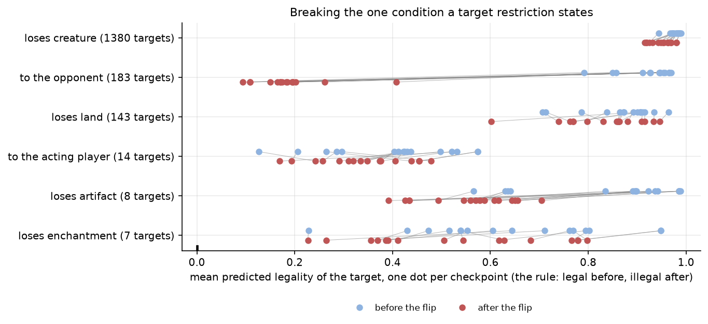

*For each flip, each checkpoint's change in the mean predicted legality of the targets, after the flip minus before, in the shared key; the grey bar is the median. By the rule every target is legal before the flip and illegal after it, a change of −1. Rows with fewer than 20 targets are drawn faint as too few to weigh. Data: `target_flips.csv`, which also holds each checkpoint's legality before and after the flip.*

- **Control is learned.** A target of "target creature you control" handed to the opponent loses between two thirds and nine tenths of its predicted legality on every checkpoint but `e64 (earlier inputs)`, which loses under half.
- **A creature that loses its creature type stays a legal target of "target creature".** The prediction barely moves on 1,380 targets. The edit leaves the permanent its power, toughness and combat status, so the model may read creature-ness from those rather than from the type line. Either way, the model does not check the condition the restriction states. Lands that lose the land type barely move either, except on `e64`, where they lose three tenths of their predicted legality.
- **The other flips are too few to weigh.** The predicted legality of artifacts that lose the artifact type drops by about a third at the median, on 8 targets. Enchantments that lose the enchantment type rest on 7 targets, and the opponent's creatures handed to the acting player on 14, which the model already doubted before the flip.

No restriction in the sample states `nonLegendary` alone, so the legendary flip did not run.

### Colour: the model counts the mana a player has and barely checks its colour

On every gen-2 checkpoint, taking one land away lowers the affordable verdict four to ten times as much as turning one land to a colour the cost cannot use. Two extra lands of the wrong colour raise the verdict above the exact board that casts the spell, even when a pip is left unpaid. The colour probe, added after the first runs, takes 300 real playability decisions from the validation games, at most two per game, whose candidate has a mana cost basic lands pay one pip each. It replaces the acting player's lands with untapped basics in six configurations. The off colour is the first of white, blue, black, red and green the cost does not name. The rule's answer is computed for every configuration by matching pips to lands. The script is `scripts/effect_knowledge_probes/colour_pips.py`.

| configuration | the acting player's untapped basics | the rule |
|---|---|---|
| exact | one land of each coloured pip's colour, one off-colour land per point of generic mana | affordable |
| surplus | exact, plus two off-colour lands | affordable |
| one short | exact, less one land | not affordable |
| pip missing | exact, with one coloured pip's land turned off-colour | not affordable |
| pip missing, +2 | pip missing, plus two off-colour lands | not affordable |
| all off colour | as many lands as the cost, all off-colour | not affordable |

The verdict's absolute level is low on every checkpoint: the exact board, which always casts the spell, is predicted affordable at about one in five. The comparisons are therefore made within each decision, as the change from the exact board.

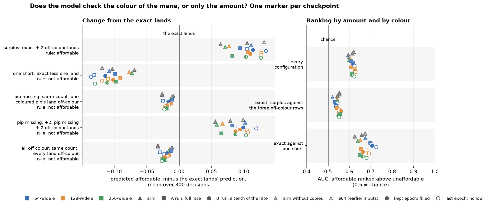

*Left: each checkpoint's mean change in the predicted affordable verdict from the exact lands, over 300 decisions, in the shared key; the exact lands are the zero line, and each row label gives the rule's answer. Right: the AUC of affordable boards ranked above unaffordable ones, over every configuration, for the exact and surplus boards against the three off-colour ones, and for the exact board against one land short. Data: `colour_pips.csv` and `colour_pips_ranking.csv`.*

| configuration | change from exact, median over 17 checkpoints | range | decisions below exact, median |
|---|---:|---|---:|
| surplus | +0.106 | +0.064 to +0.134 | 0% |
| one short | −0.108 | −0.069 to −0.136 | 100% |
| pip missing | −0.018 | −0.009 to −0.027 | 75% |
| pip missing, +2 | +0.087 | +0.056 to +0.119 | 1% |
| all off colour | −0.021 | −0.011 to −0.033 | 79% |

*Data: `colour_pips.csv`; per kind of cost, `colour_pips_by_cost.csv`.*

- **The amount of mana is read.** One land fewer lowers the verdict on every decision and every checkpoint, and two lands more raise it.
- **The colour is barely read.** A missing pip lowers the verdict on three decisions in four, by a sixth as much as a missing land at the median and between a quarter and a tenth across checkpoints. Lands that are all off-colour lower it barely more than one wrong land does.
- **More mana of the wrong colour outweighs the missing colour.** A board one pip short with two extra off-colour lands is predicted more affordable than the exact board on nearly every decision, on every checkpoint.
- **The pips of one colour are not counted.** On the 52 costs with a repeated pip, such as `{1}{U}{U}` given a single Island, the missing pip leaves the verdict where it was.
- **Ranking by colour is close to chance.** Ranked against the unaffordable boards that only differ in colour, the affordable ones score an AUC of 0.52 to 0.56. Ranked against one land short, the exact board scores 0.63 to 0.73.

The training labels do show colour deciding affordability. The corpus is stored in shards, files of records. In a sample of 21 training shards, 204 of the 894 land-payable candidates Forge judged unaffordable had enough mana in the wrong colours, so nearly a quarter of those labels turn on colour alone. The read-out ladder finds that the board plus `e` carries nearly all of what the model knows about affordability. That fits a model that judges affordability from the cost and the amount of mana, and never matches the cost's pips against the colours the lands make.

The `affordable` label gen-2 trained on carries some of Forge's AI cost policy as well as the rules. The label comes from Forge's AI cost check. That check matches pips to mana sources by the rules, so a colour shortfall is labelled correctly. It also refuses some costs the rules allow, such as a planeswalker's last loyalty, a Ward cost the AI dislikes and a Casualty sacrifice. A few candidates with enough mana of the right colours are therefore labelled unaffordable, in training and in the probes' own labels.

### Zones: the model knows which player draws, discards or mills and where a moved card goes, and barely uses the number of cards

Draws, discards, mills and moves between hand, library, graveyard, exile and the battlefield are predicted well on every gen-2 checkpoint. The weak points are two. The number of cards a script states moves the prediction far less than it should. Handing a player target to the other player moves only part of the predicted effect with it. The zone probe, added after the first runs, takes 2,000 real resolutions from the validation games, at most three per game, whose acting chain names an API that moves cards: `Draw`, `Discard`, `Mill`, `ChangeZone`, `ChangeZoneAll`, `Dig`, and the destroy and sacrifice APIs so that exile has something to be told apart from. The script is `scripts/effect_knowledge_probes/zone_effects.py`.

The model knows whether a player draws, discards or mills, and which player, and predicts fewer cards than the player gets. Card counts are read at the player slots. The model's answer for a player is the affected gate times the field's predicted count.

| cards a player | player slots | affected | AUC, median over 17 checkpoints | range | more predicted for the affected player, median | actual cards, mean | predicted cards, median |
|---|---:|---:|---:|---|---:|---:|---:|
| draws | 4,000 | 616 | 0.989 | 0.981–0.992 | 97% | 1.35 | 1.09 |
| discards | 4,000 | 148 | 0.997 | 0.995–0.998 | 99% | 1.21 | 0.90 |
| mills | 4,000 | 120 | 0.995 | 0.981–0.997 | 98% | 2.76 | 2.17 |

*The "more predicted for the affected player" column covers the records where exactly one player was affected: 419 for draws, 124 for discards, 84 for mills. Data: `zone_counts.csv`.*

- **Whether a player is affected, and which one, is known.** The model separates affected players from the rest at an AUC near 0.99, and predicts more cards for the affected player than for the other on about nine records in ten or more, on every checkpoint.
- **The count is predicted below the real one.** Every field's median prediction is short of the mean actual count, by a fifth for draws, a quarter for discards and a fifth for mills.

Where a moved card goes is right on most moves, and two pairs of destinations get confused. Card moves are read at the moved card's slot, grouped by the zone the card was in. Whether a card moves at all is ranked near perfectly from the battlefield, the graveyard and the hand.

| starting zone | cards | moved | AUC that a card moves, median over 17 checkpoints | range |
|---|---:|---:|---:|---|
| battlefield | 29,146 | 767 | 0.994 | 0.991–0.995 |
| graveyard | 5,805 | 187 | 0.996 | 0.992–0.998 |
| hand | 14,408 | 226 | 0.987 | 0.977–0.990 |

*The stack and exile hold 7 and 2 moved cards, too few to weigh. Data: `zone_moves.csv`.*

For the cards that did move, the chart shows how often the model's most probable destination other than staying put is the right one. The head names an outcome by its event, so a card put into a graveyard from anywhere is `died` and a card put onto the battlefield is `blinked`; the chart names the destination zone.

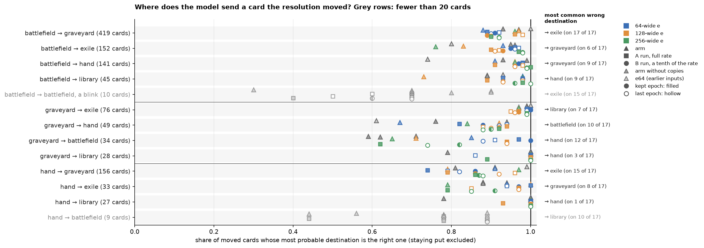

*One marker per checkpoint, in the shared key. Rows with fewer than 20 cards are greyed, and rows with fewer than nine are left out. The right margin names each row's most common wrong destination and on how many of the 17 checkpoints it is the most common. Data: `zone_outcomes.csv`, which holds every row, with the outcome predicted most often in place of the right one.*

- **From the battlefield, all four common destinations are right on more than nine moves in ten** at the median: graveyard, exile, hand and library. The usual mistake is between graveyard and exile, a destroy read as an exile or the reverse.
- **From the graveyard, exile and library are near perfect.** Returning a card to its owner's hand and returning it to the battlefield are confused with each other, and some checkpoints get only three in five of either right.
- **Discards are mostly right.** A card discarded from hand goes to the graveyard in the model's answer on six moves in seven at the median, and to exile on most of the rest.
- **Blinks are the weakest move, on too few cards to weigh.** A permanent exiled and returned to the battlefield is right on seven of its 10 moves at the median and on three on the worst checkpoint.

The predicted count rises with the number of cards the script states, but covers a fraction of the range. The amount sweep sets the literal `NumCards$` of 40 draw, 40 discard and 40 mill scripts to each value from 1 to 6, re-encodes the text with the checkpoint's own encoder, and reads the predicted count at the affected player, as the gen-2 record's damage sweep does for damage.

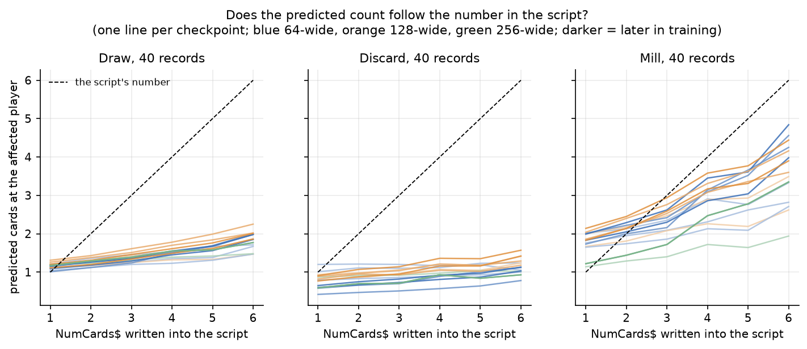

*One curve per checkpoint, in the shared key; grey curves are the arms without copies. The black line is the script's number. Data: `zone_amounts.csv`.*

| effect | predicted cards at 1 card, median over 17 checkpoints | at 6 cards, median | at 6 cards, the six arms | at 6 cards, the 11 continuation checkpoints |
|---|---:|---:|---|---|
| draw | 1.15 | 1.86 | 1.47–1.87 | 1.67–2.25 |
| discard | 0.79 | 1.12 | 1.00–1.41 | 0.78–1.57 |
| mill | 1.83 | 3.90 | 1.94–3.49 | 3.35–4.87 |

*The rule predicts 1 card at one and 6 at six. Data: `zone_amounts.csv`.*

- **Draws and mills rise far less than the rule.** From one card to six, the median predicted draw rises by less than one card, where the rule rises by five. Mills about double.
- **Discard barely moves**, and the earliest checkpoint, `e64 (earlier inputs)`, does not rise at all.
- **On mills the continuation runs follow the number more closely than the arms do.** Every continuation checkpoint but run A256's predicts more cards at six than any arm. On draws the two ranges overlap, and on discards the continuation checkpoints spread wider on both sides.

The amount sweep reads the head only, so it cannot say whether the trunk holds the number and the head fails to use it.

The predicted effect follows a player target only partly. The target flip takes the draw, discard and mill records with exactly one player target, where the targeted player is the one affected, and hands the target to the other player. The rule moves the whole effect with it.

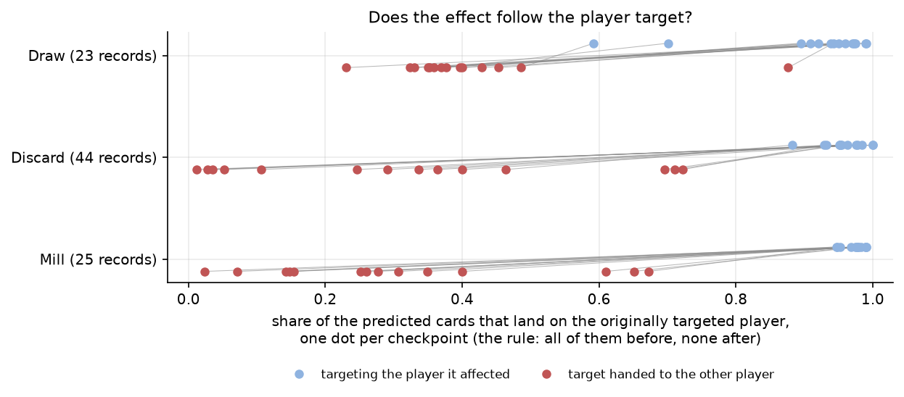

*After the target is handed to the other player: the share of the predicted cards still at the originally targeted player, in the shared key. The rule puts it at 0. Before the flip that share is 95% to 98% at the median per effect. Data: `zone_who.csv`, which also holds each player's predicted count before and after.*

- **Most of the predicted cards move, and a quarter to a third stay.** Before the flip the targeted player holds nineteen twentieths of the predicted cards at the median. After it, the originally targeted player still holds about a third of a draw and a quarter of a discard or a mill.
- **How much moves varies widely between checkpoints.** The 64-wide continuation runs move nearly all of a discard to the new target, and the 256-wide continuation runs nearly all of a mill. Arm `e128-lethality` leaves two thirds of a discard and a mill where the target was. No order by width or by stage of training holds across the three effects.

### The affordable verdict never clearly passes one half, and a sweeper's predicted deaths rise by a fifth per creature added

Both sweeps reported here fall short of the rule on every gen-2 checkpoint. The affordable verdict rises gradually with the mana given instead of stepping to certainty at the cost, and a sweeper's predicted deaths rise far slower than one per creature. The toughness and damage sweeps measure the damage-versus-toughness rule, which only appeared once training added lethality copies, so the gen-2 record reports them with its damage grids: [the death rule](2026-09-18-effect-model-gen2-improvements-design.md#the-model-compares-damage-with-toughness-only-after-training-shows-it-the-rule-directly) and [where the boundary sits](2026-09-18-effect-model-gen2-improvements-design.md#where-the-boundary-sits-wanders-between-epochs-at-the-full-learning-rate-and-settles-near-the-rule-at-a-tenth-of-it).

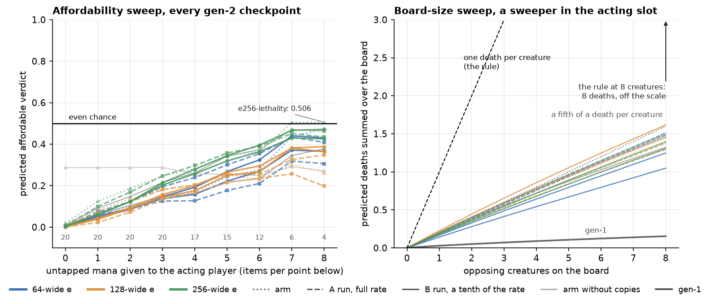

*Left: the predicted affordable verdict as the acting player's untapped mana rises, one curve per gen-2 checkpoint in the shared key; the numbers along the bottom are the items behind each point, and the bold line marks an even chance. The flat grey curve near 0.29 is `e64 (earlier inputs)`, probed before the sweep set the lands ([the fix](#the-affordability-sweep-sets-the-lands-as-well-as-the-mana-2026-10-15)). Right: predicted deaths summed over the board as opposing creatures are added, one curve per checkpoint, gen-1 dark; the dashed line is the rule's one death per creature. Data: `sweeps.csv`.*

- **The affordable verdict rises with the mana given and never clearly passes one half.** Only arm `e256-lethality` reaches it, by under a hundredth, at 7 and 8 mana, where the points rest on 6 and 4 items. The rise is gradual because each point averages items with different costs. The model's own answer separates affordable candidates from unaffordable ones at an AUC of 0.98 in the read-out ladder, so it reads affordability partly from something the sweep does not set.
- **A sweeper is predicted to kill about a fifth of the creatures added.** Every gen-2 checkpoint rises by about a fifth of a death per creature, with or without copies and at every width, where a sweeper kills one per creature. Gen-1 rose by a fiftieth. The sweep cannot tell whether the records' sweepers carry conditions that spare most creatures or the model spreads its confidence thinly over the board.

### Gen-3 inherits two board questions already in `e` and no firm case for moving another into it

Applied to the board questions, the design's rule for gen-3 finds two already in `e` and none whose share is firm enough to move into it ([the rule](#the-share-and-the-ablation-together-say-which-families-gen-3-must-move-into-e)). The rule reads three numbers per question. The share and the oracle's share come from the read-out ladder. Reliance is how far the loss of the output field the answer comes from rises when noise replaces `e` at the `[ACT]` slot alone, as a multiple of that field's loss with the true `e`.

| board question | share carried by `e`, median | share the oracle closes, median | share interpreted | output field | loss rise with noise at `[ACT]`, in multiples of the field's loss, median | next step by the rule |
|---|---:|---:|---|---|---:|---|
| how long a pump lasts | 1.01 | 0.24 | yes | `pt_duration` | 4.74 | none: already in `e` |
| affordable | 0.93 | 0.85 | yes | verdict head | not measured | none: already in `e` |
| damage taken | 0.56 | 0.15 | no | `damage_taken` | 0.45 | a stronger probe |
| legal target | 0.51 | 0.03 | no | the affected gate | 1.66 | a stronger probe |
| trigger fires | 0.30 | 0.15 | no | verdict head | not measured | a stronger probe |
| legal target, protected | 0.28 | −0.15 | no | the affected gate | 1.66 | a stronger probe |
| card affected | 0.23 | 0.05 | no | the affected gate | 1.66 | a stronger probe, then into `e` if the low share holds |
| dies | 0.20 | 0.04 | no | `zone_outcome` | 2.18 | a stronger probe, then into `e` if the low share holds |
| may block | — | — | no share | `blocker_legal` | 0.00 | the corpus: labels from the rules |

*Card-disjoint records, MLP probes, medians over the 14 checkpoints with copies. The loss rise is the increase in the field's loss over the validation samples when noise matched to the vectors' mean and covariance replaces `e` at the `[ACT]` slot alone, divided by the field's loss with the true `e`. The legal-target questions read the affected gate, as card affected does. The ablation scores only the per-entity fields, so the questions the verdict head answers have no loss rise. Data: `probe_ladder.csv`, `ablation.csv`.*

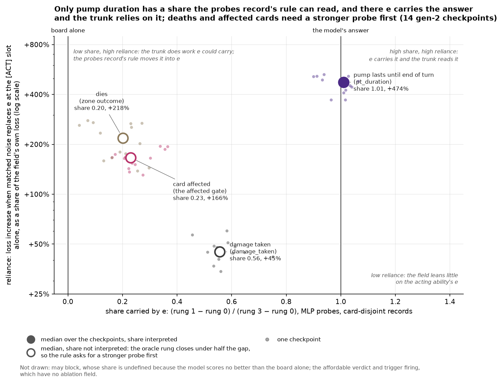

*One cloud per board question: a small dot for each of the 14 checkpoints with copies, and a large marker at the medians. The share carried by `e` is the read-out ladder's (rung 1 − rung 0) / (rung 3 − rung 0), MLP probes on card-disjoint records. Reliance is the table's loss rise with noise at `[ACT]`, drawn as a percentage of the field's own loss on a log scale. A hollow marker is a question whose share is not interpreted, because the oracle rung closes under half of the gap. The chart draws the four board questions that each have an output field of their own. The two legal-target questions read the affected gate, as card affected does, so their reliance is card affected's, and their shares are in the table. May block has no share, and the ablation does not score the verdict head that answers affordability and trigger firing. The corner notes name what each region means under the design's rule, which fixes no cut-off between them. Data: `probe_ladder.csv`, `ablation.csv` (replacement `noise`, scope `act`).*

- **Pump duration and affordability already live in `e`, and gen-3 has nothing to move there.** Both shares pass nine tenths. The trunk leans on the acting `e` for pump duration more than for any other question in the table: noise at `[ACT]` adds nearly five times the field's own loss. Affordability's reliance is not measured, and a random vector of `e`'s width closes nearly half of its share by itself.
- **Deaths, affected cards, target legality, trigger firing and damage taken need a stronger probe before gen-3 can act on their shares.** On each, the oracle closes about a seventh of the gap or less, so the probe rather than `e` may be the limit. Deaths and affected cards have the lowest shares, and noise at `[ACT]` adds more than one and a half times the field's own loss on affected cards and more than twice on deaths. A low share with high reliance is the pattern the rule answers by moving work into `e`, through auxiliary heads that read `e` alone or a thinner trunk. Deaths and affected cards are therefore gen-3's first candidates once a stronger probe confirms their shares. The high reliance may also mean only that the trunk needs the acting `e` to know which ability is acting, which the ablation cannot tell apart from using its content. A wider `e` is not the route for deaths, since four times the width did not move them into `e`. The suite's two deeper reads, the per-layer view and method C, never ran, so no stronger probe exists yet.
- **Block legality is a labelling problem, which gen-3 fixes in collection.** The model's own answer scores no better than the board alone, so the model lacks the rule rather than holding it outside `e`. The rule treats knowledge the model lacks as a corpus problem rather than an architecture problem. More than half of gen-2's "may not block" labels name a creature the AI had already planned to block with. Gen-3 records block and attack legality at Forge's declare steps, before anyone declares ([gen-3 draft](2026-XX-XX-effect-model-gen3-design.md#the-forge-hooks-and-collectors-no-longer-record-planned-events-as-real-ones)).

### Gen-1 and seventeen gen-2 checkpoints from twelve runs were probed, and every chart shares one key

The suite probed gen-1 and 17 gen-2 checkpoints from twelve training runs. A checkpoint is the model's saved weights at one epoch of training, a fixed block of 5,000 training batches. The first gen-2 runs, the arms, train from scratch and are named after the width of `e`. Arms `e64` and `e128` train on the corpus alone. Arms `e64-lethality`, `e128-lethality` and `e256-lethality` add lethality copies: training copies of a damage record with the damage and the hit creature's toughness redrawn, and the death labelled by the rule. `e64 (earlier inputs)` is the first run of arm `e64`, on inputs later corrected.

Continuation runs carry each arm with copies further. An A run resumes its arm at the full learning rate, the step size of each weight update, and a B run starts from its A run's kept epoch at a tenth of it. Each run keeps the epoch with the lowest loss on card-disjoint records, and a continuation run is probed at that kept epoch (`A64 best`) and at its last (`A64 last`). Run A256's kept epoch is its last, so it counts once. Run B256 keeps the checkpoint it started from, and `B256 best` is its own lowest epoch, 55. "The 14 checkpoints with copies" are the 17 less the three arms without copies. The [run lineage chart](2026-09-18-effect-model-gen2/charts/run-lineage.png) draws every run and checkpoint, the gen-2 record [explains the naming](2026-09-18-effect-model-gen2-improvements-design.md#result), and its [runs table](2026-09-18-effect-model-gen2-improvements-design.md#twelve-runs-share-one-corpus-one-seed-and-one-encoder-and-differ-in-width-lethality-copies-and-learning-rate) lists their directories.

The charts share one key. Colour gives the width of `e`: blue 64, orange 128, green 256. A point's marker gives the stage, a triangle for an arm, a square for an A run and a circle for a B run. A curve's style gives it too, dotted for an arm, dashed for an A run and solid for a B run. A filled marker is a run's kept epoch and a hollow one its last; `B256 best` is half filled. The arms without copies are grey triangles, `e64 (earlier inputs)` a lighter grey, and gen-1 dark grey. In a chart with one row per question, each checkpoint sits at its own fixed height within the row, the earliest stage on top; the height carries no value.

### Each probe set is frozen once per corpus, and a probing run takes under twenty minutes

Every gen-2 checkpoint is probed on one probe set, frozen over gen-2's corpus with every amount label capped at 40 (digest `ab6452679131`). The first run of arm `e64` used the set before the cap (digest `927c88b0fae4`), and gen-1 a set frozen over gen-1's corpus (digest `361fc75ce1cc`). Each scorecard is `reports/knowledge-probes-*/scorecard.json` in the checkpoint's run directory under `models/effects/runs/`, and gen-1's is `output/effects/reports/knowledge-probes-2026-09-17-full-textless-corpus-20261009/scorecard.json`. The gen-2 record's [runs table](2026-09-18-effect-model-gen2-improvements-design.md#twelve-runs-share-one-corpus-one-seed-and-one-encoder-and-differ-in-width-lethality-copies-and-learning-rate) lists every run and checkpoint.

A probing run takes 14 to 19 minutes and under 0.6 GiB of GPU memory, against a budget of two hours and 8 GB, and freezing a probe set a few minutes more. The board-abilities subsets of arm `e64` ran separately, in `models/effects/runs/2026-10-gen2-e64/reports/board-run/`.

| probe set | line items | record items | interaction pairs | interaction join rate |
|---|---:|---:|---:|---:|
| gen-1's corpus | 34,802 | 33,329 | 1,792 | 6.8% |
| gen-2's corpus | 36,178 | 35,699 | 2,010 | 7.0% |

### The first run, on gen-1, found two gaps that gen-2 closed (2026-10-08)

**Gen-1's verdict head was never trained.** Gen-1's trainer never called the verdict loss, so the two questions that head serves, whether a candidate is affordable and whether a trigger fires, had no model read-out. A head with random weights can still score far from chance, because the trunk's output at `[ACT]` is dominated by one direction that on its own separates affordable candidates. Gen-2 trains the verdict head, and its read-outs match the trunk's.

| read-out of gen-1's trunk at `[ACT]`, affordability | AUC |
|---|---:|
| top principal component (47.5% of the variance) | 0.877 |
| gen-1's untrained verdict head | 0.899 |
| 200 fresh verdict heads, median distance from 0.5 | 0.187 |
| 200 fresh verdict heads, share at least 0.4 from 0.5 | 1.0% |

**Gen-1's corpus never recorded a death caused by a resolution.** Every `dies` label was zero, and the toughness and damage sweeps read 0.000 at every value. Gen-1's collectors wrote a resolution's record before Forge ran its state-based actions and discarded the deaths those actions produced. Gen-2's collectors hold a resolution's record through the state-based check that follows it, so gen-2's corpus carries these deaths, and gen-2 is the first generation the death sweeps can measure.

### Fewer than one fired trigger in ten joins to a resolution, because most are caused by a spell being cast

The interaction join finds the resolution behind under a tenth of fired triggers in both probe sets. Most fired triggers are enters-the-battlefield or cast triggers. Their cause is a permanent spell's own cast. A cast has no ability line and no resolution record, so the join finds nothing for those triggers. The script-mined pairs supply the interactions the join cannot reach.

The trigger records offer no shortcut. About half name a `cause` entity in their event's params, but `cause` is the object that caused the event, not the ability. No record sets `attributed_to`. The counts are over the 1,000 games of gen-1's game-disjoint stratum.

| Trigger records | Count |
|---|---:|
| all | 15,335 |
| fired | 8,377 |
| naming a `cause` entity | 7,752 |
| naming a `cause` entity and fired | 4,380 |
| setting `attributed_to` | 0 |

### The affordability sweep sets the lands as well as the mana (2026-10-15)

The affordability sweep first edited only the acting player's untapped production, one number per colour, and left every land on the board as it was. The verdict then stayed flat near 0.29 from no mana to more than enough, because the model reads affordability from the lands themselves. From 2026-10-15 the sweep sets the acting player's lands to match the mana it gives, and the verdict rises with it. Run `e64 (earlier inputs)` was probed on 2026-10-13, before the change, and its affordability sweep is the flat one.

## Future plans

Gen-3 takes the probes' findings in two directions, and the [gen-3 draft](2026-XX-XX-effect-model-gen3-design.md) carries the full discussion. Where a gap traces to the labels or to the board input, gen-3 changes collection and the snapshot. Where a share is not yet interpreted, gen-3 needs a stronger probe before it moves any work into `e`.

- A stronger probe, such as the per-layer view or method C, to read the shares of deaths, affected cards, target legality, trigger firing and damage taken.
- Deaths and affected cards moved into `e` if their low shares hold, through auxiliary heads that read `e` alone or a thinner trunk rather than a wider `e` ([the rule applied](#gen-3-inherits-two-board-questions-already-in-e-and-no-firm-case-for-moving-another-into-it)).
- Block and attack legality recorded at Forge's declare steps, before anyone declares, so that no label records the AI's block plan ([gen-3 draft](2026-XX-XX-effect-model-gen3-design.md#the-forge-hooks-and-collectors-no-longer-record-planned-events-as-real-ones)).
- Every line of a permanent listed in the snapshot, measured against gen-2's losses on the six board-abilities subsets ([board abilities](#a-restriction-the-board-snapshot-does-not-list-costs-the-model-the-most-on-attack-legality), [gen-3 draft](2026-XX-XX-effect-model-gen3-design.md#the-snapshot-should-list-every-line-of-a-permanent-not-only-its-spell-and-activated-abilities)).
- What a creature has protection from, in the keyword flags, which carry protection without its colour, so the evasion grid's two protection rows are identical by construction ([evasion](#evasion-the-model-knows-an-evasive-attacker-is-hard-to-block-and-which-blocker-answers-it-only-for-horsemanship-and-fear), [gen-3 draft](2026-XX-XX-effect-model-gen3-design.md#the-keyword-flags-should-say-what-a-creature-has-protection-from)).
- Affordability labelled from the mana and additional-cost checks alone, without Forge's AI cost policy ([colour](#colour-the-model-counts-the-mana-a-player-has-and-barely-checks-its-colour), [gen-3 draft](2026-XX-XX-effect-model-gen3-design.md#the-model-has-to-learn-every-rule-that-depends-on-whose-turn-or-which-step-it-is-and-collection-records-which-check-decided-each-one)).
